# Project 1 — Complete Revisit & Study Guide

**Project:** Kubernetes Platform Engineering & GitOps Lab
**Status:** complete, frozen as a portfolio project
**Guide written:** 2026-09-27, from repository history at `012124b` (`main` == `origin/main`)
**Companions:** [project1-environment-map.md](./project1-environment-map.md) · [project1-stage-cheat-sheet.md](./project1-stage-cheat-sheet.md) · [project1-flashcards.md](./project1-flashcards.md)

This guide answers one question: *what did we build, in what order, why, what did we learn and test, and which files should I read to refresh each stage?*

Everything here comes from the repository: Git history, `README.md`, `docs/`, ADRs, experiment write-ups, runbooks and postmortems. Nothing is invented. Where the evidence is thin, the guide says so. Where a stage boundary is a judgement call, it is marked **Stage boundary inferred from repository evidence**.

> **Historical vs current.** Most documents in `docs/` were written while the environments were running.
> - **AWS:** the historical runtime was the AWS EKS Project 1 environment. Current: AWS runtime destroyed after portfolio completion (2026-09-26).
> - **VMware:** the historical runtime was the full Project 1 platform. Current: basic reusable kubeadm lab (Calico, CoreDNS, kube-proxy, Metrics Server, local-path).
> - **Git:** unchanged; this repository is the archive and the rebuild source.

---

# READ PROJECT 1 IN THIS ORDER

Open one file, read it, move to "Next file". This is the whole project in chronological and conceptual order. Section 6 gives the same path with more options.

| # | Stage | File | Why | Next file |
|---|---|---|---|---|
| 1 | Overview | [`README.md`](../../README.md) | One-page summary of the whole project and its limits | Reference architecture |
| 2 | Architecture | [`docs/architecture/project1-reference-architecture.md`](../architecture/project1-reference-architecture.md) + [SVG](../diagrams/project1-reference-architecture.svg) | Mental model before details | Environment map |
| 3 | Environments | [`docs/portfolio/project1-environment-map.md`](./project1-environment-map.md) | What ran where, and what is gone | Architecture overview |
| 4 | 1 Foundation | [`docs/architecture/architecture-overview.md`](../architecture/architecture-overview.md) | The VMware cluster and the delivery flow | App README |
| 5 | 2 App + Docker | [`app/README.md`](../../app/README.md), then [`app/Dockerfile`](../../app/Dockerfile) | The workload every later stage deploys | Jenkins README |
| 6 | 4 Jenkins CI | [`jenkins/README.md`](../../jenkins/README.md) | How CI is built and why it never deploys | CI/CD flow |
| 7 | 6 + 11 Promotion | [`docs/architecture/ci-cd-flow.md`](../architecture/ci-cd-flow.md) | Build → digest → Git promotion, loop prevention | GitOps README |
| 8 | 5 Argo CD | [`gitops/README.md`](../../gitops/README.md) | Applications, sync policy, selfHeal demo | ADR 004 |
| 9 | 11 Digests | [`docs/adr/004-immutable-image-digest-promotion.md`](../adr/004-immutable-image-digest-promotion.md) | Why tags are not enough | Networking |
| 10 | 7 Ingress + MetalLB | [`docs/architecture/networking.md`](../architecture/networking.md) | VMware external entry path | Observability |
| 11 | 8 Prometheus / Grafana | [`docs/architecture/observability.md`](../architecture/observability.md) | First metrics path | Reliability |
| 12 | 9 HPA / PDB | [`docs/architecture/reliability.md`](../architecture/reliability.md) | Reliability primitives | Terraform README |
| 13 | 10 Terraform EKS | [`terraform/aws/README.md`](../../terraform/aws/README.md) | AWS as code | Capacity analysis |
| 14 | 12 AWS capacity | [`docs/aws-observability-capacity-analysis.md`](../aws-observability-capacity-analysis.md) | Why t3.small was too small | HPA load test |
| 15 | 12 HPA load test | [`docs/aws-hpa-observability-load-test.md`](../aws-hpa-observability-load-test.md) | HPA scaling measured | VMware observability anatomy |
| 16 | 13 Metric roles | [`docs/vmware-observability-anatomy.md`](../vmware-observability-anatomy.md) | Metrics Server vs Prometheus vs KSM | Pod self-healing |
| 17 | 14 Self-healing | [`docs/vmware-pod-self-healing.md`](../vmware-pod-self-healing.md) | Pod delete, visible dip, readiness failure | Rollout failure |
| 18 | 15 Bad rollout | [`docs/vmware-rollout-failure-rollback.md`](../vmware-rollout-failure-rollback.md) | 0.1.5 stall and Git rollback | Node failure |
| 19 | 16 Node failure | [`docs/vmware-node-failure-resilience.md`](../vmware-node-failure-resilience.md) | Node loss is not pod loss | Networking anatomy |
| 20 | 17 Root cause | [`docs/vmware-networking-anatomy.md`](../vmware-networking-anatomy.md) | Why traffic failed during node loss | Ingress HA |
| 21 | 17 Fix | [`docs/vmware-ingress-ha.md`](../vmware-ingress-ha.md) | Ingress SPOF removed and retested | VMware storage |
| 22 | 18 local-path | [`docs/vmware-storage-statefulset.md`](../vmware-storage-statefulset.md) | StorageClass → PVC → PV → Pod | AWS storage |
| 23 | 19 EBS | [`docs/aws-storage-statefulset.md`](../aws-storage-statefulset.md) | EBS CSI chain | AWS storage resilience |
| 24 | 19 Node/AZ | [`docs/aws-storage-resilience.md`](../aws-storage-resilience.md) | ~6.3 min recovery, AZ limits | Security |
| 25 | 20 Security | [`docs/security-rbac.md`](../security-rbac.md) | RBAC matrix, PSA, NetworkPolicy by CNI | Advanced Argo |
| 26 | 21 Advanced Argo | [`docs/argo-advanced-patterns.md`](../argo-advanced-patterns.md) | AppSets, App-of-Apps, hooks, waves | Automation guide |
| 27 | 22 Automation | [`docs/automation/platform-automation-master-guide.md`](../automation/platform-automation-master-guide.md) | Python CLI, Ansible, tool boundaries | DR master guide |
| 28 | 23 DR | [`docs/disaster-recovery-master-guide.md`](../disaster-recovery-master-guide.md), then [`docs/dr-lab-evidence.md`](../dr-lab-evidence.md) | HA vs backup vs DR, measured drills | Operations handbook |
| 29 | 24 Operations | [`docs/operations/platform-operations-handbook.md`](../operations/platform-operations-handbook.md) | How to operate and triage | ADR index |
| 30 | 25 Decisions | [`docs/adr/README.md`](../adr/README.md) | 13 decisions in one table | Teardown record |
| 31 | 26 Retirement | [`docs/operations/aws-lab-teardown.md`](../operations/aws-lab-teardown.md), then [`docs/operations/vmware-lab-cleanup.md`](../operations/vmware-lab-cleanup.md) | Why nothing is running now | Interview guide |
| 32 | Interview | [`docs/project1-interview-master-guide.md`](../project1-interview-master-guide.md) | Pitch and question bank | Flashcards |

---

## 1. How to Use This Guide

**Three depths, pick one:**

| Path | When | Where | Approximate study target |
|---|---|---|---|
| Glance path | Refresh before an interview or after months away | Section 6.2 | about 2.5–3 hours for the whole project |
| Primary reading path | Rebuild real understanding | "Read Project 1 in this order" above + Section 6.1 | 1–2 days |
| Deep study path | Relearn a stage end to end, including failure cases | Section 7 | about a week, see Section 25 |

**Stage status labels** (from the stage records in Section 5):

| Label | Meaning |
|---|---|
| Implemented and verified | Built and observed working; evidence document exists |
| Implemented and partially verified | Built; some behaviour not observed (stated in the record) |
| Documented | Documentation deliverable (operations, portfolio) |
| Historical | Built and verified in the lab, but the runtime no longer exists |
| Not currently running | Used as a qualifier on the lines above |

**Revisit priority:** **Core** (career-relevant, interview-heavy, later stages depend on it) · **Important** (worth a solid read) · **Reference** (look up when needed).

**Numbers** are lab observations, never SLAs. Every number in this guide names its source document.

**Diagrams made for this guide:**

| Diagram | What it shows |
|---|---|
| [project1-learning-map.svg](../diagrams/project1-learning-map.svg) | Learning order from Foundation to Portfolio, with tool-to-layer links |
| [project1-learning-dependencies.svg](../diagrams/project1-learning-dependencies.svg) | Which topics depend on which, plus prerequisites for the hard stages |
| [project1-application-lifecycle.svg](../diagrams/project1-application-lifecycle.svg) | FastAPI → Docker → Jenkins → digest → Git → Argo → Pods → ingress/ALB → metrics → HPA → failure → rollback |
| [project1-final-study-architecture.svg](../diagrams/project1-final-study-architecture.svg) | Control (CI, CD), data, management, automation, observability flows |

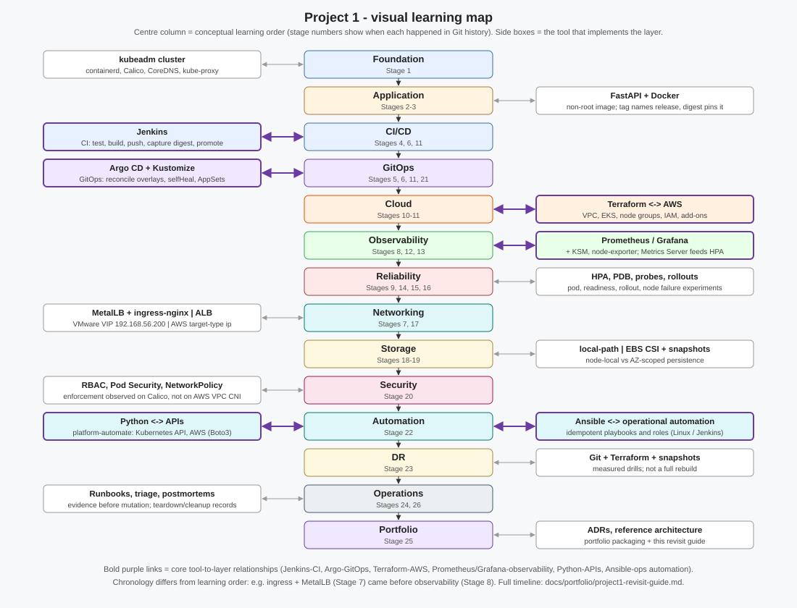

---

## 2. Project Timeline

### 2.1 How the stages were identified

- **Source:** `git log --reverse` on `main` (single branch, linear history, 93 commits from `e365c91` to `012124b`, dated 2026-09-24 to 2026-09-26).
- **Grouping:** each stage is a run of commits that adds one capability, usually `feat:` → `fix:` → `docs: record ...`. Small fixes are folded into their stage.
- **Original labels:** the docs themselves use "Step 7" (ingress + NetworkPolicy), "Step 7.5" (MetalLB), "Step 10" (AWS tooling container), and Sections 22–27 (Security, Advanced Argo, Automation, DR, Operations, Portfolio). Stage numbers below are this guide's own numbering; the original labels are noted where they exist.
- **Stage 1** is inferred: the kubeadm cluster existed before the repository (its namespaces are 54 days old; the first commit is 2026-09-24), and the cluster build itself is not recorded in Git.
- **Stages 14–17** are split by experiment document; they happened back to back on 2026-09-26. Stage boundary inferred from repository evidence.
- **Result: 26 stages.**

### 2.2 Chronological stage list

| # | Stage | Date | Commits (range) | Original label |
|---|---|---|---|---|
| 1 | Repository + VMware kubeadm foundation | 2026-09-24 | `e365c91` | — (inferred) |
| 2 | FastAPI workload + container image | 2026-09-24 | `7f52bfb` … `df7e30f` | — |
| 3 | Kustomize packaging + first local deploy | 2026-09-24 | `522d134`, `be9c7b5` | — |
| 4 | Jenkins CI | 2026-09-24 | `3a653a6` … `91b5800` | — |
| 5 | Argo CD GitOps (VMware) | 2026-09-24 | `71ed15b` … `e875218` | — |
| 6 | CI → GitOps promotion (0.1.1, 0.1.2) | 2026-09-24 | `7557521` … `5b2ce38` | — |
| 7 | Ingress, NetworkPolicy, MetalLB | 2026-09-24 | `99a0f98` … `e0403cd` | Step 7, Step 7.5 |
| 8 | Prometheus / Grafana (VMware) | 2026-09-24 | `1c562fc` … `a3ee50f` | — |
| 9 | Reliability primitives (HPA, PDB, rollouts) | 2026-09-24 | `bc8181f`, `be72ebf` | — |
| 10 | AWS Terraform EKS platform | 2026-09-24/25 | `0ea6f13` … `a94c018` | Step 10 (tooling) |
| 11 | Multi-env promotion + digest pinning | 2026-09-25 | `baec457` … `5da676f` | — |
| 12 | AWS capacity, lightweight observability, HPA load test | 2026-09-25 | `099ef70` … `6682c3d` | — |
| 13 | KSM, node-exporter, SRE dashboards | 2026-09-25/26 | `7572cfe` … `1dba455` | — |
| 14 | Pod / Argo self-healing, readiness failure | 2026-09-26 | `3fb84b7` … `dcfb7ae` | — |
| 15 | Failed rollout 0.1.5 + GitOps rollback | 2026-09-26 | `0c4fe12` … `054db3c` | — |
| 16 | Worker node failure | 2026-09-26 | `84c3478` | — |
| 17 | Networking anatomy + ingress HA | 2026-09-26 | `0d7c41b` … `9228fef` | — |
| 18 | VMware stateful storage (local-path) | 2026-09-26 | `f33876d`, `7dc0de1` | — |
| 19 | AWS EBS storage + node/AZ resilience | 2026-09-26 | `bd5e6dc` … `c8d45ca` | — |
| 20 | Kubernetes security + RBAC | 2026-09-26 | `85d76a6` … `2525408` | Section 22 |
| 21 | Advanced Argo CD patterns | 2026-09-26 | `6d57e42` … `ee15dba` | Section 23 |
| 22 | Python + Ansible automation | 2026-09-26 | `5593a26`, `0436b0c` | Section 24 |
| 23 | Disaster recovery | 2026-09-26 | `2a013bd` … `87b3034` | Section 25 |
| 24 | Operations handbook + runbooks | 2026-09-26 | `8e09fd7` | Section 26 |
| 25 | Portfolio packaging + ADRs | 2026-09-26 | `7c8e84d` | Section 27 |
| 26 | Environment retirement (AWS teardown, VMware cleanup) | 2026-09-26 | `d45c969`, `012124b` | — |

```mermaid
flowchart LR
  A[1-3 Foundation<br/>app + packaging] --> B[4-6 CI + GitOps]
  B --> C[7-9 VMware networking,<br/>observability, reliability]
  C --> D[10-13 AWS EKS,<br/>digests, AWS observability]
  D --> E[14-17 Failure engineering<br/>+ ingress HA]
  E --> F[18-19 Storage<br/>local-path + EBS]
  F --> G[20-21 Security +<br/>advanced Argo]
  G --> H[22-23 Automation + DR]
  H --> I[24-26 Operations, portfolio,<br/>retirement]
```

### 2.3 Final stage table

The single most important table in this guide. Paths are relative to `docs/` unless they start with a top-level folder name.

| # | Stage | Objective | Main technology | Environment | Primary document | Experiment | ADR | Runbook | Major commit |
|---|---|---|---|---|---|---|---|---|---|
| 1 | Foundation | Record existing cluster; set env rules | kubeadm, Calico, containerd | VMware | [architecture-overview.md](../architecture/architecture-overview.md) | None (baseline) | [002](../adr/002-eks-managed-control-plane.md) (contrast) | [kubernetes-api-failure](../runbooks/kubernetes-api-failure.md) | `e365c91` |
| 2 | FastAPI + Docker | Build + publish a hardened workload image | Python, FastAPI, Docker | Workstation → Docker Hub | [app/README.md](../../app/README.md) | Image published, digest recorded | [004](../adr/004-immutable-image-digest-promotion.md) | [docker-release-failure](../runbooks/docker-release-failure.md) | `5513e02` |
| 3 | Kustomize packaging | One base, two overlays; first deploy | Kustomize | VMware | [architecture-overview.md](../architecture/architecture-overview.md) | `kubectl apply -k` → 2/2 | [005](../adr/005-kustomize-for-environment-overlays.md) | [application-unhealthy](../runbooks/application-unhealthy.md) | `522d134` |
| 4 | Jenkins CI | Test, build, validate, push | Jenkins | Docker Desktop | [jenkins/README.md](../../jenkins/README.md) | First successful CI run | [003](../adr/003-gitops-with-argo-cd.md) | [jenkins-build-failure](../runbooks/jenkins-build-failure.md) | `91b5800` |
| 5 | Argo CD GitOps | Git becomes desired state | Argo CD v3.5.3 | VMware | [gitops/README.md](../../gitops/README.md) | Git change sync; live drift self-heal | [003](../adr/003-gitops-with-argo-cd.md) | [argo-outofsync](../runbooks/argo-outofsync.md) | `71ed15b` |
| 6 | CI → GitOps promotion | Jenkins commits overlay; Argo deploys | Jenkins, Argo CD | VMware | [ci-cd-flow.md](../architecture/ci-cd-flow.md) | 0.1.2 builds #4/#5/#6 | [003](../adr/003-gitops-with-argo-cd.md) | [gitops-change](../runbooks/gitops-change.md) | `0a633da` |
| 7 | Ingress + NP + MetalLB | External entry; restrict ingress | ingress-nginx, MetalLB, NetworkPolicy | VMware | [networking.md](../architecture/networking.md) | NodePort 200 → VIP `.200` 200 | [007](../adr/007-aws-alb-vs-vmware-ingress.md) | [metallb-vip-failure](../runbooks/metallb-vip-failure.md) | `bfeb721` |
| 8 | Prometheus / Grafana | Scrape `/metrics`, dashboard as code | kube-prometheus-stack | VMware | [observability.md](../architecture/observability.md) | Targets up, 8-panel dashboard; Grafana OOM | [006](../adr/006-prometheus-grafana-observability.md) | [prometheus-target-down](../runbooks/prometheus-target-down.md) | `1c562fc` |
| 9 | Reliability primitives | HPA, PDB, safe rollouts, spread | HPA, PDB | VMware | [reliability.md](../architecture/reliability.md) | Pod delete ~13 s; HPA idle 4%/70% | — | [hpa-not-scaling](../runbooks/hpa-not-scaling.md) | `bc8181f` |
| 10 | Terraform EKS | AWS VPC/EKS/IAM/LBC/Argo as code | Terraform, EKS | AWS (historical) | [terraform/aws/README.md](../../terraform/aws/README.md) | Lab apply (EKS 1.36.4) | [001](../adr/001-terraform-for-aws-infrastructure.md), [002](../adr/002-eks-managed-control-plane.md) | [terraform-apply-safety](../runbooks/terraform-apply-safety.md) | `5e304cd` |
| 11 | Digest promotion | Same digest to both overlays | Jenkins, Kustomize | VMware + AWS | [ci-cd-flow.md](../architecture/ci-cd-flow.md) | 0.1.4 digest in both envs | [004](../adr/004-immutable-image-digest-promotion.md), [005](../adr/005-kustomize-for-environment-overlays.md) | [git-rollback](../runbooks/git-rollback.md) | `5da676f` |
| 12 | AWS capacity + obs + HPA | Size nodes; light metrics; load-test HPA | t3.medium, Prometheus, HPA | AWS (historical) | [aws-observability-capacity-analysis.md](../aws-observability-capacity-analysis.md) | 11 → 17 pods/node; HPA 2 → 3 | [006](../adr/006-prometheus-grafana-observability.md) | [hpa-not-scaling](../runbooks/hpa-not-scaling.md) | `862588e` |
| 13 | KSM, node-exporter, dashboards | Object + node metrics, SRE views | KSM, node-exporter, Grafana | VMware + AWS | [kubernetes-platform-observability.md](../kubernetes-platform-observability.md) | AWS targets 3 → 6; VMware 22 UP / 6 DOWN | [006](../adr/006-prometheus-grafana-observability.md) | [kube-observability-troubleshooting](../runbooks/kube-observability-troubleshooting.md) | `7572cfe` |
| 14 | Self-healing + readiness | ReplicaSet, Argo selfHeal, readiness | Deployment, probes, Argo | VMware | [vmware-pod-self-healing.md](../vmware-pod-self-healing.md) | Pod delete ~10.4 s; NotReady ~31.5 s | [003](../adr/003-gitops-with-argo-cd.md) | [pod-not-ready](../runbooks/pod-not-ready.md) | `3fb84b7` |
| 15 | Failed rollout + rollback | Bad 0.1.5, Git rollback | RollingUpdate, Argo | VMware | [vmware-rollout-failure-rollback.md](../vmware-rollout-failure-rollback.md) | New RS 0/1; old RS serves; ~6 s reconcile | [004](../adr/004-immutable-image-digest-promotion.md) | [git-rollback](../runbooks/git-rollback.md) | `302a506` |
| 16 | Worker node failure | Observe kubelet loss | kubelet, taints | VMware | [vmware-node-failure-resilience.md](../vmware-node-failure-resilience.md) | Ready `Unknown` ~42.7 s; no reschedule < 300 s | [012](../adr/012-ingress-high-availability.md) | [worker-node-failure](../runbooks/worker-node-failure.md) | `84c3478` |
| 17 | Networking anatomy + ingress HA | Find root cause; remove SPOF | Calico, MetalLB, ingress-nginx | VMware | [vmware-ingress-ha.md](../vmware-ingress-ha.md) | 75 OK / 0 FAIL per worker loss | [012](../adr/012-ingress-high-availability.md) | [ingress-unavailable](../runbooks/ingress-unavailable.md) | `eb622e9` |
| 18 | local-path storage | Persistence basics | local-path, StatefulSet | VMware | [vmware-storage-statefulset.md](../vmware-storage-statefulset.md) | Pod delete → data intact (~5 s) | [013](../adr/013-local-path-vs-ebs-storage.md) | [pvc-pv-troubleshooting](../runbooks/pvc-pv-troubleshooting.md) | `f33876d` |
| 19 | EBS + node/AZ resilience | Cloud block storage behaviour | EBS CSI, gp3 | AWS (historical) | [aws-storage-resilience.md](../aws-storage-resilience.md) | Worker terminate → ~6.3 min | [008](../adr/008-ebs-csi-for-aws-persistent-storage.md) | [ebs-attach-troubleshooting](../runbooks/ebs-attach-troubleshooting.md) | `c8d45ca` |
| 20 | Security + RBAC | Least privilege, PSA, NP | RBAC, PSA, Calico | VMware + AWS | [security-rbac.md](../security-rbac.md) | `can-i` matrix; NP VMware yes / AWS no | [009](../adr/009-rbac-least-privilege.md) | [rbac-access-denied](../runbooks/rbac-access-denied.md) | `85d76a6` |
| 21 | Advanced Argo CD | Compose + generate Apps safely | Argo CD | VMware | [argo-advanced-patterns.md](../argo-advanced-patterns.md) | Hooks, waves, sync window, ComparisonError | [003](../adr/003-gitops-with-argo-cd.md) | [argo-sync-failure](../runbooks/argo-sync-failure.md) | `6d57e42` |
| 22 | Python + Ansible | Guarded automation, tool boundaries | Python, Boto3, Ansible | Workstation, `automation-lab` | [platform-automation-master-guide.md](../automation/platform-automation-master-guide.md) | CLI checks; Ansible idempotency | [010](../adr/010-python-and-ansible-automation-boundary.md) | [python-automation-failure](../runbooks/python-automation-failure.md) | `5593a26` |
| 23 | Disaster recovery | Measure recovery honestly | CSI snapshots, Git, Terraform | VMware + AWS | [disaster-recovery-master-guide.md](../disaster-recovery-master-guide.md) | Snapshot 72 s / restore 15 s; ns 23 s | [011](../adr/011-disaster-recovery-model.md) | [ebs-snapshot-restore](../runbooks/ebs-snapshot-restore.md) | `2a013bd` |
| 24 | Operations | Handbook, triage, runbooks | Runbooks | Docs | [platform-operations-handbook.md](../operations/platform-operations-handbook.md) | None new | — | [runbook-template](../runbooks/runbook-template.md) | `8e09fd7` |
| 25 | Portfolio | ADRs, reference architecture | ADRs, SVG | Docs | [project1-reference-architecture.md](../architecture/project1-reference-architecture.md) | None new | [README](../adr/README.md) | — | `7c8e84d` |
| 26 | Retirement | Destroy AWS; clean VMware | Terraform, Helm, kubectl | VMware + AWS | [vmware-lab-cleanup.md](../operations/vmware-lab-cleanup.md) | Post-cleanup nginx/DNS/storage tests | [011](../adr/011-disaster-recovery-model.md) (rebuild concept) | [terraform-apply-safety](../runbooks/terraform-apply-safety.md) | `d45c969`, `012124b` |

---

## 3. Final Architecture

Primary: [`docs/architecture/project1-reference-architecture.md`](../architecture/project1-reference-architecture.md) · [reference SVG](../diagrams/project1-reference-architecture.svg) · [control vs data plane SVG](../diagrams/project1-control-and-data-plane.svg)

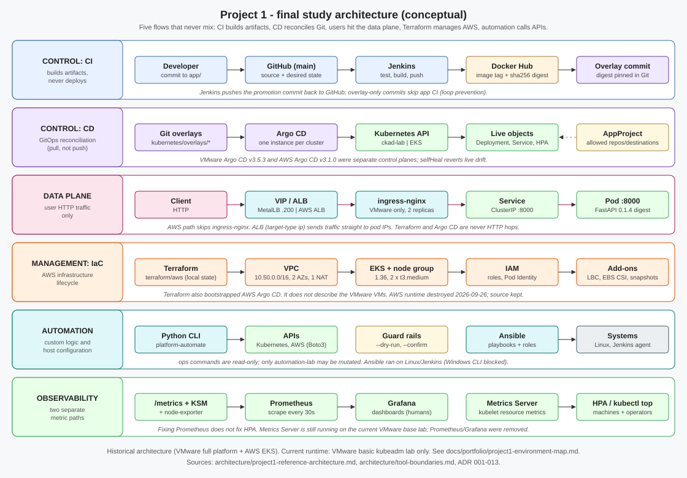

### 3.1 Control plane, data plane, management, automation

| Flow | Path | What it never does | Source |
|---|---|---|---|
| **Control: CI** | Developer → GitHub → Jenkins → Docker Hub (tag + digest) → promotion commit back to GitHub | Never runs `kubectl apply` | [ci-cd-flow.md](../architecture/ci-cd-flow.md) |
| **Control: CD** | Git overlays → Argo CD → Kubernetes API → live objects | Never builds images | [adr/003](../adr/003-gitops-with-argo-cd.md) |
| **Data plane (VMware)** | Client → MetalLB VIP `192.168.56.200` → ingress-nginx → Service → Pod `:8000` | Terraform/Argo are not HTTP hops | [networking.md](../architecture/networking.md) |
| **Data plane (AWS)** | Client → ALB (target-type ip) → Pod IP | No in-cluster ingress controller hop | [adr/007](../adr/007-aws-alb-vs-vmware-ingress.md) |
| **Management** | Terraform → AWS VPC, EKS, node groups, IAM, add-ons, Argo bootstrap | Does not describe the VMware VMs | [adr/001](../adr/001-terraform-for-aws-infrastructure.md) |
| **Automation** | Python `platform-automate` → Kubernetes / AWS APIs; Ansible → Linux hosts, Jenkins agent | Does not act as a second reconciler | [adr/010](../adr/010-python-and-ansible-automation-boundary.md) |
| **Observability** | `/metrics` + KSM + node-exporter → Prometheus → Grafana; Metrics Server → HPA / `kubectl top` | Prometheus does not feed HPA | [vmware-observability-anatomy.md](../vmware-observability-anatomy.md) |

Architecture principles (from the reference architecture): Git as desired state · CI ≠ CD · digest immutability · environment-appropriate ingress/storage · evidence before mutation · Observed ≠ Designed.

Related: [tool-boundaries.md](../architecture/tool-boundaries.md) · [ownership-boundaries.md](../architecture/ownership-boundaries.md) · [cost-awareness.md](../architecture/cost-awareness.md) · [platform-version-inventory.md](../architecture/platform-version-inventory.md)

---

## 4. Environment History

Full detail: [project1-environment-map.md](./project1-environment-map.md).

| | Historical Project 1 runtime | Now |
|---|---|---|
| **VMware `ckad-lab`** | Full platform: Argo CD v3.5.3, MetalLB, ingress-nginx HA, kube-prometheus-stack, `platform-lab`, storage/security/automation/DR/advanced-Argo labs | Basic reusable kubeadm lab |
| **AWS EKS `platform-lab-aws`** | EKS 1.36.4, 2 × t3.medium, ALB, EBS CSI, snapshots, Argo CD v3.1.0, light observability | Destroyed 2026-09-26 |

### 4.1 Current Reusable VMware Lab

Verified read-only on 2026-09-27 (`kubectl get nodes/ns/sc/deploy`, `helm list -A`, `kubectl top nodes`):

| Item | Value |
|---|---|
| Nodes | 3 Ready: `k8s-ctrl-01` (192.168.56.10), `k8s-worker-01` (.11), `k8s-worker-02` (.12) |
| Kubernetes | v1.31.14 |
| Runtime | containerd 2.2.1 |
| CNI | Calico (Tigera operator) |
| DNS / proxy | CoreDNS 2/2, kube-proxy |
| Metrics | Metrics Server 1/1 (`kubectl top nodes` returns data) |
| Storage | `local-path` (default StorageClass), provisioner Running |
| Helm releases | none |
| Project 1 components | removed (Argo CD, MetalLB, ingress-nginx, Prometheus/Grafana/KSM/node-exporter, all Project 1 namespaces, RBAC, CRDs) |

This is a **basic reusable lab**, not the Project 1 runtime. Cleanup record and validation: [operations/vmware-lab-cleanup.md](../operations/vmware-lab-cleanup.md).

### 4.2 AWS Rebuildability

- **What happened:** the AWS runtime was intentionally destroyed on 2026-09-26 ([operations/aws-lab-teardown.md](../operations/aws-lab-teardown.md)). Terraform state is empty.
- **What remains:** the source, all in this repository.
  - Terraform: [`terraform/aws/`](../../terraform/aws/)
  - Kubernetes manifests: [`kubernetes/overlays/aws/`](../../kubernetes/overlays/aws/), [`kubernetes/storage-lab-aws/`](../../kubernetes/storage-lab-aws/), [`kubernetes/security-lab-aws/`](../../kubernetes/security-lab-aws/)
  - Argo CD configuration: [`gitops/`](../../gitops/)
  - Observability values: [`observability/aws/`](../../observability/aws/)
  - Automation: [`automation/`](../../automation/)
  - Recovery docs: [terraform-recovery-runbook.md](../terraform-recovery-runbook.md), [runbooks/aws-eks-disaster-recovery.md](../runbooks/aws-eks-disaster-recovery.md)
- **Status:** rebuildable from source. After teardown, `terraform plan` proposed recreating the lab, which is what an empty state should do. **The rebuild was not repeated after teardown.** A full destructive rebuild drill was never part of Project 1.

---

## 5. Stage-by-Stage Revision

### 5.0 Stage comparison

| # | Stage | Primary technology | Problem solved | Main artifact | Experiment | Primary file |
|---|---|---|---|---|---|---|
| 1 | Foundation | kubeadm | Need a known, documented target cluster | Environment rules | — | [architecture-overview.md](../architecture/architecture-overview.md) |
| 2 | FastAPI + Docker | Docker | Need a realistic, probe-able workload | `app/Dockerfile` | Image published | [app/README.md](../../app/README.md) |
| 3 | Kustomize | Kustomize | Avoid duplicate manifests per env | `kubernetes/base` + overlays | First apply | [kustomization.yaml](../../kubernetes/base/kustomization.yaml) |
| 4 | Jenkins CI | Jenkins | Repeatable test/build/push | `jenkins/Jenkinsfile` | First CI run | [jenkins/README.md](../../jenkins/README.md) |
| 5 | Argo CD | Argo CD | Continuous reconciliation from Git | Application `platform-lab-local` | Drift → selfHeal | [gitops/README.md](../../gitops/README.md) |
| 6 | Promotion | Jenkins + Git | Releases without manual deploys | Overlay promotion commit | Builds #4/#5/#6 | [ci-cd-flow.md](../architecture/ci-cd-flow.md) |
| 7 | Ingress + MetalLB | MetalLB, ingress-nginx | No LoadBalancer on bare VMs | VIP `192.168.56.200` | VIP returns 200 | [networking.md](../architecture/networking.md) |
| 8 | Prometheus / Grafana | kube-prometheus-stack | No metrics or dashboards | ServiceMonitor, dashboard ConfigMap | Targets up | [observability.md](../architecture/observability.md) |
| 9 | Reliability | HPA, PDB | Scaling + safe rollouts | `hpa.yaml`, `pdb.yaml` | Pod delete | [reliability.md](../architecture/reliability.md) |
| 10 | Terraform EKS | Terraform | Cloud infra by hand is unrepeatable | `terraform/aws` modules | Lab apply | [terraform/aws/README.md](../../terraform/aws/README.md) |
| 11 | Digests | Kustomize `digest` | Tags are mutable | Digest pin in both overlays | 0.1.4 in both envs | [adr/004](../adr/004-immutable-image-digest-promotion.md) |
| 12 | AWS capacity + HPA | EKS nodes, HPA | Pods would not fit; prove scaling | Capacity analysis | HPA 2 → 3 | [aws-hpa-observability-load-test.md](../aws-hpa-observability-load-test.md) |
| 13 | KSM / node-exporter | KSM, node-exporter | No object/node visibility | Platform dashboards | Targets 3 → 6 | [kubernetes-platform-observability.md](../kubernetes-platform-observability.md) |
| 14 | Self-healing | Deployment, Argo | Prove who heals what | Experiment write-ups | Pod delete, drift, readiness | [vmware-pod-self-healing.md](../vmware-pod-self-healing.md) |
| 15 | Failed rollout | RollingUpdate, Git | Bad release must not cause outage | Rollback commits | 0.1.5 stall | [vmware-rollout-failure-rollback.md](../vmware-rollout-failure-rollback.md) |
| 16 | Node failure | kubelet, taints | Understand node loss | Experiment write-up | kubelet stop | [vmware-node-failure-resilience.md](../vmware-node-failure-resilience.md) |
| 17 | Ingress HA | ingress-nginx | Ingress SPOF | `ingress-nginx-controller-ha.yaml` | Worker loss × 2 | [vmware-ingress-ha.md](../vmware-ingress-ha.md) |
| 18 | local-path | StatefulSet | Stateful data on VMware | `storage-lab` StatefulSet | Pod delete | [vmware-storage-statefulset.md](../vmware-storage-statefulset.md) |
| 19 | EBS | EBS CSI | Stateful data on AWS, AZ-aware | `ebs-gp3` StorageClass | Worker terminate | [aws-storage-resilience.md](../aws-storage-resilience.md) |
| 20 | Security | RBAC, PSA | Over-privileged identities | `security-lab` | `can-i` matrix | [security-rbac.md](../security-rbac.md) |
| 21 | Advanced Argo | ApplicationSet | Scaling GitOps safely | AppSets, App-of-Apps | Hooks, waves, windows | [argo-advanced-patterns.md](../argo-advanced-patterns.md) |
| 22 | Automation | Python, Ansible | Repeatable ops without fighting GitOps | `platform-automate`, playbooks | Read-only ops, idempotency | [platform-automation-master-guide.md](../automation/platform-automation-master-guide.md) |
| 23 | DR | CSI snapshots, Git | Prove recovery, not just backups | DR evidence | Snapshot restore, ns delete | [dr-lab-evidence.md](../dr-lab-evidence.md) |
| 24 | Operations | Runbooks | Consistent incident handling | Handbook, runbooks | — | [platform-operations-handbook.md](../operations/platform-operations-handbook.md) |
| 25 | Portfolio | ADRs | Explain decisions and limits | ADRs, reference arch | — | [adr/README.md](../adr/README.md) |
| 26 | Retirement | Terraform destroy, Helm | Stop cost; keep a clean lab | Teardown/cleanup records | Post-cleanup tests | [aws-lab-teardown.md](../operations/aws-lab-teardown.md) |

### 5.0.1 Revisit priority and prerequisites

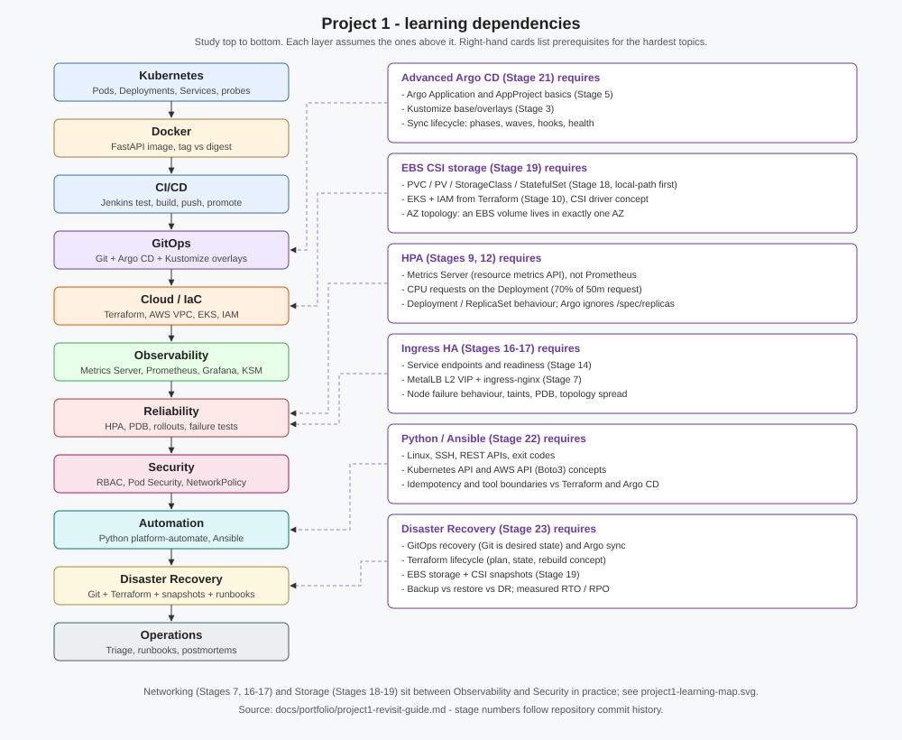

| # | Stage | Revisit priority | Prerequisites |
|---|---|---|---|
| 1 | Foundation | Core | Linux, SSH, container basics |
| 2 | FastAPI + Docker | Core | Python basics, HTTP |
| 3 | Kustomize packaging | Core | Kubernetes objects (Deployment, Service, ConfigMap) |
| 4 | Jenkins CI | Core | Docker, Git |
| 5 | Argo CD GitOps | Core | Kustomize, Kubernetes API, Git |
| 6 | CI → GitOps promotion | Core | Stages 4 + 5 |
| 7 | Ingress, NP, MetalLB | Core | Services, endpoints, L2 networking |
| 8 | Prometheus / Grafana | Core | Services, labels, Helm values |
| 9 | Reliability primitives | Core | Deployments, Metrics Server, resource requests |
| 10 | Terraform EKS | Core | AWS VPC/IAM basics, Kubernetes |
| 11 | Digest promotion | Core | Stages 2, 3, 6 |
| 12 | AWS capacity + HPA | Important | Stages 9, 10; ENI pod density concept |
| 13 | KSM, node-exporter | Important | Stage 8 |
| 14 | Self-healing + readiness | Core | Probes, ReplicaSets, endpoints, Argo selfHeal |
| 15 | Failed rollout + rollback | Core | Stages 11, 14; RollingUpdate |
| 16 | Worker node failure | Core | Node conditions, taints/tolerations, PDB |
| 17 | Ingress HA | Core | Stages 7, 16; topology spread |
| 18 | local-path storage | Important | PVC/PV/StorageClass, StatefulSet |
| 19 | EBS + node/AZ | Core | Stage 18, EKS, CSI, AZ topology |
| 20 | Security + RBAC | Core | ServiceAccounts, API verbs, namespaces, CNI |
| 21 | Advanced Argo CD | Important | Application, AppProject, Kustomize, sync lifecycle |
| 22 | Python + Ansible | Core | Linux, APIs, Kubernetes, AWS, idempotency |
| 23 | Disaster recovery | Core | GitOps, Terraform, storage, snapshots, backup vs restore |
| 24 | Operations | Important | All runtime stages |
| 25 | Portfolio | Reference | — |
| 26 | Retirement | Reference | Terraform destroy, Helm, Argo finalizers |

---

# Stage 1 — Repository and VMware kubeadm foundation

**Revisit priority:** Core · **Environment:** VMware · **Historical:** the cluster that hosted the full Project 1 platform · **Current:** the same cluster, reduced to a basic lab
**Stage boundary inferred from repository evidence:** the cluster predates the repository and its installation is not recorded in Git.

## What was the goal?
Start the repository docs-first and record the existing three-node kubeadm cluster as the local target, with explicit rules that keep VMware and AWS work separate.

## Why did we do it?
Every later stage deploys to this cluster. Writing down the nodes, versions and add-ons first gave a known baseline. The environment rules (separate overlays, separate Terraform state, check the kubectl context before writes) prevented cross-environment mistakes for the rest of the project.

## What did we build?
- Repository skeleton: `app/`, `kubernetes/base`, `kubernetes/overlays/{local,aws}`, `gitops/`, `jenkins/`, `terraform/aws`, `docs/`.
- Baseline docs: architecture overview, CI/CD and GitOps flow drafts, environment strategy, early decision log (ADR-000: repo starts as docs only).
- Recorded cluster: 3 × Ubuntu 24.04.4 VMs on VMware Workstation (`192.168.56.10–12`), Kubernetes v1.31.14, containerd 2.2.1, Calico v3.30.7 (Tigera operator), CoreDNS, kube-proxy, metrics-server, local-path provisioner.

## What did I learn?
- kubeadm runs the control plane as static pods on `k8s-ctrl-01` (etcd, kube-apiserver, kube-controller-manager, kube-scheduler).
- The CNI (Calico) provides pod networking; kube-proxy implements Services.
- Host-only networking depends on the Windows VMnet1 adapter.
- "Success in one environment is evidence for that environment only."

## Hands-on experiments
None (baseline). One troubleshooting event: the host could not ping or SSH the nodes because VMnet1 fell back to a `169.254.x.x` address; a static `192.168.56.1` fixed it ([common-issues.md](../troubleshooting/common-issues.md)).

## Important results
All three nodes Ready; add-ons listed in [architecture-overview.md](../architecture/architecture-overview.md).

## Key architecture
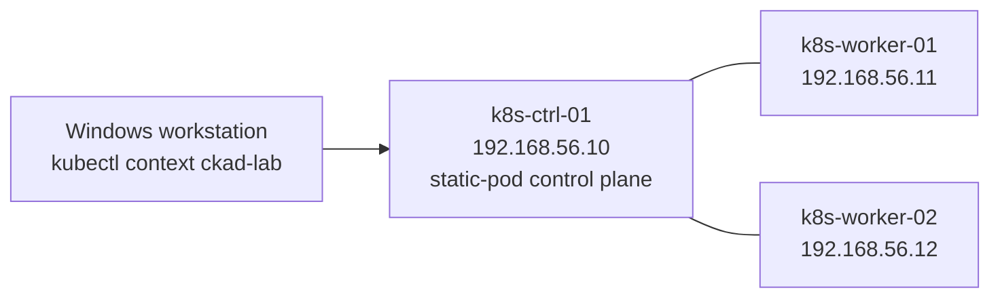

## Primary files to read
- [`docs/architecture/architecture-overview.md`](../architecture/architecture-overview.md)
- [`docs/design/environment-strategy.md`](../design/environment-strategy.md)
- [`docs/design/architecture-decisions.md`](../design/architecture-decisions.md)

## Secondary files
- [`docs/troubleshooting/common-issues.md`](../troubleshooting/common-issues.md)
- [`docs/operations/platform-inventory.md`](../operations/platform-inventory.md)

## Runbooks
[kubernetes-api-failure.md](../runbooks/kubernetes-api-failure.md) · [worker-node-failure.md](../runbooks/worker-node-failure.md) · [node-maintenance.md](../operations/node-maintenance.md)

## ADRs
[002 — EKS managed control plane](../adr/002-eks-managed-control-plane.md) (read as the contrast to kubeadm)

## Evidence
[architecture-overview.md](../architecture/architecture-overview.md) ("Cluster platform already present") · current state: [vmware-lab-cleanup.md](../operations/vmware-lab-cleanup.md)

## Important Git commits
`e365c91` chore: initialize platform engineering lab

## What should I remember?
- The cluster existed before Project 1; the repo documents it but does not build it.
- kubeadm control plane = static pods on one node (no control-plane HA in this lab).
- Always confirm `kubectl config current-context` before a write.
- Keep environment values in separate directories and separate state.

## Interview questions
- What does kubeadm give you, and what do you still own compared with EKS?
- Where do control-plane components run in a kubeadm cluster?
- What does the CNI do, and what does kube-proxy do?
- How do you avoid applying to the wrong cluster?

## Current status
Implemented and verified — the cluster still runs as the basic lab.

---

# Stage 2 — FastAPI workload and container image

**Revisit priority:** Core · **Environment:** workstation build → Docker Hub

## What was the goal?
Create a small FastAPI service with health and version endpoints and publish it as a hardened, versioned container image.

## Why did we do it?
The platform needed a real workload whose version and health could be observed, so later stages could prove promotion, probes, metrics and rollback.

## What did we build?
- Endpoints `/`, `/health` (`{"status":"healthy"}`), `/version`, `/info`; `/metrics` arrived later in 0.1.3.
- Version defined once in `app/src/__init__.py`; `APP_ENVIRONMENT` from the environment.
- Tests in `app/tests/test_app.py`.
- Dockerfile: `python:3.14-slim`, non-root user `app` (UID/GID 10001), `EXPOSE 8000`, Docker `HEALTHCHECK`, uvicorn on `0.0.0.0:8000`.
- Image `kirandevraaj/platform-lab:0.1.0`; `latest` intentionally unused.

## What did I learn?
- Non-root images and a single version source.
- A health endpoint is the contract for readiness and liveness probes.
- Tag vs digest: the tag names a release; the digest identifies the exact bytes.

## Hands-on experiments
Local run and first publish; the 0.1.0 digest was recorded in [app/README.md](../../app/README.md).

## Important results
Published artifact `0.1.0` with its digest recorded (commit `8eac844`).

## Key architecture
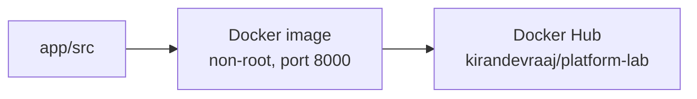

## Primary files to read
- [`app/README.md`](../../app/README.md)
- [`app/Dockerfile`](../../app/Dockerfile)
- [`app/src/main.py`](../../app/src/main.py)

## Secondary files
[`app/tests/test_app.py`](../../app/tests/test_app.py) · [`app/requirements.txt`](../../app/requirements.txt)

## Runbooks
[docker-release-failure.md](../runbooks/docker-release-failure.md) · [registry-unavailable.md](../runbooks/registry-unavailable.md)

## ADRs
[004 — Immutable image digest promotion](../adr/004-immutable-image-digest-promotion.md)

## Evidence
[app/README.md](../../app/README.md) (published artifact section)

## Important Git commits
`7f52bfb` feat: add FastAPI platform workload · `5513e02` feat: containerize FastAPI platform workload · `8eac844` docs: record published container artifact · `df7e30f` docs: clarify project implementation status

## What should I remember?
- One version source (`src/__init__.py`), never `latest`.
- Non-root UID 10001 later satisfied Pod Security and `runAsNonRoot`.
- `/health` became the readiness gate that saved the 0.1.5 rollout (Stage 15).

## Interview questions
- Why run containers as non-root?
- Why avoid the `latest` tag?
- What belongs in a health endpoint, and what does not?
- What is the difference between an image tag and a digest?

## Current status
Implemented and verified (historical build; release digests remain pinned in Git).

---

# Stage 3 — Kustomize packaging and first local deployment

**Revisit priority:** Core · **Environment:** VMware · **Historical:** full Project 1 platform · **Current:** base kubeadm lab (Project 1 components removed)

## What was the goal?
Describe the workload once in a Kustomize base and express environment differences as small overlays, then deploy it to `ckad-lab`.

## Why did we do it?
Two environments were planned from day one. A shared base prevents copy-pasted manifests from drifting apart; overlays hold only what differs (image, networking, reliability patches).

## What did we build?
- `kubernetes/base`: Namespace `platform-lab`, ConfigMap `platform-lab-config` (`APP_ENVIRONMENT`), Deployment `platform-lab` (2 replicas), Service ClusterIP `:8000`. Ingress and NetworkPolicy were added to the base in Stage 7.
- `kubernetes/overlays/local` (applied) and `kubernetes/overlays/aws` (files only at this point), each using a Kustomize `images` entry.

## What did I learn?
Kustomize base/overlay composition, the `images` transformer, labels and selectors linking Deployment → Pods → Service.

## Hands-on experiments
`kubectl apply -k kubernetes/overlays/local` on 2026-09-24.

## Important results
`platform-lab` Deployment 2/2 with pods on both workers behind a ClusterIP Service ([architecture-overview.md](../architecture/architecture-overview.md)).

## Key architecture
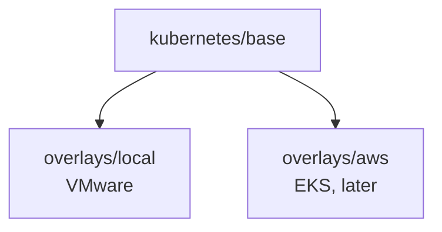

## Primary files to read
- [`docs/architecture/architecture-overview.md`](../architecture/architecture-overview.md) ("Kubernetes packaging")
- [`kubernetes/base/kustomization.yaml`](../../kubernetes/base/kustomization.yaml)
- [`kubernetes/overlays/local/kustomization.yaml`](../../kubernetes/overlays/local/kustomization.yaml)

## Secondary files
[`kubernetes/base/deployment.yaml`](../../kubernetes/base/deployment.yaml) · [`kubernetes/base/service.yaml`](../../kubernetes/base/service.yaml) · [`kubernetes/overlays/aws/kustomization.yaml`](../../kubernetes/overlays/aws/kustomization.yaml)

## Runbooks
[application-unhealthy.md](../runbooks/application-unhealthy.md) · [service-endpoint-troubleshooting.md](../runbooks/service-endpoint-troubleshooting.md)

## ADRs
[005 — Kustomize for environment overlays](../adr/005-kustomize-for-environment-overlays.md)

## Evidence
[architecture-overview.md](../architecture/architecture-overview.md) ("Actual local deployment")

## Important Git commits
`522d134` feat: add Kubernetes application packaging · `be9c7b5` feat: deploy platform-lab to local kubernetes

## What should I remember?
- This was the only manual `kubectl apply` of the app; Argo owned it from Stage 5.
- Overlays hold differences only; the base is shared.
- Later, overlays carried the digest pin (Stage 11) and HPA/PDB/ingress patches.

## Interview questions
- Kustomize vs Helm: when would you use each? (Project 1 used both.)
- How does a Service find its pods?
- What should live in a base vs an overlay?

## Current status
Historical — `platform-lab` no longer runs; manifests remain in Git.

---

# Stage 4 — Jenkins CI

**Revisit priority:** Core · **Environment:** Jenkins on Docker Desktop (not a Kubernetes target)

## What was the goal?
Build a repeatable CI pipeline that tests, builds, validates and pushes the image, on a dedicated Linux agent.

## Why did we do it?
Manual image builds are not repeatable or auditable. CI had to be separate from deployment so that Git, not Jenkins, would decide what runs in a cluster.

## What did we build?
- `jenkins/Jenkinsfile` (job `platform-lab-ci`), polling GitHub (`pollSCM('H/2 * * * *')`), `disableConcurrentBuilds()`.
- Local runtime (`jenkins/runtime/compose.yaml`): controller `jenkins/jenkins:2.568.3-lts-jdk21`, inbound agent with Docker CLI, Docker socket mounted (no Docker-in-Docker), node `linux-agent`.
- Credentials referenced by ID only (`dockerhub-platform-lab`, `github-platform-lab`).
- Image validation: runs as user `app`, exposes `8000/tcp`, has a healthcheck, `/health` answers on the agent network (up to 15 tries, 2 s apart).
- Final stage list (after later stages): Checkout → Detect Application Change → Unit Test → Read Application Version → Refuse Existing Image Tag → Docker Build → Docker Image Validation → Docker Hub Push → Capture Published Digest → Promote Local GitOps → Promote AWS GitOps → Commit and Push GitOps.

## What did I learn?
Controller/agent split, pipeline stages, credential binding, why an existing tag must be refused, and that Docker Desktop host ports bind inside its VM.

## Hands-on experiments
Iterated to the first green run.

## Important results
First successful Jenkins CI run recorded (`91b5800`). Two fixes on the way:
- `ce245d8`: run the pipeline on the Linux agent.
- `e2c51a3`: reach the health check through the agent network (probe the container by DNS name, not a host port).

## Key architecture
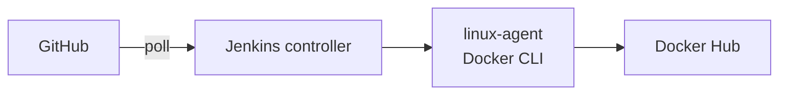

## Primary files to read
- [`jenkins/README.md`](../../jenkins/README.md)
- [`jenkins/Jenkinsfile`](../../jenkins/Jenkinsfile)
- [`docs/architecture/ci-cd-flow.md`](../architecture/ci-cd-flow.md)

## Secondary files
[`jenkins/runtime/compose.yaml`](../../jenkins/runtime/compose.yaml) · [`jenkins/runtime/agent/Dockerfile`](../../jenkins/runtime/agent/Dockerfile) · [`jenkins/runtime/controller/plugins.txt`](../../jenkins/runtime/controller/plugins.txt)

## Runbooks
[jenkins-build-failure.md](../runbooks/jenkins-build-failure.md) · [jenkins-unavailable.md](../runbooks/jenkins-unavailable.md)

## ADRs
[003 — GitOps with Argo CD](../adr/003-gitops-with-argo-cd.md) (why Jenkins does not deploy) · early log ADR-002/ADR-006 in [architecture-decisions.md](../design/architecture-decisions.md)

## Evidence
[ci-cd-flow.md](../architecture/ci-cd-flow.md) · [jenkins/README.md](../../jenkins/README.md)

## Important Git commits
`3a653a6` feat: add Jenkins CI pipeline definition · `b45482c` chore: add local Jenkins CI runtime · `ce245d8` fix: run the Jenkins pipeline on the linux agent · `e2c51a3` fix: reach the CI health check through the agent network · `91b5800` docs: record the first successful Jenkins CI run

## What should I remember?
- Jenkins is CI only. It never touches a cluster.
- Refusing an existing tag keeps releases immutable at the registry level.
- Validate the built image (user, port, health) before pushing it.

## Interview questions
- Why keep CI and CD separate?
- How does your pipeline avoid overwriting a released image?
- How do you validate an image before publishing it?
- What are the trade-offs of mounting the Docker socket into an agent?

## Current status
Historical — the Jenkins runtime was not inspected for this guide; the pipeline definition remains in Git.

---

# Stage 5 — Argo CD GitOps on VMware

**Revisit priority:** Core · **Environment:** VMware · **Historical:** full Project 1 platform · **Current:** base kubeadm lab (Project 1 components removed)

## What was the goal?
Install Argo CD on `ckad-lab` and make Git the only source of desired state for `platform-lab`.

## Why did we do it?
With GitOps, a deployment is a Git commit and the cluster continuously converges to it. Manual drift is reverted, and every change is audited in Git history.

## What did we build?
- Argo CD **v3.5.3** in namespace `argocd`.
- AppProject `platform-lab`; Application `platform-lab-local` → `kubernetes/overlays/local` on `main`, destination in-cluster, namespace `platform-lab`.
- Sync policy: automated, `prune`, `selfHeal`, `CreateNamespace=true`, `ApplyOutOfSyncOnly=true`.

## What did I learn?
Application vs AppProject, Synced vs Healthy, automated sync, prune, selfHeal, the refresh/poll interval.

## Hands-on experiments
- Git change: `APP_ENVIRONMENT` `local` → `local-gitops` (`e2b7964`) synced after a hard refresh.
- Live drift: a manual patch to `manual-drift` went OutOfSync and self-healed back to `local-gitops`, Deployment 2/2 throughout.

## Important results
Both demos recorded in [gitops/README.md](../../gitops/README.md) and [gitops-flow.md](../architecture/gitops-flow.md). Install issue: client-side `kubectl apply` of the v3.5.3 manifest failed on the ApplicationSet CRD annotation size limit; `--server-side` fixed it.

## Key architecture
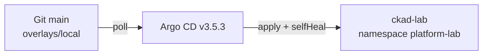

## Primary files to read
- [`gitops/README.md`](../../gitops/README.md)
- [`docs/architecture/gitops-flow.md`](../architecture/gitops-flow.md) (early; see Appendix A)
- [`gitops/applications/platform-lab-local.yaml`](../../gitops/applications/platform-lab-local.yaml)

## Secondary files
[`gitops/projects/platform-lab.yaml`](../../gitops/projects/platform-lab.yaml) · [`docs/argo-cd-interview-notes.md`](../argo-cd-interview-notes.md)

## Runbooks
[argo-outofsync.md](../runbooks/argo-outofsync.md) · [gitops-change.md](../runbooks/gitops-change.md) · [argocd-controller-unavailable.md](../runbooks/argocd-controller-unavailable.md)

## ADRs
[003 — GitOps with Argo CD](../adr/003-gitops-with-argo-cd.md)

## Evidence
[gitops/README.md](../../gitops/README.md) · [gitops-flow.md](../architecture/gitops-flow.md)

## Important Git commits
`71ed15b` feat: add Argo CD GitOps for the local platform-lab overlay · `e2b7964` chore: set APP_ENVIRONMENT to local-gitops for GitOps demo · `e875218` docs: record Argo CD GitOps sync and self-heal demos

## What should I remember?
- Git is the source of truth; Argo pulls.
- selfHeal makes manual cluster edits temporary.
- Synced (matches Git) and Healthy (workload OK) are separate states.
- Large CRDs may need server-side apply.

## Interview questions
- Push-based CD vs pull-based GitOps?
- Synced vs Healthy?
- What do prune and selfHeal do, and when would you disable them?
- What happens if someone runs `kubectl edit` on an Argo-managed Deployment?

## Current status
Historical — Argo CD was removed from VMware in Stage 26; definitions remain in `gitops/`.

---

# Stage 6 — CI → GitOps promotion (0.1.1 manual, 0.1.2 automated)

**Revisit priority:** Core · **Environment:** VMware · **Historical:** full Project 1 platform · **Current:** base kubeadm lab (Project 1 components removed)

## What was the goal?
Connect CI to GitOps: Jenkins publishes a new image and commits the new version into the overlay; Argo CD deploys it.

## Why did we do it?
To release without anyone running `kubectl` or `docker push` by hand, while keeping Git as the only deploy trigger.

## What did we build?
- Jenkins stages that publish the image and commit the local overlay image reference (tag at this stage; digest from Stage 11).
- Push via a temporary `GIT_ASKPASS` helper; no `reset --hard`, no force push.
- **Detect Application Change:** only `app/**` changes run test/build/push/promote. Jenkins' own overlay commit re-triggers a build that skips every stage and ends SUCCESS (loop prevention).

## What did I learn?
CI writing to Git is safe when scoped (only overlay files) and loop-free; publishing an image is not deploying it.

## Hands-on experiments
- **0.1.1 (manual promotion):** app commit `7557521`, overlay commit `a8ca030`; pods served 0.1.1.
- **0.1.2 (automated):** build #4 seed (skipped), build #5 built and promoted (overlay commit `1eb1428`), build #6 loop-prevention (skipped, SUCCESS).

## Important results
Argo Synced/Healthy at `1eb1428`; Deployment 2/2 on 0.1.2; old ReplicaSet scaled to 0; all endpoints 200. No manual `kubectl apply`, `docker build` or `docker push` for 0.1.2 ([ci-cd-flow.md](../architecture/ci-cd-flow.md)).

## Key architecture
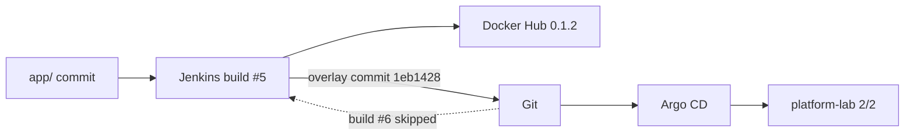

## Primary files to read
- [`docs/architecture/ci-cd-flow.md`](../architecture/ci-cd-flow.md)
- [`jenkins/Jenkinsfile`](../../jenkins/Jenkinsfile) (Detect Application Change, Promote, Commit and Push stages)

## Secondary files
[`jenkins/README.md`](../../jenkins/README.md) · [`docs/architecture/gitops-flow.md`](../architecture/gitops-flow.md)

## Runbooks
[gitops-change.md](../runbooks/gitops-change.md) · [git-rollback.md](../runbooks/git-rollback.md) · [jenkins-build-failure.md](../runbooks/jenkins-build-failure.md)

## ADRs
[003](../adr/003-gitops-with-argo-cd.md) · [004](../adr/004-immutable-image-digest-promotion.md)

## Evidence
[ci-cd-flow.md](../architecture/ci-cd-flow.md) (0.1.1 and 0.1.2 run tables)

## Important Git commits
`7557521` release 0.1.1 · `a8ca030` promote 0.1.1 · `95b2f79` docs: record 0.1.1 integration · `0a633da` feat: automate Jenkins image publish and local GitOps promotion · `d7e0a12` release 0.1.2 · `1eb1428` promote 0.1.2 (by Jenkins) · `5b2ce38` docs: record automated promotion

## What should I remember?
- The release pipeline ends with a Git commit, not a deploy.
- Change detection on `app/**` prevents CI loops and skips docs/Terraform-only commits.
- Jenkins never edits `kubernetes/base/**`, Terraform or `gitops/**`.

## Interview questions
- How does CI trigger a deployment in a GitOps model?
- How did you stop the promotion commit from triggering an infinite loop?
- What is the blast radius of the Jenkins Git credential?

## Current status
Historical.

---

# Stage 7 — Ingress, NetworkPolicy and MetalLB on VMware (Step 7 / Step 7.5)

**Revisit priority:** Core · **Environment:** VMware · **Historical:** full Project 1 platform · **Current:** base kubeadm lab (Project 1 components removed)

## What was the goal?
Give `platform-lab` an external HTTP entry point on bare VMs and restrict which pods may reach it.

## Why did we do it?
VMware has no cloud load balancer. MetalLB provides `LoadBalancer` IPs on the host-only network; ingress-nginx routes by host; NetworkPolicy limits pod-to-pod access.

## What did we build?
- Ingress `platform-lab` (host `platform-lab.local`, class `nginx`) → Service `platform-lab:8000`.
- NetworkPolicy: TCP/8000 to app pods only from the ingress-nginx controller (egress unrestricted).
- ingress-nginx controller Service patched NodePort → LoadBalancer in the local overlay.
- MetalLB v0.16.1 L2, pool `lab-pool` `192.168.56.200–210`, L2Advertisement `lab-l2`.

## What did I learn?
MetalLB L2 answers ARP for the VIP from one node; `externalTrafficPolicy: Cluster` forwards to any node; the NodePort remains after the type change; TLS was not configured.

## Hands-on experiments
- Step 7: NodePort `192.168.56.11:30080` → HTTP 200.
- Step 7.5: VIP `192.168.56.200` assigned from `lab-pool`, announced from `k8s-worker-01`; all endpoints 200 via the VIP. Jenkins build #10 skipped app CI.

## Important results
External path: client → `192.168.56.200:80` → ingress-nginx → Ingress → Service → pod ([networking.md](../architecture/networking.md)).

## Key architecture
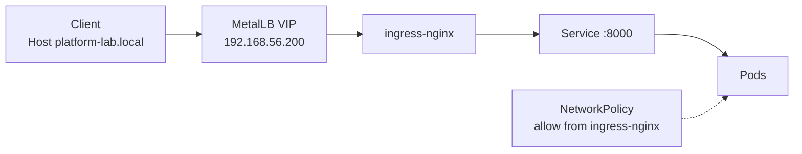

## Primary files to read
- [`docs/architecture/networking.md`](../architecture/networking.md)
- [`kubernetes/base/ingress.yaml`](../../kubernetes/base/ingress.yaml)
- [`kubernetes/base/networkpolicy.yaml`](../../kubernetes/base/networkpolicy.yaml)

## Secondary files
[`kubernetes/overlays/local/ingress-nginx-controller-service.yaml`](../../kubernetes/overlays/local/ingress-nginx-controller-service.yaml) · [`docs/vmware-networking-anatomy.md`](../vmware-networking-anatomy.md) (deep dive, Stage 17)

## Runbooks
[ingress-unavailable.md](../runbooks/ingress-unavailable.md) · [metallb-vip-failure.md](../runbooks/metallb-vip-failure.md) · [networkpolicy-troubleshooting.md](../runbooks/networkpolicy-troubleshooting.md) · [service-endpoint-troubleshooting.md](../runbooks/service-endpoint-troubleshooting.md)

## ADRs
[007 — AWS ALB vs VMware ingress](../adr/007-aws-alb-vs-vmware-ingress.md)

## Evidence
[networking.md](../architecture/networking.md) (Step 7 and Step 7.5 validation)

## Important Git commits
`99a0f98` feat: add ingress and network policy for platform-lab · `4902de0` docs: record ingress and NetworkPolicy validation · `bfeb721` feat: expose local ingress-nginx through MetalLB · `e0403cd` docs: record MetalLB LoadBalancer VIP

## What should I remember?
- MetalLB is not a cloud load balancer; it announces an IP via ARP.
- ingress-nginx was a single replica here: the SPOF found in Stage 17.
- The AWS overlay never got this patch; AWS used an ALB instead.

## Interview questions
- How do you get `type: LoadBalancer` on bare metal?
- `externalTrafficPolicy: Cluster` vs `Local`?
- What does this NetworkPolicy allow and deny?

## Current status
Historical — MetalLB and ingress-nginx were removed in Stage 26.

---

# Stage 8 — Prometheus / Grafana observability on VMware

**Revisit priority:** Core · **Environment:** VMware · **Historical:** full Project 1 platform · **Current:** base kubeadm lab (Project 1 components removed)

## What was the goal?
Expose application metrics and give the platform a GitOps-managed Prometheus/Grafana stack with a dashboard as code.

## Why did we do it?
Without metrics there was no way to see load, errors or pod health, and no data for later failure experiments.

## What did we build?
- App **0.1.3** adds `/metrics` (`prometheus-fastapi-instrumentator`).
- Argo Application `platform-lab-observability`: kube-prometheus-stack **91.5.1** in `monitoring`, Alertmanager disabled, Prometheus ClusterIP, Grafana LoadBalancer (MetalLB assigned `192.168.56.201`).
- ServiceMonitor (port `http`, `/metrics`, every 30 s); dashboard ConfigMap `platform-lab-grafana-dashboard`; NetworkPolicy patch allowing `monitoring` to reach TCP/8000.

## What did I learn?
ServiceMonitor discovery, dashboard provisioning via labelled ConfigMaps, and that NetworkPolicy must allow the scraper.

## Hands-on experiments
0.1.3 release through the pipeline (build #12 built and promoted; build #13 loop prevention), then dashboard and target checks.

## Important results
- Both Applications Synced/Healthy; Grafana `/login` 200 at `.201`; dashboard uid `platform-lab` with 8 panels; both pod targets `up` ([observability.md](../architecture/observability.md)).
- **Failure:** Grafana was OOMKilled. `a3ee50f` raised Grafana's memory request 128Mi → 256Mi and limit 256Mi → 512Mi through Git ([postmortems/grafana-oom.md](../postmortems/grafana-oom.md)).

## Key architecture
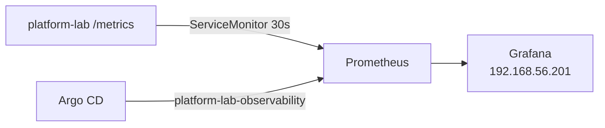

## Primary files to read
- [`docs/architecture/observability.md`](../architecture/observability.md)
- [`observability/README.md`](../../observability/README.md)
- [`observability/values-kube-prometheus-stack.yaml`](../../observability/values-kube-prometheus-stack.yaml)

## Secondary files
[`kubernetes/overlays/local/servicemonitor.yaml`](../../kubernetes/overlays/local/servicemonitor.yaml) · [`observability/dashboards/platform-lab-dashboard.yaml`](../../observability/dashboards/platform-lab-dashboard.yaml) · [`gitops/applications/platform-lab-observability.yaml`](../../gitops/applications/platform-lab-observability.yaml)

## Runbooks
[prometheus-target-down.md](../runbooks/prometheus-target-down.md) · [grafana-unavailable.md](../runbooks/grafana-unavailable.md)

## ADRs
[006 — Prometheus + Grafana observability](../adr/006-prometheus-grafana-observability.md)

## Evidence
[observability.md](../architecture/observability.md) · [postmortems/grafana-oom.md](../postmortems/grafana-oom.md)

## Important Git commits
`1c562fc` feat: add Prometheus/Grafana observability · `75cda8e` promote 0.1.3 · `f79f231` docs: record observability validation · `a3ee50f` fix: raise Grafana memory limit to stop OOMKills

## What should I remember?
- Observability components need realistic resources too (Grafana OOM).
- Fix through Git, not `kubectl edit`; selfHeal would revert a manual edit.
- Don't hard-code the Grafana IP; MetalLB assigns it.

## Interview questions
- How does Prometheus discover targets in kube-prometheus-stack?
- How did you manage dashboards as code?
- Tell me about the Grafana OOM and how you fixed it.

## Current status
Historical — kube-prometheus-stack was removed in Stage 26.

---

# Stage 9 — Reliability primitives: HPA, PDB, safe rollouts

**Revisit priority:** Core · **Environment:** VMware · **Historical:** full Project 1 platform · **Current:** base kubeadm lab (Project 1 components removed)

## What was the goal?
Harden `platform-lab` with autoscaling, a disruption budget, a zero-downtime rollout strategy and pod spreading.

## Why did we do it?
Two replicas alone do not guarantee availability. Rollouts, drains and load need explicit controls.

## What did we build?
- HPA (`autoscaling/v2`): min 2, max 4, target 70% CPU of a 50m request. Argo ignores `/spec/replicas` so it does not fight the HPA.
- PDB `minAvailable: 1`.
- RollingUpdate `maxSurge: 1`, `maxUnavailable: 0`.
- `topologySpreadConstraints`: `maxSkew: 1`, `kubernetes.io/hostname`, `ScheduleAnyway`.
- Readiness and liveness probes on `/health`.

## What did I learn?
HPA needs Metrics Server and CPU requests; PDBs only cover voluntary disruption; soft spread may not balance pods right after a rollout.

## Hands-on experiments
Rollout of the patch (build #16 skipped app CI), HPA/PDB inspection, pod deletion.

## Important results
- HPA `cpu: 4%/70%`, ScalingActive True, replicas stayed 2 (idle); PDB allowed disruptions 1.
- Pod deleted → replacement Ready in ~13 s; surviving pod 0 restarts.
- Both pods briefly landed on `k8s-worker-02`; deleting one restored the spread ([reliability.md](../architecture/reliability.md)).
- VMware HPA 2 → 4 under load is recorded in the Section 26 operations docs ([hpa-not-scaling.md](../runbooks/hpa-not-scaling.md), [platform-operations-handbook.md](../operations/platform-operations-handbook.md)); no standalone VMware load-test write-up exists. The measured load test is the AWS one (Stage 12).

## Key architecture
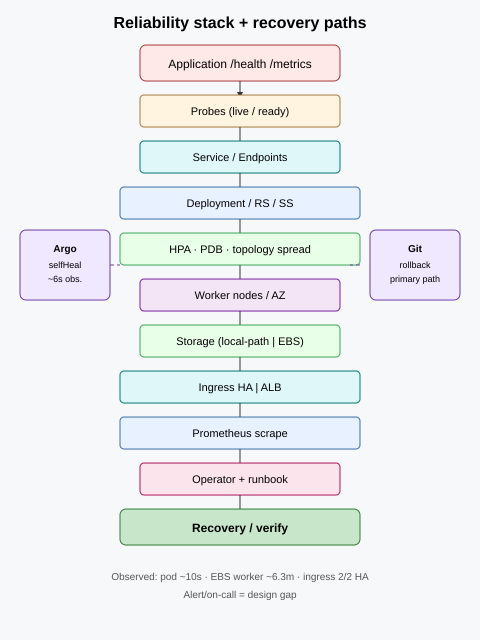

## Primary files to read
- [`docs/architecture/reliability.md`](../architecture/reliability.md)
- [`kubernetes/overlays/local/hpa.yaml`](../../kubernetes/overlays/local/hpa.yaml)
- [`kubernetes/overlays/local/pdb.yaml`](../../kubernetes/overlays/local/pdb.yaml)
- [`kubernetes/overlays/local/deployment-reliability-patch.yaml`](../../kubernetes/overlays/local/deployment-reliability-patch.yaml)

## Secondary files
[`docs/diagrams/project1-reliability-stack.svg`](../diagrams/project1-reliability-stack.svg) · [`gitops/applications/platform-lab-local.yaml`](../../gitops/applications/platform-lab-local.yaml) (ignoreDifferences)

## Runbooks
[hpa-not-scaling.md](../runbooks/hpa-not-scaling.md) · [pod-failure.md](../runbooks/pod-failure.md) · [pod-not-ready.md](../runbooks/pod-not-ready.md)

## ADRs
No numbered ADR; see early log ADR-008 in [architecture-decisions.md](../design/architecture-decisions.md).

## Evidence
[reliability.md](../architecture/reliability.md) (local reliability validation)

## Important Git commits
`bc8181f` feat: harden local platform-lab with HPA, PDB, and safe rollouts · `be72ebf` docs: record local reliability validation

## What should I remember?
- HPA depends on Metrics Server and on resource requests.
- `maxUnavailable: 0` + readiness = old pods keep serving during a bad rollout (proved in Stage 15).
- A PDB does not protect against a node crash (proved in Stage 16).
- Let the HPA own replicas: ignore `/spec/replicas` in Argo.

## Interview questions
- What does an HPA need to work?
- PDB vs HPA: what does each protect?
- Why `maxUnavailable: 0`?
- Why might topology spread still leave both pods on one node?

## Current status
Historical.

---

# Stage 10 — AWS Terraform EKS platform

**Revisit priority:** Core · **Historical runtime:** AWS EKS Project 1 environment · **Current:** AWS runtime destroyed after portfolio completion

## What was the goal?
Build the AWS side of the platform entirely as code: VPC, EKS, IAM, the AWS Load Balancer Controller and a Terraform-bootstrapped Argo CD.

## Why did we do it?
Clicking resources into existence is not repeatable, reviewable or destroyable. Terraform gives a plan before every change and a clean destroy path, and it mirrors how cloud platforms are really run.

## What did we build?
- Toolbox container `platform-aws-tools` (AWS CLI v2, Terraform, kubectl 1.36.x, Helm 3) so nothing was installed on Windows; credentials in a named volume, never in Git.
- `terraform/aws` modules: `vpc`, `iam`, `eks`, `aws_load_balancer_controller`, `argocd`, `gitops_bootstrap`. Later stages added `metrics_server`, `ebs_csi` and `snapshot_controller`.
- `ap-south-1`, VPC `10.50.0.0/16`, AZs `ap-south-1a`/`1b`, public + private subnets, single NAT gateway (cost trade-off), EKS 1.36, 2 nodes (t3.small at first), IMDSv2, encrypted gp3 root volumes.
- `cluster_endpoint_public_access_cidrs` required; validation rejects `0.0.0.0/0`.
- `kubernetes/overlays/aws`: ALB ingress patch (target-type `ip`), HPA, PDB, config patch; Argo AppProject + Application `platform-lab-aws` rendered by Terraform templates.
- Safety: `null_resource.destroy_safety` runs `scripts/pre-destroy-cleanup.sh` (delete Applications and Ingresses first) and pre-apply gate scripts.

## What did I learn?
Terraform module structure, plan/apply discipline, EKS shared responsibility, subnet and security-group tagging for the Load Balancer Controller, Pod Identity, and why Terraform and Argo must not own the same objects.

## Hands-on experiments
Lab `terraform apply` (the README states "applied for the AWS lab"; EKS 1.36.4 observed per [ADR 002](../adr/002-eks-managed-control-plane.md)). The HTML architecture page is a pre-apply snapshot ("46 to add").

## Important results
Two fixes during bring-up:
- `7f07d0b`: GitOps bootstrap hardened for Windows line endings (`.gitattributes`).
- `a94c018`: corrected node security-group tagging so the Load Balancer Controller can uniquely identify the cluster SG (see the comment in `modules/eks/main.tf`).

## Key architecture
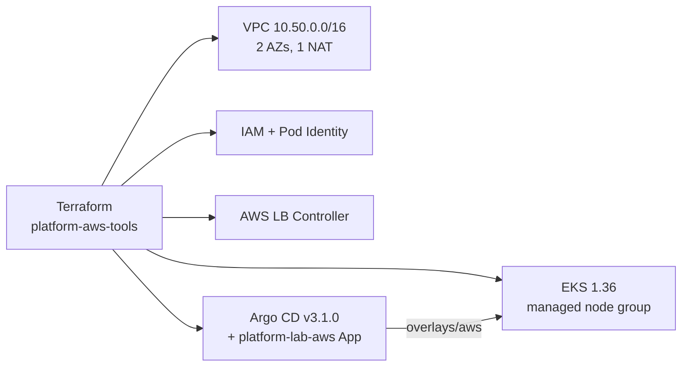

## Primary files to read
- [`terraform/aws/README.md`](../../terraform/aws/README.md)
- [`terraform/aws/main.tf`](../../terraform/aws/main.tf)
- [`tools/aws/README.md`](../../tools/aws/README.md)

## Secondary files
[`terraform/aws/variables.tf`](../../terraform/aws/variables.tf) · [`terraform/aws/modules/eks/main.tf`](../../terraform/aws/modules/eks/main.tf) · [`terraform/aws/scripts/pre-destroy-cleanup.sh`](../../terraform/aws/scripts/pre-destroy-cleanup.sh) · [`kubernetes/overlays/aws/`](../../kubernetes/overlays/aws/) · [`docs/aws-eks-platform-architecture.html`](../aws-eks-platform-architecture.html) (pre-apply snapshot)

## Runbooks
[terraform-plan-failure.md](../runbooks/terraform-plan-failure.md) · [terraform-apply-safety.md](../runbooks/terraform-apply-safety.md) · [aws-alb-unhealthy.md](../runbooks/aws-alb-unhealthy.md) · [aws-api-failure.md](../runbooks/aws-api-failure.md)

## ADRs
[001 — Terraform for AWS](../adr/001-terraform-for-aws-infrastructure.md) · [002 — EKS managed control plane](../adr/002-eks-managed-control-plane.md) · [007 — ALB vs VMware ingress](../adr/007-aws-alb-vs-vmware-ingress.md)

## Evidence
[terraform/aws/README.md](../../terraform/aws/README.md) · [adr/002](../adr/002-eks-managed-control-plane.md)

## Important Git commits
`0ea6f13` chore: prepare aws terraform tooling foundation · `5e304cd` feat: add aws eks terraform platform · `7f07d0b` fix: harden aws gitops bootstrap for windows · `a94c018` fix: correct aws node security group tagging

## What should I remember?
- Plan before apply; `terraform destroy` needs explicit approval and pre-destroy cleanup (Ingress/ALB first).
- Terraform owns AWS infrastructure; Argo owns in-cluster app state.
- Local Terraform state was an accepted lab gap (production would use a remote backend).
- Single NAT saved cost at the expense of AZ resilience.

## Interview questions
- Why Terraform instead of the console or CloudFormation?
- What does EKS manage for you, and what do you still own?
- Why must `terraform destroy` delete Ingresses first?
- What are the risks of local Terraform state?

## Current status
Historical — AWS runtime destroyed 2026-09-26 (Stage 26); Terraform source remains and is rebuildable.

---

# Stage 11 — Multi-environment GitOps promotion and digest pinning

**Revisit priority:** Core · **Environment:** VMware + AWS · **VMware:** historical full Project 1 platform; current base kubeadm lab · **Historical runtime:** AWS EKS Project 1 environment · **Current:** AWS runtime destroyed after portfolio completion

## What was the goal?
Promote one immutable image digest to both environments from one Jenkins pipeline.

## Why did we do it?
Tags can be moved or overwritten; a digest cannot. Pinning the same digest in both overlays guarantees both clusters run identical bytes and makes rollback exact.

## What did we build?
- Jenkins promotes both overlays (`Promote Local GitOps`, `Promote AWS GitOps`), then one `Commit and Push GitOps`.
- `Capture Published Digest`: reads `RepoDigests`, requires `^sha256:[a-f0-9]{64}$` for the right repo, fails closed, never falls back to the local image ID. If `origin/main` still used `newTag`, the pipeline converts it to `digest`.
- Release 0.1.4 promoted to both overlays with an `app.kubernetes.io/version` label.
- AWS Metrics Server installed by Terraform (chart 3.14.0, `InternalIP`, no `kubelet-insecure-tls`).

## What did I learn?
Kustomize `images[].digest`; release version (logical) vs digest (physical); one artifact, many environments.

## Hands-on experiments
0.1.4 release and dual promotion.

## Important results
`kirandevraaj/platform-lab:0.1.4` @ `sha256:1cca2b5964043fe6c9c09f17d7f86a3572a46699602919d15c45c9a069b872ff` pinned in both overlays and running in both clusters ([adr/004](../adr/004-immutable-image-digest-promotion.md), [README.md](../../README.md)).

## Key architecture
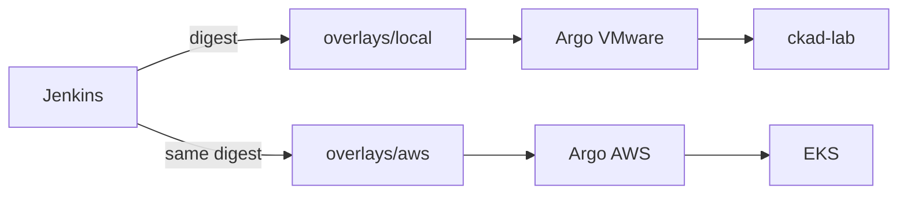

## Primary files to read
- [`docs/architecture/ci-cd-flow.md`](../architecture/ci-cd-flow.md)
- [`docs/adr/004-immutable-image-digest-promotion.md`](../adr/004-immutable-image-digest-promotion.md)
- [`kubernetes/overlays/local/kustomization.yaml`](../../kubernetes/overlays/local/kustomization.yaml) and [`kubernetes/overlays/aws/kustomization.yaml`](../../kubernetes/overlays/aws/kustomization.yaml)

## Secondary files
[`jenkins/Jenkinsfile`](../../jenkins/Jenkinsfile) · [`gitops/applications/platform-lab-aws.yaml`](../../gitops/applications/platform-lab-aws.yaml) · [`terraform/aws/modules/metrics_server/main.tf`](../../terraform/aws/modules/metrics_server/main.tf)

## Runbooks
[git-rollback.md](../runbooks/git-rollback.md) · [docker-release-failure.md](../runbooks/docker-release-failure.md) · [registry-unavailable.md](../runbooks/registry-unavailable.md)

## ADRs
[004](../adr/004-immutable-image-digest-promotion.md) · [005](../adr/005-kustomize-for-environment-overlays.md)

## Evidence
Overlay files in Git · [ci-cd-flow.md](../architecture/ci-cd-flow.md)

## Important Git commits
`baec457` feat: enable multi-environment gitops promotion · `0590eb7` release: platform-lab 0.1.4 · `baf74d5` chore: promote 0.1.4 to local and aws GitOps · `a3d493b` feat: add aws metrics server and version metadata · `5da676f` feat: pin gitops releases by image digest

## What should I remember?
- Image tags are references; digests identify immutable artifacts.
- The digest capture fails closed: no digest, no promotion.
- The same digest ran in both environments; environment behaviour came from overlays (this is what made the Stage 15 fault VMware-only).

## Interview questions
- Tag vs digest promotion: why does it matter?
- How do you guarantee two environments run the same artifact?
- What happens in your pipeline if the registry doesn't return a digest?

## Current status
Historical — digest pins remain in Git.

---

# Stage 12 — AWS capacity analysis, lightweight observability and HPA load test

**Revisit priority:** Important · **Historical runtime:** AWS EKS Project 1 environment · **Current:** AWS runtime destroyed after portfolio completion

## What was the goal?
Check whether observability fits on the small EKS nodes, resize if needed, add a lightweight Prometheus/Grafana, and prove the HPA scales under load.

## Why did we do it?
On EKS, pod slots per node are limited by ENI/IP capacity. Adding a full kube-prometheus-stack blindly would have left pods Pending.

## What did we build?
- Read-only capacity analysis on 2 × t3.small, then node type → **t3.medium** (`862588e`, node group replaced).
- Argo Application `platform-observability-aws`: Prometheus chart 29.33.0 (6 h retention, emptyDir), Grafana chart 10.5.15 (ClusterIP + port-forward only).
- Temporary load Job `platform-lab-hpa-load-tmp` (curl, concurrency 30 → 80 → 120) against the ClusterIP Service.

## What did I learn?
Pod density and real memory use, not CPU, bind small nodes. Measure with `kubectl top`, not only requests. The HPA path (Metrics Server) is separate from the Prometheus path.

## Hands-on experiments
Capacity measurement; node resize; observability install; HPA load test.

## Important results
- t3.small: **11 pods/node** (22 slots, 18 running, ~4 free), memory ~63.8% used. t3.medium: **17 pods/node** (34 slots), memory ~19% ([aws-observability-capacity-analysis.md](../aws-observability-capacity-analysis.md)).
- Observability added ~+524 Mi memory; `up{job="platform-lab"} = 1` ([aws-lightweight-observability.md](../aws-lightweight-observability.md)).
- HPA: CPU 90–97%, desired replicas **2 → 3** about **65 s** after load start; new pod Ready ~37 s after creation; the load Job was OOMKilled by its own 64Mi limit; scale-down to 2 about 5–6 min later; max 4 never reached ([aws-hpa-observability-load-test.md](../aws-hpa-observability-load-test.md)).

## Key architecture
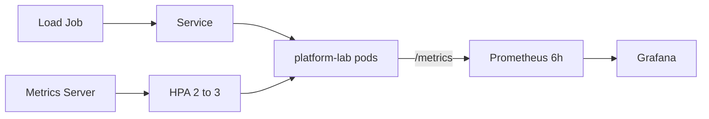

## Primary files to read
- [`docs/aws-observability-capacity-analysis.md`](../aws-observability-capacity-analysis.md)
- [`docs/aws-lightweight-observability.md`](../aws-lightweight-observability.md)
- [`docs/aws-hpa-observability-load-test.md`](../aws-hpa-observability-load-test.md)

## Secondary files
[`observability/aws/values-prometheus.yaml`](../../observability/aws/values-prometheus.yaml) · [`observability/aws/values-grafana.yaml`](../../observability/aws/values-grafana.yaml) · [`kubernetes/overlays/aws/hpa.yaml`](../../kubernetes/overlays/aws/hpa.yaml)

## Runbooks
[hpa-not-scaling.md](../runbooks/hpa-not-scaling.md) · [metrics-server-unavailable.md](../runbooks/metrics-server-unavailable.md) · [grafana-unavailable.md](../runbooks/grafana-unavailable.md)

## ADRs
[006](../adr/006-prometheus-grafana-observability.md) · [002](../adr/002-eks-managed-control-plane.md)

## Evidence
The three primary documents above.

## Important Git commits
`099ef70` docs: add aws observability capacity analysis · `862588e` feat: scale aws worker nodes to t3.medium · `a37bc92` feat: add lightweight aws observability · `523a4a9` docs: document aws lightweight observability · `6682c3d` docs: add aws hpa observability load test

## What should I remember?
- On EKS, count pod slots before adding workloads.
- A 50m CPU request makes the 70% target about 35m, so light load triggers scaling.
- Scale-down is deliberately slow (minutes).
- This capacity pressure resurfaced at portfolio freeze (Grafana surge pod Pending; see [aws-observability-degraded-final-state.md](./aws-observability-degraded-final-state.md)).

## Interview questions
- Why can an EKS node run out of pod slots while CPU is idle?
- What drives HPA decisions, and how quickly does it scale up and down?
- How did you size observability for a small cluster?

## Current status
Historical.

---

# Stage 13 — Kubernetes platform observability (KSM, node-exporter) and SRE dashboards

**Revisit priority:** Important · **Environment:** AWS + VMware · **Historical runtime:** AWS EKS Project 1 environment · **Current:** AWS runtime destroyed after portfolio completion · **VMware:** historical full Project 1 platform; current base kubeadm lab

## What was the goal?
Add Kubernetes object metrics (kube-state-metrics) and node metrics (node-exporter) on AWS, and build "30-second" platform dashboards for both environments.

## Why did we do it?
Application metrics alone cannot answer "how many replicas are available?" or "is a node under pressure?". Operators need a platform view.

## What did we build?
- Argo Application `platform-k8s-metrics-aws`: KSM chart 8.5.0, node-exporter chart 4.57.0 (DaemonSet), scraped via `extraScrapeConfigs` with `honor_labels: true`.
- Dashboards "Kubernetes Platform AWS" (36 panels + 5 rows) and "Kubernetes Platform VMware".
- Read-only anatomy of the VMware stack (Prometheus, Grafana, KSM, node-exporter, Metrics Server roles).

## What did I learn?
- KSM reports object state; node-exporter reports host metrics.
- Metrics Server serves HPA and `kubectl top` and is not scraped by Prometheus.
- Triage map: HPA problem → start with Metrics Server; empty dashboard → Prometheus targets; wrong replica count → KSM.

## Hands-on experiments
Install and target verification on AWS; dashboard validation in both environments; read-only VMware inspection.

## Important results
- AWS targets 3 → 6; pods 20 → 23; memory about +124 Mi ([kubernetes-platform-observability.md](../kubernetes-platform-observability.md)).
- VMware Prometheus: 28 active targets; dashboard showed 22 UP / 6 DOWN (control-plane scrapes, treated as lab noise) ([grafana-platform-dashboard.md](../grafana-platform-dashboard.md), [vmware-observability-anatomy.md](../vmware-observability-anatomy.md)).
- Fixes: preserve KSM labels in the scrape (`b30490f`); harden the KSM "up" panel query (`d7fb737`).

## Key architecture
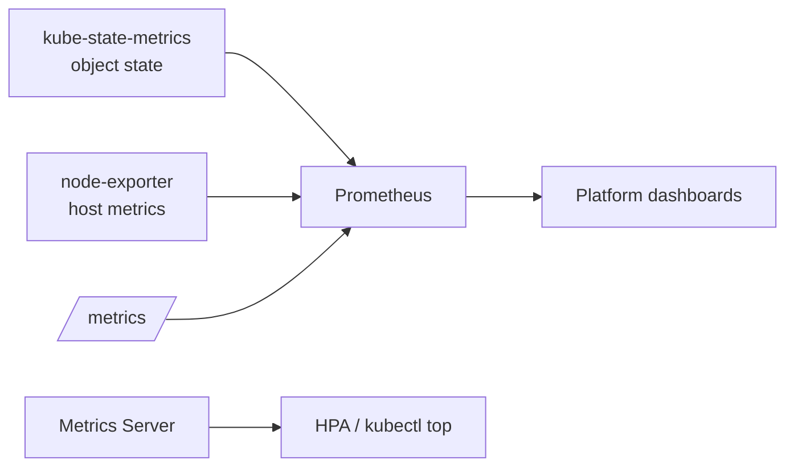

## Primary files to read
- [`docs/kubernetes-platform-observability.md`](../kubernetes-platform-observability.md)
- [`docs/vmware-observability-anatomy.md`](../vmware-observability-anatomy.md)
- [`docs/grafana-platform-dashboard.md`](../grafana-platform-dashboard.md)

## Secondary files
[`observability/aws/values-kube-state-metrics.yaml`](../../observability/aws/values-kube-state-metrics.yaml) · [`observability/aws/values-prometheus-node-exporter.yaml`](../../observability/aws/values-prometheus-node-exporter.yaml) · [`observability/dashboards/kubernetes-platform-vmware-dashboard.yaml`](../../observability/dashboards/kubernetes-platform-vmware-dashboard.yaml) · [`observability/aws/dashboards/kubernetes-platform-aws-dashboard.yaml`](../../observability/aws/dashboards/kubernetes-platform-aws-dashboard.yaml)

## Runbooks
[kube-observability-troubleshooting.md](../runbooks/kube-observability-troubleshooting.md) · [prometheus-target-down.md](../runbooks/prometheus-target-down.md) · [metrics-server-unavailable.md](../runbooks/metrics-server-unavailable.md)

## ADRs
[006](../adr/006-prometheus-grafana-observability.md)

## Evidence
The three primary documents above.

## Important Git commits
`7572cfe` feat: add kubernetes platform observability · `b30490f` fix: preserve kube-state-metrics labels · `d7fb737` fix: harden kube-state-metrics up panel query · `c269238` feat: add cross-environment platform sre dashboards · `1dba455` docs: document vmware observability anatomy

## What should I remember?
- Metrics Server is not Prometheus; KSM is not node-exporter.
- Fixing Prometheus does not fix HPA.
- DOWN control-plane targets on kubeadm are often localhost-bound, not broken.

## Interview questions
- What does kube-state-metrics give you that node-exporter doesn't?
- A dashboard is empty: where do you start?
- Why is Metrics Server not enough for dashboards?

## Current status
Historical.

---

# Stage 14 — Pod self-healing, Argo self-healing and readiness failure (VMware)

**Revisit priority:** Core · **Environment:** VMware · **Historical:** full Project 1 platform · **Current:** base kubeadm lab (Project 1 components removed)

## What was the goal?
Prove, with timings, which component heals which failure: ReplicaSet for deleted pods, Argo CD for drifted specs, readiness for unhealthy pods.

## Why did we do it?
"Kubernetes self-heals" is vague. Knowing exactly who acts, and when, is the basis of every later runbook.

## What did we build?
No new infrastructure; four controlled experiments on the 0.1.4 digest.

## What did I learn?
- Pod deletion is healed by the ReplicaSet; HPA, PDB and Argo play no part.
- Argo only heals fields that Git manages.
- Readiness removes a pod from endpoints without replacing it; liveness restarts the container.
- A 30 s scrape interval can hide short dips.

## Hands-on experiments
1. **Delete one pod.**
2. **Make the dip visible:** cordon both workers, delete a pod, keep the replacement Pending.
3. **Argo self-heal:** annotation drift (trial 1), then label drift (trial 2).
4. **Readiness failure:** pause the container from the node (`ctr tasks pause`; SIGSTOP to PID 1 inside the container had no effect).

## Important results
- Pod delete: replacement created ~0.2 s, Ready ~10.4 s; endpoints back to 2 at ~10.4 s; `/health` 200 on all ~40 polls. The old pod stayed Terminating for minutes (Calico `KillPodSandboxError … Unauthorized`) without affecting service ([vmware-pod-self-healing.md](../vmware-pod-self-healing.md)).
- Visible dip: replacement Pending ~85–90 s; KSM recorded available=1 about 30 s after the drop.
- Argo: a live-only annotation stayed Synced ~180 s (never healed). Changing Git-managed label `app.kubernetes.io/component`: OutOfSync at ~0.22 s, Synced at ~0.96 s, `autoHealAttemptsCount: 3` ([vmware-argo-self-healing.md](../vmware-argo-self-healing.md)).
- Readiness: NotReady at ~31.5 s; endpoints and available 2 → 1; no third pod; recovery ~5.9 s after unpause; restartCount 0 → 1 (liveness); a few `000` responses before the endpoint was removed.

## Key architecture
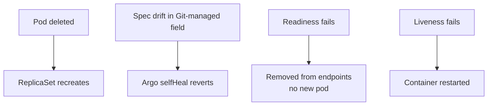

## Primary files to read
- [`docs/vmware-pod-self-healing.md`](../vmware-pod-self-healing.md)
- [`docs/vmware-argo-self-healing.md`](../vmware-argo-self-healing.md)

## Secondary files
[`docs/vmware-observability-anatomy.md`](../vmware-observability-anatomy.md) · [`kubernetes/overlays/local/deployment-reliability-patch.yaml`](../../kubernetes/overlays/local/deployment-reliability-patch.yaml)

## Runbooks
[pod-failure.md](../runbooks/pod-failure.md) · [pod-not-ready.md](../runbooks/pod-not-ready.md) · [argo-outofsync.md](../runbooks/argo-outofsync.md)

## ADRs
[003](../adr/003-gitops-with-argo-cd.md)

## Evidence
The two primary documents.

## Important Git commits
`3fb84b7` docs: document vmware pod self-healing · `7030f71` docs: document observable vmware pod failure · `1639188` docs: document vmware argo self healing · `dcfb7ae` docs: document vmware readiness failure

## What should I remember?
- Running is not Ready ("Running ≠ Ready ≠ Serving").
- ReplicaSet self-heal ≠ Argo self-heal.
- To test Argo drift, change a field Git declares.
- A pod stuck Terminating does not mean the app is down.

## Interview questions
- A pod is Running but gets no traffic: why?
- Who recreates a deleted pod? Who reverts a manual edit?
- Readiness vs liveness: what does each do on failure?
- Why might your dashboards miss a 10-second outage?

## Current status
Historical.

---

# Stage 15 — Failed rollout 0.1.5 and GitOps rollback

**Revisit priority:** Core · **Environment:** VMware (AWS overlay also received the digest; AWS stayed Ready by design) · **Historical:** full Project 1 platform · **Current:** base kubeadm lab; AWS runtime destroyed after portfolio completion

## What was the goal?
Ship a deliberately broken release through the real pipeline, watch the rollout stall safely, and roll back through Git.

## Why did we do it?
To prove that the reliability settings from Stage 9 prevent an outage, and that Git (not `kubectl rollout undo`) is the rollback mechanism in a GitOps platform.

## What did we build?
Release **0.1.5** (digest `sha256:945424e9…1b96`) whose `/health` returns 503 only when `APP_ENVIRONMENT=local-gitops`, so VMware fails readiness and AWS stays Ready.

## What did I learn?
Readiness is a release gate; `maxUnavailable: 0` keeps old pods serving; Argo can be Synced and Degraded at once; environment-gated faults are possible when one digest runs everywhere.

## Hands-on experiments
Promote 0.1.5 (`0c4fe12`, `6acbe3e`) → observe → roll back in Git (`302a506` re-pins the 0.1.4 digest in both overlays; `95820c8` reverts the app source).

## Important results
- Within ~6 s of sync: 3 replicas, 1 updated, 2 available, 1 unavailable; new ReplicaSet 0/1; old ReplicaSet 2/2; endpoints stayed 2 and served 0.1.4; Argo Synced → Progressing → Degraded.
- After the Git rollback and Argo reconcile (~6 s): 2/2, bad ReplicaSet scaled to 0, Synced/Healthy. No `kubectl rollout undo` ([vmware-rollout-failure-rollback.md](../vmware-rollout-failure-rollback.md)).

## Key architecture
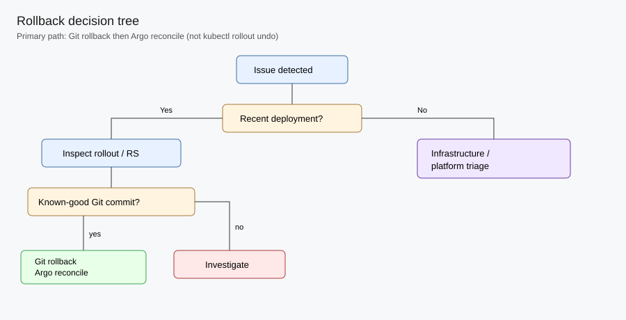

## Primary files to read
- [`docs/vmware-rollout-failure-rollback.md`](../vmware-rollout-failure-rollback.md)
- [`docs/postmortems/failed-rollout-0.1.5.md`](../postmortems/failed-rollout-0.1.5.md)
- [`docs/runbooks/git-rollback.md`](../runbooks/git-rollback.md)

## Secondary files
[`docs/diagrams/rollback-decision-tree.svg`](../diagrams/rollback-decision-tree.svg) · [`docs/runbooks/failed-rollout.md`](../runbooks/failed-rollout.md)

## Runbooks
[failed-rollout.md](../runbooks/failed-rollout.md) · [git-rollback.md](../runbooks/git-rollback.md) · [pod-not-ready.md](../runbooks/pod-not-ready.md)

## ADRs
[004](../adr/004-immutable-image-digest-promotion.md) · [003](../adr/003-gitops-with-argo-cd.md)

## Evidence
[vmware-rollout-failure-rollback.md](../vmware-rollout-failure-rollback.md) · [postmortems/failed-rollout-0.1.5.md](../postmortems/failed-rollout-0.1.5.md)

## Important Git commits
`0c4fe12` feat: release 0.1.5 with intentional VMware readiness failure · `6acbe3e` chore: promote 0.1.5 digest to local and aws GitOps · `302a506` fix: rollback overlays to known-good 0.1.4 digest · `95820c8` revert: restore healthy 0.1.4 application source · `054db3c` docs: document vmware failed rollout and gitops rollback

## What should I remember?
- A bad release that fails readiness never takes traffic if `maxUnavailable: 0`.
- Roll back by re-pinning the known-good digest in Git; `kubectl rollout undo` would be reverted by selfHeal.
- Revert the source too, or the next CI run ships the bug again.

## Interview questions
- Walk me through a failed deployment and how you recovered.
- Why not `kubectl rollout undo` in a GitOps setup?
- How can Argo show Synced and Degraded at the same time?

## Current status
Historical.

---

# Stage 16 — Worker node failure (VMware)

**Revisit priority:** Core · **Environment:** VMware · **Historical:** full Project 1 platform · **Current:** base kubeadm lab (Project 1 components removed)

## What was the goal?
Observe what really happens when a worker's kubelet stops (not a drain).

## Why did we do it?
Pod failure was understood; node failure behaves differently and exposes platform-level single points of failure.

## What did we build?
No new infrastructure. Preparation: pods rebalanced across workers; Calico restarted on worker-02 after an `Unauthorized` error.

## What did I learn?
- Node Ready can become `Unknown`, not only `False`.
- Pods are not evicted until the default 300 s `NoExecute` toleration expires.
- A PDB does not help with involuntary failure.
- External access can fail even when an app pod survives.

## Hands-on experiments
`systemctl stop kubelet` on `k8s-worker-02` (~06:33:38Z), then `systemctl start kubelet` (~06:39).

## Important results
Ready `Unknown` and endpoints 2 → 1 at ~42.7 s; `unreachable:NoSchedule` at ~42.7 s, `unreachable:NoExecute` at ~51.7 s; no replacement pod during the 5+ minute outage; external `/health` often returned `000` ([vmware-node-failure-resilience.md](../vmware-node-failure-resilience.md)). The `000` responses led straight to Stage 17.

## Key architecture
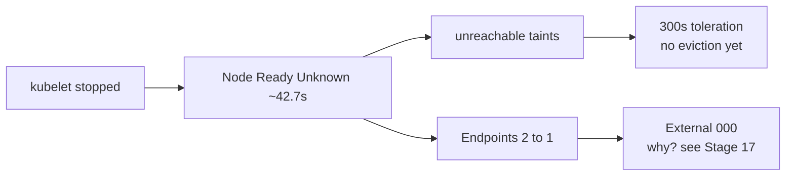

## Primary files to read
- [`docs/vmware-node-failure-resilience.md`](../vmware-node-failure-resilience.md)
- [`docs/postmortems/vmware-worker-failure.md`](../postmortems/vmware-worker-failure.md)

## Secondary files
[`docs/operations/node-maintenance.md`](../operations/node-maintenance.md) · [`docs/diagrams/platform-failure-domain.svg`](../diagrams/platform-failure-domain.svg)

## Runbooks
[worker-node-failure.md](../runbooks/worker-node-failure.md) · [node-maintenance.md](../operations/node-maintenance.md)

## ADRs
[012 — Ingress HA](../adr/012-ingress-high-availability.md) (the decision this experiment triggered)

## Evidence
[vmware-node-failure-resilience.md](../vmware-node-failure-resilience.md)

## Important Git commits
`84c3478` docs: document vmware node failure resilience

## What should I remember?
- Pod resilience is different from node resilience.
- Eviction waits ~300 s by default; plan for that gap.
- Check where platform components (ingress!) run, not only the app.

## Interview questions
- What happens, step by step, when a worker node dies?
- Why didn't Kubernetes reschedule pods immediately?
- What's the difference between a drain and a node failure?

## Current status
Historical.

---

# Stage 17 — Networking anatomy and ingress HA (VMware)

**Revisit priority:** Core · **Environment:** VMware · **Historical:** full Project 1 platform · **Current:** base kubeadm lab (Project 1 components removed)

## What was the goal?
Find out why external traffic failed during the worker outage, then remove the cause through GitOps and retest.

## Why did we do it?
The app still had a Ready pod, yet clients got `000`. Guessing would have been easy; the anatomy document proves the root cause first.

## What did we build?
- Read-only anatomy: Calico v3.30.7 (pool `10.244.0.0/16`, VXLAN CrossSubnet), kube-proxy iptables mode, MetalLB v0.16.1, ingress-nginx chart 4.15.1 / controller v1.15.1, `externalTrafficPolicy: Cluster`, NodePorts 30080/30443.
- Fix in `kubernetes/overlays/local`: ingress-nginx **2 replicas**, soft topology spread (`maxSkew 1`, `ScheduleAnyway`), PDB `minAvailable: 1`.

## What did I learn?
App HA is not external HA. With `Cluster` traffic policy, surviving ingress endpoints matter more than which node holds the VIP. GitOps ownership stops the ingress drifting back to 1 replica.

## Hands-on experiments
- Root cause: the only ingress-nginx replica ran on worker-02. Its endpoints went 1 → 0 while app endpoints went 2 → 1. MetalLB re-announced the VIP from worker-01, but there was no ingress backend ([vmware-networking-anatomy.md](../vmware-networking-anatomy.md)).
- Ruled out with evidence: `externalTrafficPolicy: Local`, empty app Service, HPA/Argo, NetworkPolicy.
- After the fix: kubelet stop on worker-02, then on worker-01.

## Important results
- Worker-02 stop: ingress endpoints 2 → 1 at ~36 s; `/health` **75 OK / 0 FAIL**. Worker-01 stop: 2 → 1 at ~38 s; **75 / 0** ([vmware-ingress-ha.md](../vmware-ingress-ha.md)).
- Sync issue: Argo CD v3.5.3 rejected `ServerSideApply` combined with `Force`; fixed by managing a full Deployment manifest without Force (`675586c`, `97cabed`).
- No zero-packet-loss claim for every failure mode.

## Key architecture
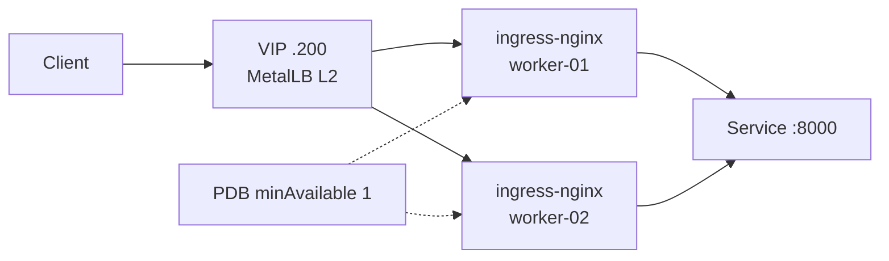

## Primary files to read
- [`docs/vmware-networking-anatomy.md`](../vmware-networking-anatomy.md)
- [`docs/vmware-ingress-ha.md`](../vmware-ingress-ha.md)
- [`docs/adr/012-ingress-high-availability.md`](../adr/012-ingress-high-availability.md)

## Secondary files
[`docs/postmortems/vmware-ingress-spof.md`](../postmortems/vmware-ingress-spof.md) · [`kubernetes/overlays/local/ingress-nginx-controller-ha.yaml`](../../kubernetes/overlays/local/ingress-nginx-controller-ha.yaml) · [`kubernetes/overlays/local/ingress-nginx-controller-pdb.yaml`](../../kubernetes/overlays/local/ingress-nginx-controller-pdb.yaml) · [`kubernetes/overlays/local/ingress-nginx-values.yaml`](../../kubernetes/overlays/local/ingress-nginx-values.yaml)

## Runbooks
[ingress-unavailable.md](../runbooks/ingress-unavailable.md) · [metallb-vip-failure.md](../runbooks/metallb-vip-failure.md) · [service-endpoint-troubleshooting.md](../runbooks/service-endpoint-troubleshooting.md)

## ADRs
[012](../adr/012-ingress-high-availability.md) · [007](../adr/007-aws-alb-vs-vmware-ingress.md)

## Evidence
[vmware-ingress-ha.md](../vmware-ingress-ha.md) · [postmortems/vmware-ingress-spof.md](../postmortems/vmware-ingress-spof.md)

## Important Git commits
`0d7c41b` docs: document vmware networking anatomy · `eb622e9` feat: make vmware ingress highly available · `675586c` fix: drop Force sync option incompatible with ServerSideApply · `97cabed` fix: manage ingress HA via full Deployment without ServerSideApply Force · `9228fef` docs: record vmware ingress-nginx HA validation

## What should I remember?
- Ingress is platform HA, not app HA.
- Prove the root cause before changing anything; rule alternatives out with evidence.
- Soft spread + PDB was enough for this 2-worker lab.

## Interview questions
- Your app had healthy pods but users got errors during a node failure. Why?
- How does MetalLB L2 fail over?
- How did you make ingress highly available, and how did you prove it?

## Current status
Historical.

---

# Stage 18 — VMware stateful storage (local-path)

**Revisit priority:** Important · **Environment:** VMware · **Historical:** full Project 1 platform (`storage-lab`) · **Current:** base kubeadm lab; `local-path` itself still runs

## What was the goal?
Walk the full storage chain StorageClass → PVC → PV → Pod with a StatefulSet and prove data survives pod deletion.

## Why did we do it?
To learn persistence on the simplest provisioner before moving to cloud block storage, and to see its limits.

## What did we build?
Argo Application `platform-storage-vmware`: StatefulSet `storage-demo` in `storage-lab` (1 replica, `nginx:1.27-alpine`), PVC `data-storage-demo-0` (1Gi, RWO) on StorageClass `local-path` (`rancher.io/local-path`, `WaitForFirstConsumer`, reclaim Delete); Grafana dashboard "Kubernetes Storage VMware".

## What did I learn?
StatefulSet ordinals give stable identity; `WaitForFirstConsumer` binds where the pod lands; local-path PVs are pinned to one node; the same PVC interface does not mean portable storage.

## Hands-on experiments
Write `/data/state.txt`, delete the pod, compare.

## Important results
Pod `storage-demo-0` back Ready in ~5 s with a new UID, same PVC/PV, identical file, still on `k8s-worker-02` because the PV requires that hostname. Node-down behaviour was **not tested** ([vmware-storage-statefulset.md](../vmware-storage-statefulset.md)).

## Key architecture
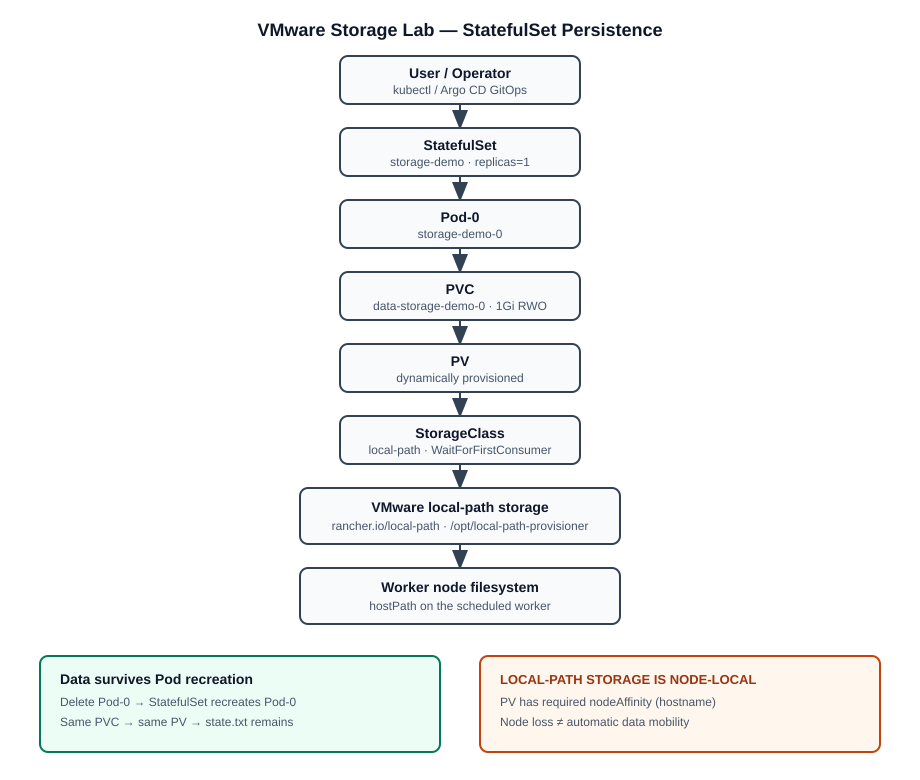

## Primary files to read
- [`docs/vmware-storage-statefulset.md`](../vmware-storage-statefulset.md)
- [`docs/adr/013-local-path-vs-ebs-storage.md`](../adr/013-local-path-vs-ebs-storage.md)

## Secondary files
[`kubernetes/storage-lab/statefulset.yaml`](../../kubernetes/storage-lab/statefulset.yaml) · [`docs/diagrams/vmware-storage-pod-recovery.svg`](../diagrams/vmware-storage-pod-recovery.svg) · [`docs/diagrams/vmware-vs-aws-storage-abstraction.svg`](../diagrams/vmware-vs-aws-storage-abstraction.svg)

## Runbooks
[pvc-pv-troubleshooting.md](../runbooks/pvc-pv-troubleshooting.md)

## ADRs
[013](../adr/013-local-path-vs-ebs-storage.md)

## Evidence
[vmware-storage-statefulset.md](../vmware-storage-statefulset.md)

## Important Git commits
`f33876d` feat: add vmware stateful storage lab · `7dc0de1` docs: document vmware stateful storage lab

## What should I remember?
- local-path = node-local; if the node dies, the data is unavailable.
- KSM shows PVC/PV object state, not file contents; prove data with `kubectl exec`.
- `storage-lab` was removed in Stage 26; the `local-path` StorageClass was kept.

## Interview questions
- Deployment vs StatefulSet for storage?
- What does `WaitForFirstConsumer` do?
- Why is local-path not suitable for production HA?

## Current status
Historical — `storage-lab` removed; `local-path` StorageClass still running on the basic lab (re-tested in Stage 26).

---

# Stage 19 — AWS EBS storage and node/AZ resilience

**Revisit priority:** Core · **Historical runtime:** AWS EKS Project 1 environment · **Current:** AWS runtime destroyed after portfolio completion (EBS volume deleted at teardown)

## What was the goal?
Run the same StatefulSet on EBS through the CSI driver, then test worker loss and the AZ boundary.

## Why did we do it?
Cloud block storage behaves differently from local disks: it can follow a pod to another node, but only within one AZ, and detach/attach takes time.

## What did we build?
- Terraform `ebs_csi` module: add-on `aws-ebs-csi-driver` v1.66.0-eksbuild.1, IAM role with `AmazonEBSCSIDriverPolicy`.
- StorageClass `ebs-gp3` (gp3, ext4, `WaitForFirstConsumer`, Delete, not default); StatefulSet `storage-demo`; PVC `data-storage-demo-0` → volume `vol-05faa26874d720ecd` in `ap-south-1b`.
- Dashboard `kubernetes-storage-aws`; KSM PVC/PV collectors enabled.
- Temporary node group `storage-resilience-test-1b` (1 × t3.medium) to have spare capacity in the same AZ.

## What did I learn?
The CSI chain (Pod → ServiceAccount → Pod Identity → IAM → EBS API), AZ topology, and that detach latency dominates node-failure recovery.

## Hands-on experiments
1. Delete the pod.
2. Terminate its worker (`aws ec2 terminate-instances`).
3. Cordon all `ap-south-1b` nodes and delete the pod (AZ test).

## Important results
- Pod delete: Ready again in ~14 s on the same node, file identical ([aws-storage-statefulset.md](../aws-storage-statefulset.md)).
- Worker terminate: node NotReady within ~1 s; replacement scheduled in 1b immediately; `FailedAttachVolume` repeated while the old attachment detached; **failure → Ready ≈ 379 s (~6.3 min)**; attach → Ready ~11–15 s; same volume, data identical ([aws-storage-resilience.md](../aws-storage-resilience.md)).
- AZ test: pod Pending with "0/3 nodes are available: 1 Too many pods, 2 node(s) were unschedulable". The expected "volume node affinity conflict" did not appear because the other-AZ node was full, so the AZ constraint was only partly demonstrated.
- Fix: Grafana PV panel query corrected (`be8e68b`).

## Key architecture
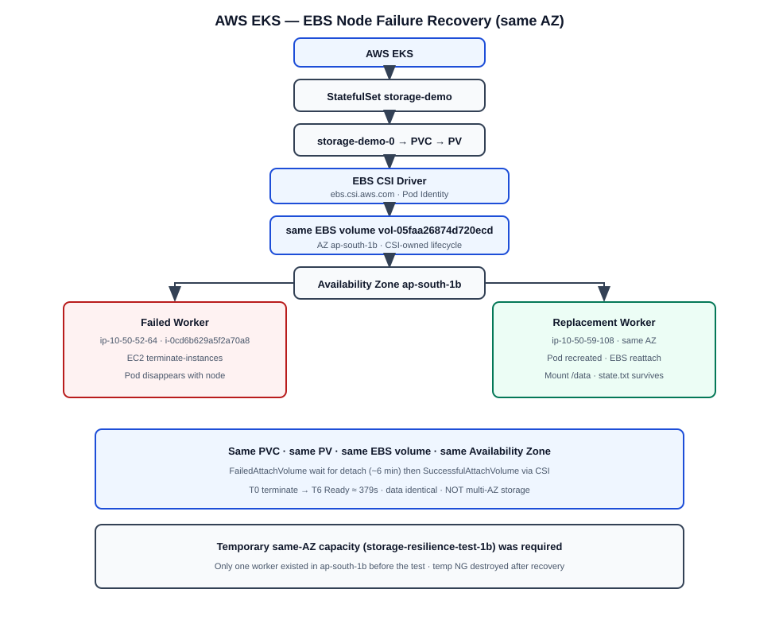

## Primary files to read
- [`docs/aws-storage-statefulset.md`](../aws-storage-statefulset.md)
- [`docs/aws-storage-resilience.md`](../aws-storage-resilience.md)
- [`docs/adr/008-ebs-csi-for-aws-persistent-storage.md`](../adr/008-ebs-csi-for-aws-persistent-storage.md)

## Secondary files
[`kubernetes/storage-lab-aws/`](../../kubernetes/storage-lab-aws/) · [`terraform/aws/modules/ebs_csi/main.tf`](../../terraform/aws/modules/ebs_csi/main.tf) · [`docs/diagrams/aws-ebs-az-constraint.svg`](../diagrams/aws-ebs-az-constraint.svg) · [`docs/diagrams/storage-resilience-vmware-vs-aws.svg`](../diagrams/storage-resilience-vmware-vs-aws.svg)

## Runbooks
[ebs-attach-troubleshooting.md](../runbooks/ebs-attach-troubleshooting.md) · [pvc-pv-troubleshooting.md](../runbooks/pvc-pv-troubleshooting.md) · [ebs-storage-recovery.md](../runbooks/ebs-storage-recovery.md)

## ADRs
[008](../adr/008-ebs-csi-for-aws-persistent-storage.md) · [013](../adr/013-local-path-vs-ebs-storage.md)

## Evidence
[aws-storage-statefulset.md](../aws-storage-statefulset.md) · [aws-storage-resilience.md](../aws-storage-resilience.md)

## Important Git commits
`bd5e6dc` feat: add aws ebs storage lab · `584f290` docs: record aws ebs storage lab results · `be8e68b` fix: correct aws storage grafana pv panel query · `c8d45ca` feat: validate aws ebs node failure resilience

## What should I remember?
- EBS is AZ-scoped.
- Spare same-AZ capacity is a prerequisite for fast storage recovery.
- ~6.3 min was mostly detach wait; this is AZ-local resilience, not multi-AZ.
- Persistent storage is not a backup (Stage 23).

## Interview questions
- How does an EBS-backed pod recover when its node dies? What takes the time?
- Why can't the pod move to another AZ?
- What does the EBS CSI driver need from IAM?

## Current status
Historical — runtime and volume destroyed.

---

# Stage 20 — Kubernetes security and RBAC (Section 22)

**Revisit priority:** Core · **Environment:** VMware + AWS · **VMware:** historical full Project 1 platform; current base kubeadm lab · **Historical runtime:** AWS EKS Project 1 environment · **Current:** AWS runtime destroyed after portfolio completion

## What was the goal?
Show least-privilege identities, RBAC scoping, Pod Security Admission, token mounting and NetworkPolicy with observed results on both clusters.

## Why did we do it?
Default ServiceAccounts, broad roles and unrestricted pod traffic are common real-world gaps. The same manifests on two clusters also exposed a CNI difference.

## What did we build?
- Namespace `security-lab` via `platform-security-vmware` / `platform-security-aws`.
- ServiceAccounts `security-reader`, `security-writer`, `security-node-reader`, `security-global-reader`.
- Roles `security-pod-reader`, `security-pod-manager` (create/delete, no update/patch); ClusterRoles `security-node-reader`, `security-pod-viewer` (bound by a RoleBinding), `security-global-pod-reader-role` (bound by a ClusterRoleBinding).
- PSA labels: enforce `baseline`, audit/warn `restricted` (v1.31 VMware, v1.36 AWS).
- NetworkPolicies `default-deny-ingress` + `allow-net-client-to-server` (port 8080).
- `platform-lab` got a dedicated ServiceAccount with `automountServiceAccountToken: false`.

## What did I learn?
A Role is not a binding; a RoleBinding decides namespace scope even for a ClusterRole; token automount is separate from identity; NetworkPolicy enforcement depends on the CNI.

## Hands-on experiments
`kubectl auth can-i` matrix per ServiceAccount; RoleBinding-to-ClusterRole scope test; token-mount check; root-user pod under PSA; allowed vs denied client under NetworkPolicy.

## Important results
- `can-i` matrix identical on both clusters. Reader: pods get/list/watch yes; create/delete no; secrets no. Writer: create/delete yes; update/patch no. Node-reader: nodes yes, pods no. Global-reader: pods in both namespaces yes; secrets/nodes no.
- `security-pod-viewer` via RoleBinding only worked inside `security-lab`.
- Token path present on `security-reader-demo`, absent on `security-no-api`.
- Root-user pod **admitted** under baseline with restricted **warnings** (no enforced rejection was recorded).
- NetworkPolicy: VMware (Calico) denied client timed out; AWS denied client still got `OK` (not enforced by the VPC CNI setup) ([security-rbac.md](../security-rbac.md)).
- Fixes: net-server command YAML (`1856f0f`); AppProjects had to allow the ServiceAccount kind (`c42fc0b`).

## Key architecture
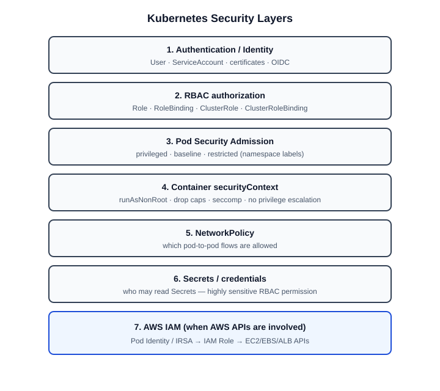

## Primary files to read
- [`docs/security-rbac.md`](../security-rbac.md)
- [`docs/adr/009-rbac-least-privilege.md`](../adr/009-rbac-least-privilege.md)
- [`docs/architecture/final-security-review.md`](../architecture/final-security-review.md)

## Secondary files
[`kubernetes/security-lab-vmware/`](../../kubernetes/security-lab-vmware/) · [`kubernetes/security-lab-aws/`](../../kubernetes/security-lab-aws/) · [`docs/diagrams/kubernetes-rbac-model.svg`](../diagrams/kubernetes-rbac-model.svg) · [`docs/diagrams/serviceaccount-security.svg`](../diagrams/serviceaccount-security.svg) · [`docs/diagrams/aws-iam-vs-kubernetes-rbac.svg`](../diagrams/aws-iam-vs-kubernetes-rbac.svg) · [`docs/diagrams/project1-security-architecture.svg`](../diagrams/project1-security-architecture.svg)

## Runbooks
[rbac-access-denied.md](../runbooks/rbac-access-denied.md) · [serviceaccount-troubleshooting.md](../runbooks/serviceaccount-troubleshooting.md) · [pod-security-admission.md](../runbooks/pod-security-admission.md) · [networkpolicy-troubleshooting.md](../runbooks/networkpolicy-troubleshooting.md) · [security-incident.md](../runbooks/security-incident.md)

## ADRs
[009](../adr/009-rbac-least-privilege.md)

## Evidence
[security-rbac.md](../security-rbac.md)

## Important Git commits
`85d76a6` feat: add kubernetes security and rbac hardening · `1856f0f` fix: repair security-lab net-server command yaml · `c42fc0b` fix: allow ServiceAccount in platform-lab AppProjects · `2525408` docs: document kubernetes security and rbac hardening

## What should I remember?
- Role is not a binding; RoleBinding determines namespace scope.
- Diagnose with `can-i` before granting; never bind cluster-admin to debug.
- NetworkPolicy objects existing ≠ NetworkPolicy enforced.
- IAM controls AWS APIs; RBAC controls kube-apiserver verbs.

## Interview questions
- RoleBinding vs ClusterRoleBinding with a ClusterRole: what scope?
- How would you debug a Forbidden error?
- Your NetworkPolicy has no effect: what do you check?
- PSA baseline vs restricted?

## Current status
Implemented and partially verified (AWS NetworkPolicy enforcement not observed; readOnlyRootFilesystem not implemented) — not currently running.

---

# Stage 21 — Advanced Argo CD patterns (Section 23)

**Revisit priority:** Important · **Environment:** VMware · **Historical:** full Project 1 platform · **Current:** base kubeadm lab (Project 1 components removed)

## What was the goal?
Learn the Argo CD features used at scale (AppProjects, ApplicationSets, App-of-Apps, sync phases, waves, hooks, sync windows) in an isolated project without touching the real apps.

## Why did we do it?
One Application per app does not scale. Generating and composing Applications safely requires understanding generators, boundaries and sync ordering.

## What did we build?
- AppProject `platform-advanced-lab`.
- Applications `platform-argo-advanced-lab`, `platform-app-of-apps`, `platform-app-of-applicationsets`, `argo-syncfail-demo`, `argo-waves-health-demo`.
- ApplicationSets `platform-advanced-set` (List), `platform-advanced-git-set` (Git, temporary), `platform-advanced-env-set`, `platform-advanced-cluster-set` (Cluster), `platform-nested-list-set`.
- Hooks `argo-pre-sync-check` (PreSync), `argo-post-sync-check` (PostSync), SyncFail demo; waves; sync-window notes.

## What did I learn?
Phase vs wave; ApplicationSet generates Applications; App-of-Apps composes Applications; App-of-Apps is not a security boundary (AppProject is); separate Argo instances limit cluster generators.

## Hands-on experiments
Wrong destination, ordered sync, SyncFail, sync window deny, delete a generated app, cluster and Git generators, idempotent re-sync.

## Important results
- Wrong destination → `InvalidSpecError: destination does not match allowed destinations`.
- Sync order: Namespace → PreSync Job → ConfigMap → Service → Deployment → PostSync Job.
- SyncFail: PreSync Job failed, SyncFail Job ran, operation Failed.
- Sync window: "Sync operation blocked by sync window".
- A manually deleted generated Application was regenerated.
- **ComparisonError:** `waves-health` was Unknown because Kustomize could not resolve `../base/namespace.yaml`; fixed with self-contained kustomizations (`b2554fc`) ([postmortems/argo-comparison-error.md](../postmortems/argo-comparison-error.md)).
- Source: [argo-advanced-patterns.md](../argo-advanced-patterns.md) §35.

## Key architecture
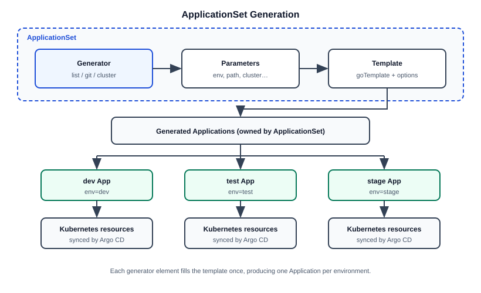

## Primary files to read
- [`docs/argo-advanced-patterns.md`](../argo-advanced-patterns.md)
- [`docs/architecture/argo-gitops-reference.md`](../architecture/argo-gitops-reference.md)
- [`docs/argo-cd-interview-notes.md`](../argo-cd-interview-notes.md)

## Secondary files
[`gitops/appsets/`](../../gitops/appsets/) · [`gitops/applications/platform-app-of-apps.yaml`](../../gitops/applications/platform-app-of-apps.yaml) · [`kubernetes/argo-advanced-lab/`](../../kubernetes/argo-advanced-lab/) · [`docs/diagrams/argo-sync-lifecycle.svg`](../diagrams/argo-sync-lifecycle.svg) · [`docs/diagrams/argo-app-of-apps.svg`](../diagrams/argo-app-of-apps.svg) · [`docs/diagrams/argo-project-security.svg`](../diagrams/argo-project-security.svg)

## Runbooks
[argo-sync-failure.md](../runbooks/argo-sync-failure.md) · [argocd-applicationset-troubleshooting.md](../runbooks/argocd-applicationset-troubleshooting.md) · [argocd-appproject-denied.md](../runbooks/argocd-appproject-denied.md) · [argo-outofsync.md](../runbooks/argo-outofsync.md)

## ADRs
[003](../adr/003-gitops-with-argo-cd.md) · [005](../adr/005-kustomize-for-environment-overlays.md)

## Evidence
[argo-advanced-patterns.md](../argo-advanced-patterns.md) · [postmortems/argo-comparison-error.md](../postmortems/argo-comparison-error.md)

## Important Git commits
`6d57e42` feat: add advanced argo cd gitops patterns · `7a1369a` feat: add syncfail and health-wave demo applications · `b2554fc` fix: make argo advanced lab kustomizations self-contained · `ee15dba` docs: record advanced argo experiment results and fix cluster-set namespace

## What should I remember?
- ApplicationSet generates Applications; App-of-Apps composes Applications.
- AppProject is the boundary (repos, destinations, kinds).
- A source-generation error shows as ComparisonError/Unknown, not as a sync failure.
- Prefer List generators for stable names.

## Interview questions
- ApplicationSet vs App-of-Apps?
- Sync phase vs sync wave?
- What does an AppProject restrict?
- What does ComparisonError mean and how do you debug it?

## Current status
Historical.

---

# Stage 22 — Python and Ansible automation (Section 24)

**Revisit priority:** Core · **Environment:** workstation + VMware `automation-lab` namespace · **Historical:** full Project 1 platform · **Current:** base kubeadm lab (`automation-lab` removed); AWS runtime destroyed after portfolio completion; source still runnable

## What was the goal?
Build a guarded automation layer: a Python CLI for API-driven checks and reports, and Ansible for host/service configuration, with clear boundaries against Terraform and Argo CD.

## Why did we do it?
Operations need repeatable tooling, but automation that mutates clusters directly would fight GitOps. The boundaries had to be explicit.

## What did we build?
- `automation/python`: CLI `platform-automate` (doctor, inventory, validate, plan, reconcile, verify, report; read-only `ops health|triage|report|evidence`). Pins: `kubernetes==32.0.1`, `boto3==1.40.18`, `ansible-runner==2.4.1`.
- Guard rails: `--dry-run`, `--confirm`, `--timeout`, `--max-retries`, `--context`; no `--force-all`; only `automation-lab` may be mutated; Terraform plan-only (refuses `-auto-approve`); never `shell=True`; exit codes (5 partial failure, 124 timeout).
- `automation/ansible`: playbooks `01_basics` … `15_platform_baseline`, roles `platform_common`, `platform_service`, `platform_node`, `aws_ec2` inventory, Vault example with fake secrets.
- `kubernetes/automation-lab` + Argo Application; `jenkins/Jenkinsfile.automation-lab`.

## What did I learn?
Idempotency, dry-run/confirm patterns, structured reports, exit codes, Boto3 vs Terraform, Ansible variable precedence, FQCN, and when not to automate.

## Hands-on experiments
CLI `doctor` / `verify` / `ops` commands; Ansible idempotency (`06_idempotency` expects `changed=0` on the second run).

## Important results
- Python CLI: implemented and verified (README capability matrix).
- Boto3: partial (code and docs; live Windows workstation path limited).
- Ansible: partial (Linux/Jenkins path; Windows CLI blocked because `ansible-runner` cannot import `fcntl`; the package falls back to subprocess).

## Key architecture
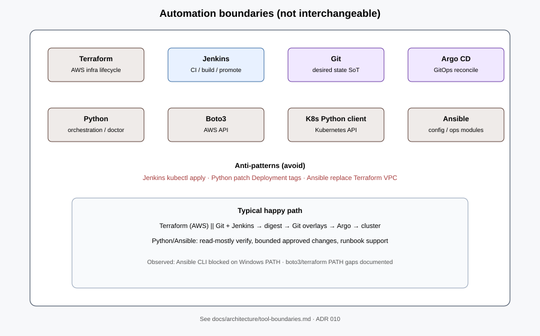

## Primary files to read
- [`docs/automation/platform-automation-master-guide.md`](../automation/platform-automation-master-guide.md)
- [`automation/python/README.md`](../../automation/python/README.md)
- [`automation/ansible/README.md`](../../automation/ansible/README.md)

## Secondary files
[`docs/automation/python-platform-automation.md`](../automation/python-platform-automation.md) · [`docs/automation/ansible-platform-automation.md`](../automation/ansible-platform-automation.md) · [`docs/automation/automation-architecture.md`](../automation/automation-architecture.md) · [`docs/python-automation-fundamentals.md`](../python-automation-fundamentals.md) · [`docs/ansible-variable-precedence.md`](../ansible-variable-precedence.md) · [`docs/toolchain-inventory.md`](../toolchain-inventory.md) · [`docs/automation/automation-command-reference.md`](../automation/automation-command-reference.md) · [`docs/automation/vmware-nsx-automation-bridge.md`](../automation/vmware-nsx-automation-bridge.md)

## Runbooks
[python-automation.md](../runbooks/python-automation.md) · [python-automation-failure.md](../runbooks/python-automation-failure.md) · [ansible-failure.md](../runbooks/ansible-failure.md) · [automation-failure.md](../runbooks/automation-failure.md) · [aws-api-failure.md](../runbooks/aws-api-failure.md) · [kubernetes-api-failure.md](../runbooks/kubernetes-api-failure.md)

## ADRs
[010 — Python / Ansible / Terraform / Argo boundaries](../adr/010-python-and-ansible-automation-boundary.md)

## Evidence
[README.md](../../README.md) capability matrix · [automation/python/README.md](../../automation/python/README.md)

## Important Git commits
`5593a26` feat: add platform automation framework · `0436b0c` docs: fix automation diagram encoding

## What should I remember?
- Terraform manages infrastructure lifecycle; Python handles custom automation logic; Ansible handles operational/configuration orchestration; Argo owns Kubernetes desired state.
- Don't build a second reconciler that fights Argo.
- Ansible `changed` is not the same as verified.
- Read-only by default; mutation needs `--confirm`.

## Interview questions
- When do you use Python vs Ansible vs Terraform?
- How do you make automation safe to run in production?
- What does idempotency mean in Ansible, and how did you test it?
- Why not use Boto3 to create infrastructure Terraform already manages?

## Current status
Implemented and partially verified (Boto3 live path and Windows Ansible limited).

---

# Stage 23 — Disaster recovery (Section 25)

**Revisit priority:** Core · **Environment:** VMware (Git/Argo/namespace drills) + AWS (EBS snapshot drill) · **VMware:** historical full Project 1 platform; current base kubeadm lab · **Historical runtime:** AWS EKS Project 1 environment · **Current:** AWS runtime destroyed after portfolio completion

## What was the goal?
Define HA vs backup vs restore vs DR vs rebuild, and measure the recovery paths that could be safely tested.

## Why did we do it?
Having a backup proves nothing until a restore is measured. The project needed honest RTO/RPO numbers and a clear list of what was *not* tested.

## What did we build?
- Terraform `snapshot_controller` module (v8.6.0-eksbuild.8); VolumeSnapshotClass `ebs-csi-snapclass`.
- `kubernetes/dr-lab` (Argo app `platform-dr-recovery`) and `kubernetes/dr-storage-restore` (VolumeSnapshot, static VolumeSnapshotContent, restore PVC).
- DR master guide, fundamentals, business continuity, scenario matrix (18 scenarios), Terraform DR, AWS Backup assessment, runbooks.

## What did I learn?
RPO/RTO in practice; what Git restores (declarative objects) and what it does not (runtime and external data); snapshot restores return to the snapshot point; restore rules are namespace-scoped.

## Hands-on experiments
EBS snapshot + restore; Git bad-config drill (`57df7df` bad → `e5b79b7` restore); Argo Application delete; namespace delete; selfHeal after live drift. (An earlier attempt `9eacd1d` was reverted in `f2f769f` before the measured drill.)

## Important results
- Snapshot ReadyToUse **~72 s**; restore PVC → Running **~15 s**; restored volume had POINT-A but not POINT-B (RPO window ≈ **74 s**).
- Argo Application delete: workload stayed up; App recovery ≈ **6–14 s**.
- Namespace delete: RTO ≈ **23 s**.
- selfHeal after live drift ≈ **6 s**.
- First restore failed: a PVC `dataSource` VolumeSnapshot must be in the same namespace; fixed with a static VolumeSnapshotContent in `dr-storage-restore` ([postmortems/cross-namespace-snapshot-restore.md](../postmortems/cross-namespace-snapshot-restore.md)).
- Capacity: nodes hit 17/17 pods; node group temporarily scaled to 3.
- Not executed: AWS Backup for EKS restore, full EKS rebuild, cross-region, full AZ loss ([dr-lab-evidence.md](../dr-lab-evidence.md)).

## Key architecture
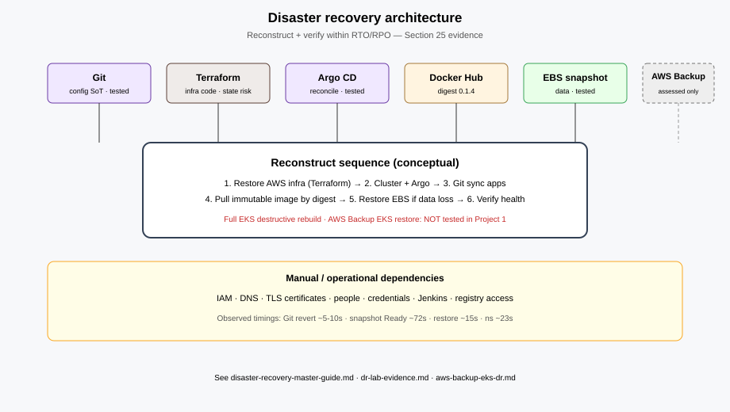

## Primary files to read
- [`docs/disaster-recovery-master-guide.md`](../disaster-recovery-master-guide.md)
- [`docs/dr-lab-evidence.md`](../dr-lab-evidence.md)
- [`docs/disaster-scenario-matrix.md`](../disaster-scenario-matrix.md)

## Secondary files
[`docs/disaster-recovery-fundamentals.md`](../disaster-recovery-fundamentals.md) · [`docs/business-continuity.md`](../business-continuity.md) · [`docs/terraform-dr.md`](../terraform-dr.md) · [`docs/terraform-recovery-runbook.md`](../terraform-recovery-runbook.md) · [`docs/aws-backup-eks-dr.md`](../aws-backup-eks-dr.md) · [`docs/dr-baseline-inventory.md`](../dr-baseline-inventory.md) · [`docs/operations/rpo-rto-operational-guide.md`](../operations/rpo-rto-operational-guide.md) · [`kubernetes/dr-storage-restore/`](../../kubernetes/dr-storage-restore/)

## Runbooks
[disaster-recovery-index.md](../runbooks/disaster-recovery-index.md) · [ebs-snapshot-restore.md](../runbooks/ebs-snapshot-restore.md) · [ebs-storage-recovery.md](../runbooks/ebs-storage-recovery.md) · [git-argo-recovery.md](../runbooks/git-argo-recovery.md) · [aws-eks-disaster-recovery.md](../runbooks/aws-eks-disaster-recovery.md) · [terraform-infrastructure-recovery.md](../runbooks/terraform-infrastructure-recovery.md)

## ADRs
[011 — Disaster recovery model](../adr/011-disaster-recovery-model.md)

## Evidence
[dr-lab-evidence.md](../dr-lab-evidence.md)

## Important Git commits
`2a013bd` feat: add disaster recovery and restore lab · `57df7df` / `e5b79b7` measured Git drill · `e4d61be` docs: record DR lab evidence and fix storage AppProject whitelist · `87b3034` docs: align DR tested status with measured lab evidence

## What should I remember?
- Persistent storage is not a backup; a backup is not DR.
- Git gives config RPO ≈ 0 for what is in Git, nothing more.
- Most tested evidence is HA/self-healing, not full DR (scenario matrix summary).
- `terraform destroy` is not DR.

## Interview questions
- HA vs backup vs DR?
- How did you measure RTO and RPO?
- What does a namespace recovery from Git not bring back?
- What DR would you add for production?

## Current status
Implemented and partially verified (scoped drills; no full rebuild or AWS Backup restore).

---

# Stage 24 — Operations handbook, runbooks and postmortems (Section 26)

**Revisit priority:** Important · **Environment:** documentation (based on observed lab evidence)

## What was the goal?
Turn everything observed into an operator's handbook: triage, runbooks, checklists, incident process and postmortems.

## Why did we do it?
Knowledge in experiment write-ups is not usable during an incident. Runbooks give read-only first steps and safe remediation paths.

## What did we build?
- [Platform operations handbook](../operations/platform-operations-handbook.md) (34 sections) and [operations index](../operations/README.md).
- About 40 runbooks from one template (READ-ONLY / SAFE MUTATION / DESTRUCTIVE labels).
- Checklists (daily health, pre-change, post-change, operator shift); incident severity, escalation, evidence, timeline.
- Six postmortems + template; triage framework (7 steps); troubleshooting matrix; observed-vs-untested; production gaps; RPO/RTO operator guide.
- Diagrams: failure domain, rollback decision tree, operations lifecycle, runbook map, operating model.

## What did I learn?
Evidence before mutation; stabilise first; label Observed vs Design guidance; blameless postmortems.

## Hands-on experiments
None new; the handbook cites earlier experiments.

## Important results
A navigable operations layer with coverage honesty ([observed-vs-untested.md](../operations/observed-vs-untested.md)).

## Key architecture
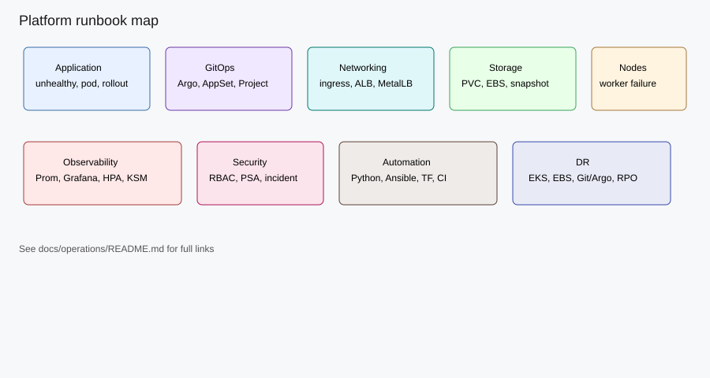

## Primary files to read
- [`docs/operations/platform-operations-handbook.md`](../operations/platform-operations-handbook.md)
- [`docs/operations/README.md`](../operations/README.md)
- [`docs/troubleshooting/triage-framework.md`](../troubleshooting/triage-framework.md)

## Secondary files
[`docs/operations/observed-vs-untested.md`](../operations/observed-vs-untested.md) · [`docs/operations/production-gaps.md`](../operations/production-gaps.md) · [`docs/troubleshooting/troubleshooting-matrix.md`](../troubleshooting/troubleshooting-matrix.md) · [`docs/runbooks/runbook-template.md`](../runbooks/runbook-template.md) · [`docs/checklists/daily-platform-health.md`](../checklists/daily-platform-health.md) · [`docs/operations/operations-interview-notes.md`](../operations/operations-interview-notes.md)

## Runbooks
All of [`docs/runbooks/`](../runbooks/); map in [operations/README.md](../operations/README.md).

## ADRs
— (operations follows from ADRs 003, 004, 011)

## Evidence
[postmortems/](../postmortems/) · [observed-vs-untested.md](../operations/observed-vs-untested.md)

## Important Git commits
`8e09fd7` feat: add platform operations handbook and runbooks

## What should I remember?
- Runbooks begin with read-only evidence ("evidence before mutation").
- Severity and escalation rules decide when to stop experimenting.
- Never hide Degraded; record it.

## Interview questions
- What do you do in the first 60 seconds of an incident?
- What does a good runbook contain?
- How do you run a blameless postmortem?

## Current status
Documented.

---

# Stage 25 — Portfolio packaging and ADRs (Section 27)

**Revisit priority:** Reference · **Environment:** documentation

## What was the goal?
Package the project for reviewers: numbered ADRs, reference architecture, portfolio pages, evidence index and an interview guide.

## Why did we do it?
Decisions and limits must be explainable without the author present.

## What did we build?
13 ADRs; reference architecture + 6 portfolio SVGs; tool/ownership boundaries; cost awareness; final security review; version inventory; portfolio pages (summary, narrative, walkthrough, failure stories, technology matrix, known limitations, roadmap, status, commit map, demo script, screenshot plan, LinkedIn cards); evidence index; interview master guide; timeline; README rewrite.

## What did I learn?
How to write decision records and label claims honestly (Implemented + Verified / Partial / Documented / Not tested).

## Hands-on experiments
None.

## Important results
The portfolio set listed in [portfolio/README.md](./README.md).

## Key architecture
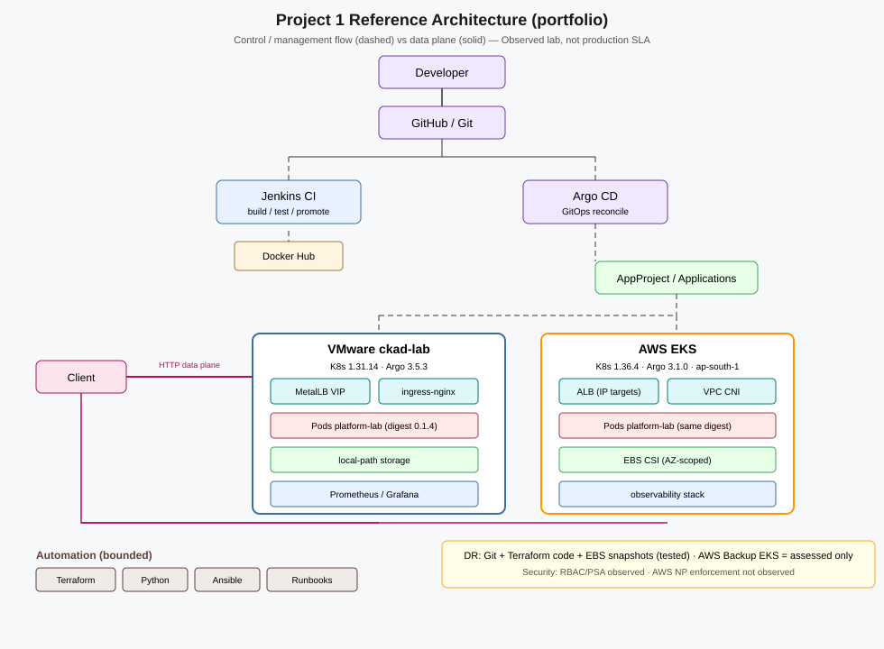

## Primary files to read
- [`docs/architecture/project1-reference-architecture.md`](../architecture/project1-reference-architecture.md)
- [`docs/adr/README.md`](../adr/README.md)
- [`docs/portfolio/README.md`](./README.md)

## Secondary files
[`docs/portfolio/known-limitations.md`](./known-limitations.md) · [`docs/architecture/tool-boundaries.md`](../architecture/tool-boundaries.md) · [`docs/architecture/ownership-boundaries.md`](../architecture/ownership-boundaries.md) · [`docs/project1-interview-master-guide.md`](../project1-interview-master-guide.md) · [`docs/portfolio/failure-engineering-stories.md`](./failure-engineering-stories.md) · [`docs/evidence/README.md`](../evidence/README.md)

## Runbooks
—

## ADRs
All 13: [adr/README.md](../adr/README.md)

## Evidence
[evidence/README.md](../evidence/README.md)

## Important Git commits
`7c8e84d` feat: finalize platform engineering portfolio

## What should I remember?
- Observed ≠ Designed; limitations are listed, not hidden.
- The AWS observability Degraded state at freeze is a recorded limitation.

## Interview questions
- Which decision would you revisit first, and why?
- What are the project's known limitations?

## Current status
Documented.

---

# Stage 26 — Environment retirement: AWS teardown and VMware cleanup

**Revisit priority:** Reference · **Environment:** AWS + VMware · **Historical runtime:** AWS EKS Project 1 environment · **Current:** AWS runtime destroyed after portfolio completion · **VMware:** historical full Project 1 platform; current base kubeadm lab

## What was the goal?
Stop AWS cost by destroying the Project 1 runtime, and return VMware to a clean, reusable basic lab, without touching Git sources.

## Why did we do it?
The portfolio was complete. Running infrastructure costs money and drifts; the source is enough to rebuild.

## What did we build?
Two operational records: [aws-lab-teardown.md](../operations/aws-lab-teardown.md) and [vmware-lab-cleanup.md](../operations/vmware-lab-cleanup.md).

## What did I learn?
Destroy order matters (ALB/Ingress and finalizers before VPC); dependency violations need targeted manual cleanup; "clean the runtime, keep the source".

## Hands-on experiments
- **AWS:** `terraform destroy` plan of 52 resources. The pre-destroy ALB wait timed out with 1 ALB left, so stuck Argo/Ingress finalizers were cleared. The first apply hit `DependencyViolation`; the orphaned ALB, target group and security groups were deleted by hand; a second apply removed the remaining 4 resources.
- **VMware:** removed Argo CD (apps, projects, AppSets, CRDs), kube-prometheus-stack, ingress-nginx, MetalLB, Project 1 namespaces, ClusterRoles and CRDs; then tested nginx + Service + DNS, pod-to-Service HTTP and local-path persistence.

## Important results
- AWS: Terraform state empty; self-owned EBS snapshots 0; account, `kiran-admin`, default VPC and unrelated `lab-web-tg` preserved.
- VMware: 3 nodes Ready; all post-cleanup tests passed; no `kubeadm reset`.

## Key architecture
See Section 4.1 and [project1-environment-map.md](./project1-environment-map.md).

## Primary files to read
- [`docs/operations/aws-lab-teardown.md`](../operations/aws-lab-teardown.md)
- [`docs/operations/vmware-lab-cleanup.md`](../operations/vmware-lab-cleanup.md)
- [`docs/portfolio/project1-environment-map.md`](./project1-environment-map.md)

## Secondary files
[`terraform/aws/scripts/pre-destroy-cleanup.sh`](../../terraform/aws/scripts/pre-destroy-cleanup.sh) · [`docs/architecture/cost-awareness.md`](../architecture/cost-awareness.md)

## Runbooks
[terraform-apply-safety.md](../runbooks/terraform-apply-safety.md) · [terraform-infrastructure-recovery.md](../runbooks/terraform-infrastructure-recovery.md)

## ADRs
[001](../adr/001-terraform-for-aws-infrastructure.md) · [011](../adr/011-disaster-recovery-model.md) (rebuild-from-code concept)

## Evidence
The two operations records.

## Important Git commits
`d45c969` docs: record aws lab teardown · `012124b` docs: record vmware lab cleanup

## What should I remember?
- AWS: rebuildable from source; rebuild not repeated after teardown.
- VMware: basic lab now; the Project 1 runtime is gone but its manifests remain.
- Load balancers created by controllers (ALB) can block VPC deletion; clean them first.

## Interview questions
- How do you tear down an EKS environment safely?
- What blocked your `terraform destroy`, and how did you fix it?
- How do you prove an environment is rebuildable?

## Current status
Implemented and verified.

---

## 6. Primary Reading Path

### 6.1 Recommended Reading Order

One file per column, read left to right. Do not open anything else until the row is done.

| # | Stage | START HERE | THEN (architecture / design) | THEN (experiment / evidence) | THEN (runbook) |
|---|---|---|---|---|---|
| 1 | Foundation | [architecture-overview.md](../architecture/architecture-overview.md) | [design/environment-strategy.md](../design/environment-strategy.md) | [platform-version-inventory.md](../architecture/platform-version-inventory.md) | [kubernetes-api-failure](../runbooks/kubernetes-api-failure.md) |
| 2 | FastAPI + Docker | [app/README.md](../../app/README.md) | [app/Dockerfile](../../app/Dockerfile) | [ci-cd-flow.md](../architecture/ci-cd-flow.md) (run tables) | [docker-release-failure](../runbooks/docker-release-failure.md) |
| 3 | Kustomize | [adr/005](../adr/005-kustomize-for-environment-overlays.md) | [kubernetes/base/kustomization.yaml](../../kubernetes/base/kustomization.yaml) | [kubernetes/overlays/local/kustomization.yaml](../../kubernetes/overlays/local/kustomization.yaml) | [application-unhealthy](../runbooks/application-unhealthy.md) |
| 4 | Jenkins CI | [jenkins/README.md](../../jenkins/README.md) | [ci-cd-flow.md](../architecture/ci-cd-flow.md) | [jenkins/Jenkinsfile](../../jenkins/Jenkinsfile) | [jenkins-build-failure](../runbooks/jenkins-build-failure.md) |
| 5 | Argo CD | [gitops/README.md](../../gitops/README.md) | [adr/003](../adr/003-gitops-with-argo-cd.md) | [vmware-argo-self-healing.md](../vmware-argo-self-healing.md) | [argo-outofsync](../runbooks/argo-outofsync.md) |
| 6 | Promotion | [ci-cd-flow.md](../architecture/ci-cd-flow.md) | [gitops-flow.md](../architecture/gitops-flow.md) (early model, see Appendix A) | [portfolio/commit-map.md](./commit-map.md) | [gitops-change](../runbooks/gitops-change.md) |
| 7 | Ingress + MetalLB | [networking.md](../architecture/networking.md) | [adr/007](../adr/007-aws-alb-vs-vmware-ingress.md) | [vmware-networking-anatomy.md](../vmware-networking-anatomy.md) | [metallb-vip-failure](../runbooks/metallb-vip-failure.md) |
| 8 | Prometheus / Grafana | [observability.md](../architecture/observability.md) | [adr/006](../adr/006-prometheus-grafana-observability.md) | [postmortems/grafana-oom.md](../postmortems/grafana-oom.md) | [prometheus-target-down](../runbooks/prometheus-target-down.md) |
| 9 | Reliability | [reliability.md](../architecture/reliability.md) | [kubernetes/overlays/local/hpa.yaml](../../kubernetes/overlays/local/hpa.yaml) | [reliability.md](../architecture/reliability.md) (validation section) | [hpa-not-scaling](../runbooks/hpa-not-scaling.md) |
| 10 | Terraform EKS | [terraform/aws/README.md](../../terraform/aws/README.md) | [adr/001](../adr/001-terraform-for-aws-infrastructure.md) | [aws-eks-platform-architecture.html](../aws-eks-platform-architecture.html) (pre-apply snapshot) | [terraform-apply-safety](../runbooks/terraform-apply-safety.md) |
| 11 | Digests | [adr/004](../adr/004-immutable-image-digest-promotion.md) | [ci-cd-flow.md](../architecture/ci-cd-flow.md) | [kubernetes/overlays/aws/kustomization.yaml](../../kubernetes/overlays/aws/kustomization.yaml) | [git-rollback](../runbooks/git-rollback.md) |
| 12 | AWS capacity + HPA | [aws-observability-capacity-analysis.md](../aws-observability-capacity-analysis.md) | [aws-lightweight-observability.md](../aws-lightweight-observability.md) | [aws-hpa-observability-load-test.md](../aws-hpa-observability-load-test.md) | [hpa-not-scaling](../runbooks/hpa-not-scaling.md) |
| 13 | KSM / node-exporter | [kubernetes-platform-observability.md](../kubernetes-platform-observability.md) | [vmware-observability-anatomy.md](../vmware-observability-anatomy.md) | [grafana-platform-dashboard.md](../grafana-platform-dashboard.md) | [kube-observability-troubleshooting](../runbooks/kube-observability-troubleshooting.md) |
| 14 | Self-healing | [vmware-pod-self-healing.md](../vmware-pod-self-healing.md) | [reliability.md](../architecture/reliability.md) | [vmware-argo-self-healing.md](../vmware-argo-self-healing.md) | [pod-not-ready](../runbooks/pod-not-ready.md) |
| 15 | Failed rollout | [vmware-rollout-failure-rollback.md](../vmware-rollout-failure-rollback.md) | [rollback-decision-tree.svg](../diagrams/rollback-decision-tree.svg) | [postmortems/failed-rollout-0.1.5.md](../postmortems/failed-rollout-0.1.5.md) | [git-rollback](../runbooks/git-rollback.md) |
| 16 | Node failure | [vmware-node-failure-resilience.md](../vmware-node-failure-resilience.md) | [platform-failure-domain.svg](../diagrams/platform-failure-domain.svg) | [postmortems/vmware-worker-failure.md](../postmortems/vmware-worker-failure.md) | [worker-node-failure](../runbooks/worker-node-failure.md) |
| 17 | Ingress HA | [vmware-networking-anatomy.md](../vmware-networking-anatomy.md) | [adr/012](../adr/012-ingress-high-availability.md) | [vmware-ingress-ha.md](../vmware-ingress-ha.md) | [ingress-unavailable](../runbooks/ingress-unavailable.md) |
| 18 | local-path | [vmware-storage-statefulset.md](../vmware-storage-statefulset.md) | [adr/013](../adr/013-local-path-vs-ebs-storage.md) | [kubernetes/storage-lab/](../../kubernetes/storage-lab/) | [pvc-pv-troubleshooting](../runbooks/pvc-pv-troubleshooting.md) |
| 19 | EBS | [aws-storage-statefulset.md](../aws-storage-statefulset.md) | [adr/008](../adr/008-ebs-csi-for-aws-persistent-storage.md) | [aws-storage-resilience.md](../aws-storage-resilience.md) | [ebs-attach-troubleshooting](../runbooks/ebs-attach-troubleshooting.md) |
| 20 | Security | [security-rbac.md](../security-rbac.md) | [adr/009](../adr/009-rbac-least-privilege.md) | [final-security-review.md](../architecture/final-security-review.md) | [rbac-access-denied](../runbooks/rbac-access-denied.md) |
| 21 | Advanced Argo | [argo-advanced-patterns.md](../argo-advanced-patterns.md) | [argo-gitops-reference.md](../architecture/argo-gitops-reference.md) | [postmortems/argo-comparison-error.md](../postmortems/argo-comparison-error.md) | [argo-sync-failure](../runbooks/argo-sync-failure.md) |
| 22 | Automation | [platform-automation-master-guide.md](../automation/platform-automation-master-guide.md) | [automation-architecture.md](../automation/automation-architecture.md) | [automation/python/README.md](../../automation/python/README.md) | [python-automation-failure](../runbooks/python-automation-failure.md) |
| 23 | DR | [disaster-recovery-master-guide.md](../disaster-recovery-master-guide.md) | [adr/011](../adr/011-disaster-recovery-model.md) | [dr-lab-evidence.md](../dr-lab-evidence.md) | [ebs-snapshot-restore](../runbooks/ebs-snapshot-restore.md) |
| 24 | Operations | [platform-operations-handbook.md](../operations/platform-operations-handbook.md) | [troubleshooting/triage-framework.md](../troubleshooting/triage-framework.md) | [observed-vs-untested.md](../operations/observed-vs-untested.md) | [runbook-template](../runbooks/runbook-template.md) |
| 25 | Portfolio | [project1-reference-architecture.md](../architecture/project1-reference-architecture.md) | [adr/README.md](../adr/README.md) | [known-limitations.md](./known-limitations.md) | — |
| 26 | Retirement | [aws-lab-teardown.md](../operations/aws-lab-teardown.md) | [vmware-lab-cleanup.md](../operations/vmware-lab-cleanup.md) | [project1-environment-map.md](./project1-environment-map.md) | [terraform-apply-safety](../runbooks/terraform-apply-safety.md) |

### 6.2 Glance path

Goal: a complete Project 1 refresh in **approximately 2–3 hours**. Every time below is an approximate study target, not a promise.

| Area (stages) | What to glance at | Approximate study target |
|---|---|---|
| Whole project | [README.md](../../README.md) + [reference architecture SVG](../diagrams/project1-reference-architecture.svg) | 10 min |
| Environments | [project1-environment-map.md](./project1-environment-map.md) | 5 min |
| Kubernetes foundation (1, 3) | [architecture-overview.md](../architecture/architecture-overview.md) | 5 min |
| Docker / FastAPI (2) | [app/README.md](../../app/README.md) + [app/Dockerfile](../../app/Dockerfile) | 5 min |
| CI/CD (4, 6, 11) | [ci-cd-flow.md](../architecture/ci-cd-flow.md) + [adr/004](../adr/004-immutable-image-digest-promotion.md) | 10 min |
| GitOps (5, 21) | [gitops/README.md](../../gitops/README.md) + [argo-gitops-reference.md](../architecture/argo-gitops-reference.md) | 10 min |
| VMware networking (7, 17) | [networking.md](../architecture/networking.md) + [adr/012](../adr/012-ingress-high-availability.md) | 10 min |
| Observability (8, 13) | [vmware-observability-anatomy.md](../vmware-observability-anatomy.md) + [kubernetes-platform-observability.md](../kubernetes-platform-observability.md) | 10 min |
| Reliability (9, 12) | [reliability.md](../architecture/reliability.md) + [aws-hpa-observability-load-test.md](../aws-hpa-observability-load-test.md) | 10 min |
| AWS / Terraform (10) | [terraform/aws/README.md](../../terraform/aws/README.md) + [project1-reference-architecture.svg](../diagrams/project1-reference-architecture.svg) | 10 min |
| Failure engineering (14–17) | [portfolio/failure-engineering-stories.md](./failure-engineering-stories.md) | 15 min |
| Storage (18, 19) | [adr/013](../adr/013-local-path-vs-ebs-storage.md) + [aws-storage-resilience.md](../aws-storage-resilience.md) (results) | 10 min |
| Security (20) | [security-rbac.md](../security-rbac.md) §20 onwards + [adr/009](../adr/009-rbac-least-privilege.md) | 10 min |
| Automation (22) | [adr/010](../adr/010-python-and-ansible-automation-boundary.md) + [platform-automation-cheat-sheet.md](../automation/platform-automation-cheat-sheet.md) | 10 min |
| DR (23) | [dr-lab-evidence.md](../dr-lab-evidence.md) + [adr/011](../adr/011-disaster-recovery-model.md) | 10 min |
| Operations (24) | [operations/README.md](../operations/README.md) + [observed-vs-untested.md](../operations/observed-vs-untested.md) | 10 min |
| Limits + retirement (25, 26) | [known-limitations.md](./known-limitations.md) + Section 4 of this guide | 10 min |
| Self-test | [project1-flashcards.md](./project1-flashcards.md) | 20 min |

Total: about 2.5–3 hours.

### 6.3 Study by objective

**If I want to revise Kubernetes:** Stage 1 [architecture-overview.md](../architecture/architecture-overview.md) → Stage 3 [kubernetes/base/](../../kubernetes/base/) → Stage 9 [reliability.md](../architecture/reliability.md) → Stage 14 [vmware-pod-self-healing.md](../vmware-pod-self-healing.md) → Stage 16 [vmware-node-failure-resilience.md](../vmware-node-failure-resilience.md) → Stage 17 [vmware-networking-anatomy.md](../vmware-networking-anatomy.md) → Stage 18 [vmware-storage-statefulset.md](../vmware-storage-statefulset.md) → Stage 20 [security-rbac.md](../security-rbac.md).

**If I want to revise AWS:** Stage 10 [terraform/aws/README.md](../../terraform/aws/README.md) → [adr/002](../adr/002-eks-managed-control-plane.md) → [adr/007](../adr/007-aws-alb-vs-vmware-ingress.md) → Stage 12 [aws-observability-capacity-analysis.md](../aws-observability-capacity-analysis.md) → Stage 19 [aws-storage-statefulset.md](../aws-storage-statefulset.md), [aws-storage-resilience.md](../aws-storage-resilience.md) → Stage 20 [security-rbac.md](../security-rbac.md) §20 (IAM vs RBAC) → Stage 23 [aws-backup-eks-dr.md](../aws-backup-eks-dr.md) → Stage 26 [aws-lab-teardown.md](../operations/aws-lab-teardown.md). *All historical runtime.*

**If I want to revise GitOps:** Stage 5 [gitops/README.md](../../gitops/README.md) → [adr/003](../adr/003-gitops-with-argo-cd.md) → Stage 11 [adr/004](../adr/004-immutable-image-digest-promotion.md), [adr/005](../adr/005-kustomize-for-environment-overlays.md) → Stage 14 [vmware-argo-self-healing.md](../vmware-argo-self-healing.md) → Stage 15 [vmware-rollout-failure-rollback.md](../vmware-rollout-failure-rollback.md) → Stage 21 [argo-advanced-patterns.md](../argo-advanced-patterns.md) → [argo-cd-interview-notes.md](../argo-cd-interview-notes.md).

**If I want to revise DevOps CI/CD:** Stage 2 [app/Dockerfile](../../app/Dockerfile) → Stage 4 [jenkins/README.md](../../jenkins/README.md), [jenkins/Jenkinsfile](../../jenkins/Jenkinsfile) → Stage 6/11 [ci-cd-flow.md](../architecture/ci-cd-flow.md) → [adr/004](../adr/004-immutable-image-digest-promotion.md) → Stage 15 [git-rollback.md](../runbooks/git-rollback.md) → [jenkins-build-failure.md](../runbooks/jenkins-build-failure.md).

**If I want to revise Observability:** Stage 8 [observability.md](../architecture/observability.md) → [adr/006](../adr/006-prometheus-grafana-observability.md) → Stage 12 [aws-lightweight-observability.md](../aws-lightweight-observability.md) → Stage 13 [vmware-observability-anatomy.md](../vmware-observability-anatomy.md), [kubernetes-platform-observability.md](../kubernetes-platform-observability.md), [grafana-platform-dashboard.md](../grafana-platform-dashboard.md) → [operations/golden-signals.md](../operations/golden-signals.md) → [aws-observability-degraded-final-state.md](./aws-observability-degraded-final-state.md).

**If I want to revise Automation:** Stage 22 [adr/010](../adr/010-python-and-ansible-automation-boundary.md) → [python-automation-fundamentals.md](../python-automation-fundamentals.md) → [automation/python/README.md](../../automation/python/README.md) → [automation/ansible/README.md](../../automation/ansible/README.md) → [ansible-variable-precedence.md](../ansible-variable-precedence.md) → [platform-automation-master-guide.md](../automation/platform-automation-master-guide.md) → [automation-interview-notes.md](../automation-interview-notes.md).

**If I want to revise SRE / DR:** Stages 14–17 failure write-ups → [failure-engineering-stories.md](./failure-engineering-stories.md) → Stage 19 [aws-storage-resilience.md](../aws-storage-resilience.md) → Stage 23 [disaster-recovery-fundamentals.md](../disaster-recovery-fundamentals.md), [disaster-recovery-master-guide.md](../disaster-recovery-master-guide.md), [dr-lab-evidence.md](../dr-lab-evidence.md), [disaster-scenario-matrix.md](../disaster-scenario-matrix.md) → Stage 24 [rpo-rto-operational-guide.md](../operations/rpo-rto-operational-guide.md), [platform-operations-handbook.md](../operations/platform-operations-handbook.md).

---

## 7. Deep Study Path

Slower than the glance path: for each topic, go theory → implementation → experiment → failure case → runbook → ADR → interview.

| Topic (stages) | Theory | Implementation | Experiment | Failure case | Runbook | ADR | Interview |
|---|---|---|---|---|---|---|---|
| Workload + CI (2, 4) | [app/README.md](../../app/README.md) | [jenkins/Jenkinsfile](../../jenkins/Jenkinsfile) | [ci-cd-flow.md](../architecture/ci-cd-flow.md) | Refuse Existing Image Tag stage | [jenkins-build-failure](../runbooks/jenkins-build-failure.md) | [004](../adr/004-immutable-image-digest-promotion.md) | [interview guide](../project1-interview-master-guide.md) |
| GitOps (5, 6, 11) | [adr/003](../adr/003-gitops-with-argo-cd.md) | [gitops/applications/](../../gitops/applications/) | [vmware-argo-self-healing.md](../vmware-argo-self-healing.md) | 0.1.5 rollout | [git-rollback](../runbooks/git-rollback.md) | [003](../adr/003-gitops-with-argo-cd.md), [005](../adr/005-kustomize-for-environment-overlays.md) | [argo-cd-interview-notes.md](../argo-cd-interview-notes.md) |
| VMware networking (7, 17) | [networking.md](../architecture/networking.md) | [kubernetes/overlays/local/](../../kubernetes/overlays/local/) | [vmware-ingress-ha.md](../vmware-ingress-ha.md) | Ingress SPOF | [ingress-unavailable](../runbooks/ingress-unavailable.md) | [012](../adr/012-ingress-high-availability.md) | [postmortems/vmware-ingress-spof.md](../postmortems/vmware-ingress-spof.md) |
| Observability (8, 12, 13) | [vmware-observability-anatomy.md](../vmware-observability-anatomy.md) | [observability/](../../observability/) | [aws-hpa-observability-load-test.md](../aws-hpa-observability-load-test.md) | Grafana OOM; AWS Degraded at freeze | [kube-observability-troubleshooting](../runbooks/kube-observability-troubleshooting.md) | [006](../adr/006-prometheus-grafana-observability.md) | [interview guide](../project1-interview-master-guide.md) |
| Reliability (9, 14–16) | [reliability.md](../architecture/reliability.md) | [kubernetes/overlays/local/](../../kubernetes/overlays/local/) (HPA, PDB) | [vmware-pod-self-healing.md](../vmware-pod-self-healing.md) | Worker failure | [worker-node-failure](../runbooks/worker-node-failure.md) | [012](../adr/012-ingress-high-availability.md) | [failure-engineering-stories.md](./failure-engineering-stories.md) |
| AWS IaC (10) | [adr/001](../adr/001-terraform-for-aws-infrastructure.md), [adr/002](../adr/002-eks-managed-control-plane.md) | [terraform/aws/](../../terraform/aws/) | Lab apply (Stage 10 record) | Teardown DependencyViolation | [terraform-apply-safety](../runbooks/terraform-apply-safety.md) | [001](../adr/001-terraform-for-aws-infrastructure.md) | [interview guide](../project1-interview-master-guide.md) |
| Storage (18, 19) | [adr/013](../adr/013-local-path-vs-ebs-storage.md) | [kubernetes/storage-lab-aws/](../../kubernetes/storage-lab-aws/) | [aws-storage-resilience.md](../aws-storage-resilience.md) | `FailedAttachVolume`, AZ Pending | [ebs-attach-troubleshooting](../runbooks/ebs-attach-troubleshooting.md) | [008](../adr/008-ebs-csi-for-aws-persistent-storage.md) | [interview guide](../project1-interview-master-guide.md) |
| Security (20) | [security-rbac.md](../security-rbac.md) | [kubernetes/security-lab-vmware/](../../kubernetes/security-lab-vmware/) | `can-i` matrix, NP test | AWS NP not enforced | [networkpolicy-troubleshooting](../runbooks/networkpolicy-troubleshooting.md) | [009](../adr/009-rbac-least-privilege.md) | [final-security-review.md](../architecture/final-security-review.md) |
| Advanced Argo (21) | [argo-gitops-reference.md](../architecture/argo-gitops-reference.md) | [gitops/appsets/](../../gitops/appsets/) | [argo-advanced-patterns.md](../argo-advanced-patterns.md) | ComparisonError | [argocd-applicationset-troubleshooting](../runbooks/argocd-applicationset-troubleshooting.md) | [003](../adr/003-gitops-with-argo-cd.md) | [argo-cd-interview-notes.md](../argo-cd-interview-notes.md) |
| Automation (22) | [python-automation-fundamentals.md](../python-automation-fundamentals.md) | [automation/](../../automation/) | Idempotency playbook | Windows `fcntl` | [automation-failure](../runbooks/automation-failure.md) | [010](../adr/010-python-and-ansible-automation-boundary.md) | [automation-interview-notes.md](../automation-interview-notes.md) |
| DR (23) | [disaster-recovery-fundamentals.md](../disaster-recovery-fundamentals.md) | [kubernetes/dr-storage-restore/](../../kubernetes/dr-storage-restore/) | [dr-lab-evidence.md](../dr-lab-evidence.md) | Cross-namespace restore | [ebs-snapshot-restore](../runbooks/ebs-snapshot-restore.md) | [011](../adr/011-disaster-recovery-model.md) | [disaster-recovery-interview-notes.md](../disaster-recovery-interview-notes.md) |
| Operations (24) | [triage-framework.md](../troubleshooting/triage-framework.md) | [runbooks/](../runbooks/) | — | [postmortems/](../postmortems/) | [runbook-template](../runbooks/runbook-template.md) | — | [operations-interview-notes.md](../operations/operations-interview-notes.md) |

---

## 8. VMware Revision

**Historical:** the full Project 1 platform on `ckad-lab`. **Current:** basic reusable kubeadm lab (Section 4.1). Manifests for everything below remain in Git.

### VMware Revision Path

| # | Topic | Files | Current state |
|---|---|---|---|
| 1 | kubeadm foundation | [architecture-overview.md](../architecture/architecture-overview.md), [design/environment-strategy.md](../design/environment-strategy.md) | Running (basic lab) |
| 2 | Kubernetes workloads | [kubernetes/base/](../../kubernetes/base/), [kubernetes/overlays/local/](../../kubernetes/overlays/local/), [reliability.md](../architecture/reliability.md) | Removed (`platform-lab` gone) |
| 3 | Calico | [vmware-networking-anatomy.md](../vmware-networking-anatomy.md) | Running |
| 4 | MetalLB | [networking.md](../architecture/networking.md), [metallb-vip-failure](../runbooks/metallb-vip-failure.md) | Removed |
| 5 | ingress-nginx | [networking.md](../architecture/networking.md), [vmware-ingress-ha.md](../vmware-ingress-ha.md), [adr/012](../adr/012-ingress-high-availability.md) | Removed |
| 6 | Prometheus / Grafana | [observability.md](../architecture/observability.md), [observability/values-kube-prometheus-stack.yaml](../../observability/values-kube-prometheus-stack.yaml), [vmware-observability-anatomy.md](../vmware-observability-anatomy.md) | Removed (Metrics Server still runs) |
| 7 | Failure testing | [vmware-pod-self-healing.md](../vmware-pod-self-healing.md), [vmware-rollout-failure-rollback.md](../vmware-rollout-failure-rollback.md), [vmware-node-failure-resilience.md](../vmware-node-failure-resilience.md) | Historical evidence |
| 8 | local-path storage | [vmware-storage-statefulset.md](../vmware-storage-statefulset.md), [kubernetes/storage-lab/](../../kubernetes/storage-lab/) | StorageClass running; lab removed |
| 9 | Security | [security-rbac.md](../security-rbac.md), [kubernetes/security-lab-vmware/](../../kubernetes/security-lab-vmware/) | Removed |
| 10 | Cleanup / final base lab | [vmware-lab-cleanup.md](../operations/vmware-lab-cleanup.md), [project1-environment-map.md](./project1-environment-map.md) | Current |

---

## 9. AWS Revision

> **Historical runtime:** AWS EKS Project 1 environment. **Current:** AWS runtime destroyed after portfolio completion. Every item below is historical runtime; the source is still in Git.

### AWS Revision Path

| # | Topic | Files | Key facts |
|---|---|---|---|
| 1 | AWS architecture | [project1-reference-architecture.svg](../diagrams/project1-reference-architecture.svg), [project1-reference-architecture.md](../architecture/project1-reference-architecture.md) | ap-south-1, 2 AZs |
| 2 | Terraform | [terraform/aws/README.md](../../terraform/aws/README.md), [adr/001](../adr/001-terraform-for-aws-infrastructure.md) | Modules; local state |
| 3 | VPC | [terraform/aws/](../../terraform/aws/) (`modules/vpc`) | `10.50.0.0/16`, single NAT |
| 4 | EKS | [adr/002](../adr/002-eks-managed-control-plane.md) | EKS 1.36.4 |
| 5 | Node groups | [aws-observability-capacity-analysis.md](../aws-observability-capacity-analysis.md) | t3.small → t3.medium (11 → 17 pods/node) |
| 6 | ALB | [adr/007](../adr/007-aws-alb-vs-vmware-ingress.md), [aws-alb-unhealthy](../runbooks/aws-alb-unhealthy.md) | target-type ip |
| 7 | EBS CSI | [aws-storage-statefulset.md](../aws-storage-statefulset.md), [aws-storage-resilience.md](../aws-storage-resilience.md), [adr/008](../adr/008-ebs-csi-for-aws-persistent-storage.md) | `ebs-gp3`; ~6.3 min worker-loss recovery |
| 8 | Observability | [aws-lightweight-observability.md](../aws-lightweight-observability.md), [aws-hpa-observability-load-test.md](../aws-hpa-observability-load-test.md), [aws-observability-degraded-final-state.md](./aws-observability-degraded-final-state.md) | Light stack; Degraded at freeze |
| 9 | Security | [security-rbac.md](../security-rbac.md) §20 | IAM vs RBAC; NP not enforced |
| 10 | DR | [dr-lab-evidence.md](../dr-lab-evidence.md), [aws-backup-eks-dr.md](../aws-backup-eks-dr.md) | Snapshot 72 s / restore 15 s; AWS Backup not executed |
| 11 | Teardown | [aws-lab-teardown.md](../operations/aws-lab-teardown.md) | 52-resource destroy; state empty |
| 12 | Rebuild-from-code concept | Section 4.2, [terraform-recovery-runbook.md](../terraform-recovery-runbook.md), [terraform-dr.md](../terraform-dr.md) | Rebuildable from source; rebuild not repeated after teardown |

---

## 10. Application Lifecycle

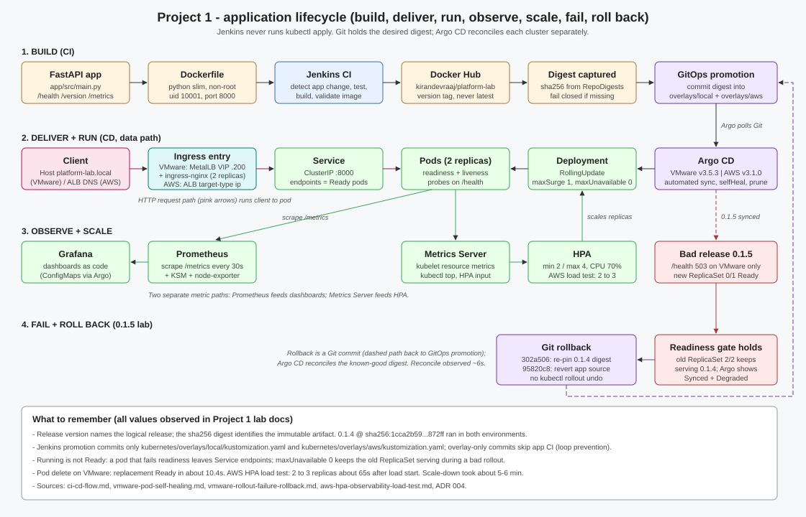

### Application Lifecycle Revision

| Step | What happens | Where to revise |
|---|---|---|
| FastAPI | `/`, `/health`, `/version`, `/info`, `/metrics` | [app/README.md](../../app/README.md), [app/src/](../../app/src/) |
| Docker | `python:3.14-slim` base, non-root user UID 10001 | [app/Dockerfile](../../app/Dockerfile) |
| Jenkins | Test → build → validate → push; refuses existing tag | [jenkins/Jenkinsfile](../../jenkins/Jenkinsfile) |
| Docker Hub | Version tag published | [ci-cd-flow.md](../architecture/ci-cd-flow.md) |
| Digest | Published digest captured | [adr/004](../adr/004-immutable-image-digest-promotion.md) |
| GitOps promotion | Digest committed to both overlays | [kubernetes/overlays/](../../kubernetes/overlays/) |
| Argo CD | Detects commit, syncs | [gitops/README.md](../../gitops/README.md) |
| Kubernetes | Rolling update gated by readiness | [reliability.md](../architecture/reliability.md) |
| Service | Endpoints = Ready pods only | [service-endpoint-troubleshooting](../runbooks/service-endpoint-troubleshooting.md) |
| Ingress / ALB | VMware VIP + ingress-nginx; AWS ALB → Pod IP | [networking.md](../architecture/networking.md), [adr/007](../adr/007-aws-alb-vs-vmware-ingress.md) |
| Prometheus | Scrapes `/metrics` | [observability.md](../architecture/observability.md) |
| Grafana | Dashboards as code | [grafana-platform-dashboard.md](../grafana-platform-dashboard.md) |
| HPA | Metrics Server CPU vs requests | [aws-hpa-observability-load-test.md](../aws-hpa-observability-load-test.md) |
| Failure | 0.1.5 fails readiness on VMware | [vmware-rollout-failure-rollback.md](../vmware-rollout-failure-rollback.md) |
| Rollback | Re-pin 0.1.4 digest in Git (`302a506`), revert source (`95820c8`) | [git-rollback](../runbooks/git-rollback.md) |

---

## 11. GitOps Lifecycle

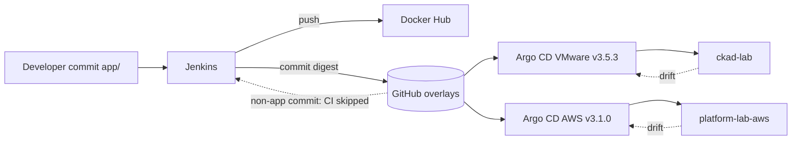

| Concept | What the project showed | Source |
|---|---|---|
| Git is desired state | Every deploy and rollback is a commit | [adr/003](../adr/003-gitops-with-argo-cd.md) |
| CI never deploys | Jenkins does not run `kubectl apply` / `set image` / `helm upgrade` for the app; it commits the digest to Git | [jenkins/README.md](../../jenkins/README.md) |
| Loop prevention | "Detect Application Change" skips non-`app/` commits (builds #6, #13) | [ci-cd-flow.md](../architecture/ci-cd-flow.md) |
| Digest pinning | Same digest in `overlays/local` and `overlays/aws` | [adr/004](../adr/004-immutable-image-digest-promotion.md) |
| selfHeal | Git-managed field reverted in under a second; live-only annotation left alone | [vmware-argo-self-healing.md](../vmware-argo-self-healing.md) |
| Rollback = Git revert | 0.1.5 → 0.1.4 through Git, not `rollout undo` | [vmware-rollout-failure-rollback.md](../vmware-rollout-failure-rollback.md) |
| Boundaries | AppProjects restrict repos, destinations, kinds | [argo-advanced-patterns.md](../argo-advanced-patterns.md) |
| Scale | ApplicationSets and App-of-Apps | [argo-gitops-reference.md](../architecture/argo-gitops-reference.md) |
| Recovery | Deleted App / namespace recreated from Git (6–14 s / ≈23 s) | [dr-lab-evidence.md](../dr-lab-evidence.md) |

---

## 12. Failure Engineering

### Failure Engineering Revision Path

| # | Failure | What failed? | What did we observe? | What fixed it? | Which document proves it? |
|---|---|---|---|---|---|
| 1 | Pod failure | App pod deleted (VMware) | Replacement Ready ~10.4 s; `/health` 200 throughout | ReplicaSet controller | [vmware-pod-self-healing.md](../vmware-pod-self-healing.md) |
| 2 | Readiness failure | App process paused | NotReady ~31.5 s; endpoints 2 → 1; no third pod; restart via liveness | Readiness removes endpoint; liveness restarts | [vmware-pod-self-healing.md](../vmware-pod-self-healing.md) |
| 3 | Argo drift | Git-managed label changed live | OutOfSync ~0.22 s → Synced ~0.96 s; live-only annotation not healed | Argo selfHeal | [vmware-argo-self-healing.md](../vmware-argo-self-healing.md) |
| 4 | Failed rollout | 0.1.5 `/health` 503 on VMware | New RS 0/1, old RS 2/2 served; Argo Degraded | Git rollback `302a506` + source revert `95820c8` | [vmware-rollout-failure-rollback.md](../vmware-rollout-failure-rollback.md) |
| 5 | Worker failure | kubelet stopped on worker-02 | Ready `Unknown` ~42.7 s; no eviction < 300 s; external `000` | Restart kubelet; led to #6 | [vmware-node-failure-resilience.md](../vmware-node-failure-resilience.md) |
| 6 | Ingress SPOF | Only ingress-nginx replica on the dead worker | Ingress endpoints 1 → 0 while app had a Ready pod | Root cause proven before change | [vmware-networking-anatomy.md](../vmware-networking-anatomy.md) |
| 7 | Ingress HA | Same worker loss after fix | 75 OK / 0 FAIL for each worker | 2 replicas + soft spread + PDB via GitOps | [vmware-ingress-ha.md](../vmware-ingress-ha.md) |
| 8 | EBS node failure | EC2 worker terminated | `FailedAttachVolume`; Ready ≈379 s (~6.3 min); data intact | CSI detach/attach; spare same-AZ node | [aws-storage-resilience.md](../aws-storage-resilience.md) |
| 9 | Snapshot restore | Point-in-time restore drill | ReadyToUse ~72 s; restore ~15 s; POINT-A only (≈74 s RPO window) | VolumeSnapshot → new PVC | [dr-lab-evidence.md](../dr-lab-evidence.md) |
| 10 | RBAC denial | ServiceAccounts asked for verbs they lack | `can-i` returned no (e.g. reader create/delete, secrets) on both clusters | Least-privilege Roles by design | [security-rbac.md](../security-rbac.md) |
| 11 | Pod Security | Root-user pod in `security-lab` | **Admitted** under baseline with restricted **warnings**. No enforced rejection was recorded | Stricter enforcement documented as a gap | [security-rbac.md](../security-rbac.md) §13 |
| 12 | HPA scaling | CPU load on AWS | CPU 90–97%; 2 → 3 ~65 s; scale-down 5–6 min later | HPA working as designed | [aws-hpa-observability-load-test.md](../aws-hpa-observability-load-test.md) |
| 13 | Argo ComparisonError | `waves-health` app Unknown | Kustomize could not load `../base/namespace.yaml` | Self-contained kustomizations `b2554fc` | [postmortems/argo-comparison-error.md](../postmortems/argo-comparison-error.md) |
| 14 | Snapshot restore issue | Restore PVC in another namespace | `dataSource` must be same-namespace | Static VolumeSnapshotContent in `dr-storage-restore` | [postmortems/cross-namespace-snapshot-restore.md](../postmortems/cross-namespace-snapshot-restore.md) |

**Other failures worth knowing:**

| Failure | Fix | Source |
|---|---|---|
| Grafana OOMKilled (VMware) | Memory 256Mi → 512Mi limit via Git (`a3ee50f`) | [postmortems/grafana-oom.md](../postmortems/grafana-oom.md) |
| Argo v3.5.3 rejected ServerSideApply + Force | Full Deployment manifest, no Force (`675586c`, `97cabed`) | [vmware-ingress-ha.md](../vmware-ingress-ha.md) |
| AWS NetworkPolicy not enforced | Recorded as limitation | [security-rbac.md](../security-rbac.md) |
| t3.small "Too many pods" | t3.medium node group | [aws-observability-capacity-analysis.md](../aws-observability-capacity-analysis.md) |
| AWS observability Degraded at freeze | Recorded, not hidden | [aws-observability-degraded-final-state.md](./aws-observability-degraded-final-state.md) |
| Teardown `DependencyViolation` | Manual orphan ALB/TG/SG deletion, second apply | [aws-lab-teardown.md](../operations/aws-lab-teardown.md) |

---

## 13. Storage Revision

| Topic | VMware (Stage 18) | AWS (Stage 19, historical runtime) | Source |
|---|---|---|---|
| Provisioner | `rancher.io/local-path` (node-local disk) | EBS CSI `ebs.csi.aws.com`, gp3 | [adr/013](../adr/013-local-path-vs-ebs-storage.md) |
| StorageClass | `local-path` (default) | `ebs-gp3` (`WaitForFirstConsumer`, not default) | [vmware-storage-statefulset.md](../vmware-storage-statefulset.md), [aws-storage-statefulset.md](../aws-storage-statefulset.md) |
| Pod delete | Data intact | Ready ~14 s, data intact | same |
| Node loss | Data tied to that node | Volume detaches/attaches in same AZ; ≈379 s | [aws-storage-resilience.md](../aws-storage-resilience.md) |
| AZ | n/a | EBS is AZ-scoped | [adr/008](../adr/008-ebs-csi-for-aws-persistent-storage.md) |
| Backup | none | CSI snapshot drill (Stage 23) | [dr-lab-evidence.md](../dr-lab-evidence.md) |

Order: [adr/013](../adr/013-local-path-vs-ebs-storage.md) → [vmware-storage-statefulset.md](../vmware-storage-statefulset.md) → [aws-storage-statefulset.md](../aws-storage-statefulset.md) → [aws-storage-resilience.md](../aws-storage-resilience.md) → [ebs-snapshot-restore](../runbooks/ebs-snapshot-restore.md) → [pvc-pv-troubleshooting](../runbooks/pvc-pv-troubleshooting.md).

Key lesson: persistent storage survives pod restarts but is not a backup. A namespace recreated from Git does not bring PVC/EBS data back ([disaster-scenario-matrix.md](../disaster-scenario-matrix.md) row 6).

---

## 14. Security Revision

Order: [security-rbac.md](../security-rbac.md) → [adr/009](../adr/009-rbac-least-privilege.md) → [kubernetes-rbac-model.svg](../diagrams/kubernetes-rbac-model.svg) → [aws-iam-vs-kubernetes-rbac.svg](../diagrams/aws-iam-vs-kubernetes-rbac.svg) → [final-security-review.md](../architecture/final-security-review.md) → runbooks [rbac-access-denied](../runbooks/rbac-access-denied.md), [pod-security-admission](../runbooks/pod-security-admission.md), [networkpolicy-troubleshooting](../runbooks/networkpolicy-troubleshooting.md).

| Layer | What was verified | Gap |
|---|---|---|
| RBAC | Identical `can-i` matrix on both clusters | — |
| ClusterRole via RoleBinding | Scoped to one namespace | — |
| ServiceAccount tokens | Mounted only where needed; `platform-lab` SA `automountServiceAccountToken: false` | — |
| PSA | Baseline enforce; restricted warn on root pod | No enforced rejection recorded; `readOnlyRootFilesystem` not implemented |
| NetworkPolicy | Enforced on VMware (Calico) | Not enforced on AWS VPC CNI setup |
| IAM vs RBAC | IAM → AWS APIs; RBAC → kube-apiserver verbs | — |

---

## 15. Automation Revision

Order: [adr/010](../adr/010-python-and-ansible-automation-boundary.md) → [project1-automation-boundaries.svg](../diagrams/project1-automation-boundaries.svg) → [python-automation-fundamentals.md](../python-automation-fundamentals.md) → [automation/python/README.md](../../automation/python/README.md) → [automation/ansible/README.md](../../automation/ansible/README.md) → [automation-command-reference.md](../automation/automation-command-reference.md) → [automation-interview-notes.md](../automation-interview-notes.md).

| Tool | Owns | Must not | Verified |
|---|---|---|---|
| Terraform | AWS infrastructure lifecycle | Be driven with `-auto-approve` by the Python CLI | Yes (Stage 10 apply, Stage 26 destroy) |
| Argo CD | Kubernetes desired state | Be bypassed by automation | Yes |
| Python `platform-automate` | Checks, reports, guarded `automation-lab` changes | Mutate outside `automation-lab`; use `shell=True` | Yes (CLI); Boto3 path partial |
| Ansible | Host / service configuration | Replace GitOps for app state | Partial (Linux/Jenkins path; Windows blocked by `fcntl`) |

---

## 16. DR Revision

Order: [disaster-recovery-fundamentals.md](../disaster-recovery-fundamentals.md) → [adr/011](../adr/011-disaster-recovery-model.md) → [disaster-scenario-matrix.md](../disaster-scenario-matrix.md) → [dr-lab-evidence.md](../dr-lab-evidence.md) → [disaster-recovery-master-guide.md](../disaster-recovery-master-guide.md) → [aws-backup-eks-dr.md](../aws-backup-eks-dr.md) → [disaster-recovery-index](../runbooks/disaster-recovery-index.md) → [disaster-recovery-interview-notes.md](../disaster-recovery-interview-notes.md).

| Drill | Environment | Result | Status |
|---|---|---|---|
| EBS snapshot + restore | AWS (historical) | ReadyToUse ~72 s; restore ~15 s; POINT-A only | Tested |
| Cross-namespace restore | AWS | Failed, fixed with static VolumeSnapshotContent | Tested (failure + fix) |
| Git bad config → restore | VMware | `57df7df` → `e5b79b7` | Tested |
| Argo Application delete | VMware | Recovered 6–14 s; workload stayed up | Tested |
| Namespace delete | VMware | ≈23 s | Tested |
| selfHeal live drift | VMware | ≈6 s | Tested |
| AWS Backup for EKS restore | AWS | Assessed only | Not executed |
| Full EKS rebuild / cross-region / AZ loss | AWS | — | Not tested |

The DR master guide contradicts itself on whether the snapshot restore was tested; [dr-lab-evidence.md](../dr-lab-evidence.md) settles it (tested). See Appendix A.

---

## 17. Operations Revision

Order: [operations/README.md](../operations/README.md) → [platform-operations-handbook.md](../operations/platform-operations-handbook.md) → [triage-framework.md](../troubleshooting/triage-framework.md) → [incident-severity.md](../operations/incident-severity.md) → [escalation.md](../operations/escalation.md) → [runbook-template.md](../runbooks/runbook-template.md) → [postmortems/](../postmortems/) → [observed-vs-untested.md](../operations/observed-vs-untested.md) → [production-gaps.md](../operations/production-gaps.md) → [operations-interview-notes.md](../operations/operations-interview-notes.md).

Checklists: [daily-platform-health](../checklists/daily-platform-health.md) · [pre-change](../checklists/pre-change-checklist.md) · [post-change](../checklists/post-change-checklist.md) · [operator-shift](../checklists/operator-shift-checklist.md).

Postmortems: [failed-rollout-0.1.5](../postmortems/failed-rollout-0.1.5.md) · [vmware-worker-failure](../postmortems/vmware-worker-failure.md) · [vmware-ingress-spof](../postmortems/vmware-ingress-spof.md) · [grafana-oom](../postmortems/grafana-oom.md) · [argo-comparison-error](../postmortems/argo-comparison-error.md) · [cross-namespace-snapshot-restore](../postmortems/cross-namespace-snapshot-restore.md).

---

## 18. Five Core Engineering Stories

Chosen for depth of evidence (experiment write-up + postmortem or ADR). These are the primary interview stories; more in [failure-engineering-stories.md](./failure-engineering-stories.md).

### Story 1 — Immutable digest release and GitOps rollback (Stages 11, 15)

| | |
|---|---|
| **Situation** | Jenkins promotes one image digest into both GitOps overlays; Argo CD deploys on VMware and AWS. |
| **Problem** | Release 0.1.5 failed `/health` (503) on VMware by design. Would a bad release cause an outage, and how do you undo it under GitOps? |
| **Investigation** | Watched the rollout: new ReplicaSet 0/1, old ReplicaSet 2/2, endpoints stayed at 2 serving 0.1.4; Argo Synced + Degraded. |
| **Action** | Re-pinned the 0.1.4 digest in both overlays (`302a506`) and reverted the app source (`95820c8`). No `kubectl rollout undo`. |
| **Result** | Argo reconciled in ~6 s; 2/2 healthy; no user-facing outage. |
| **Lesson** | Readiness + `maxUnavailable: 0` is the release gate; Git is the rollback mechanism; revert the source too. |
| **Read** | [vmware-rollout-failure-rollback.md](../vmware-rollout-failure-rollback.md) · [postmortems/failed-rollout-0.1.5.md](../postmortems/failed-rollout-0.1.5.md) · [adr/004](../adr/004-immutable-image-digest-promotion.md) |

### Story 2 — Worker failure exposes an ingress SPOF, fixed with HA (Stages 16, 17)

| | |
|---|---|
| **Situation** | VMware app had 2 replicas across workers, a PDB and a MetalLB VIP. |
| **Problem** | Stopping kubelet on worker-02 caused external `000` errors even though a Ready app pod survived. |
| **Investigation** | Networking anatomy: the only ingress-nginx replica was on worker-02; ingress endpoints went 1 → 0; MetalLB moved the VIP but had no backend. Ruled out traffic policy, Service, HPA/Argo and NetworkPolicy. |
| **Action** | Through GitOps: ingress-nginx 2 replicas, soft topology spread, PDB `minAvailable: 1`. Fixed an Argo SSA + Force sync error on the way. |
| **Result** | Repeated for each worker: 75 OK / 0 FAIL. |
| **Lesson** | App HA is not platform HA; prove root cause before changing anything. |
| **Read** | [vmware-node-failure-resilience.md](../vmware-node-failure-resilience.md) · [vmware-networking-anatomy.md](../vmware-networking-anatomy.md) · [vmware-ingress-ha.md](../vmware-ingress-ha.md) · [adr/012](../adr/012-ingress-high-availability.md) |

### Story 3 — EBS persistence through worker termination (Stage 19, historical runtime)

| | |
|---|---|
| **Situation** | StatefulSet on EBS gp3 volume in `ap-south-1b`. |
| **Problem** | What happens to the data and the pod when the EC2 worker is terminated? |
| **Investigation** | Added same-AZ spare capacity first; terminated the worker; watched `FailedAttachVolume` while the old attachment released. |
| **Action** | Let CSI detach/attach complete; then tried an AZ cordon test. |
| **Result** | Pod Ready ≈379 s (~6.3 min) after failure, same volume, data identical. AZ test: Pending, but the scheduler message was "Too many pods", so the AZ constraint was only partly demonstrated. |
| **Lesson** | EBS is AZ-scoped; recovery time is dominated by detach; plan same-AZ capacity. |
| **Read** | [aws-storage-resilience.md](../aws-storage-resilience.md) · [adr/008](../adr/008-ebs-csi-for-aws-persistent-storage.md) |

### Story 4 — Measured DR: snapshot restore and Git recovery (Stage 23)

| | |
|---|---|
| **Situation** | Needed real RTO/RPO numbers, not claims. |
| **Problem** | The first snapshot restore failed: the PVC `dataSource` pointed at a VolumeSnapshot in another namespace. |
| **Investigation** | Confirmed `dataSource` must be same-namespace. |
| **Action** | Static VolumeSnapshotContent + VolumeSnapshot in `dr-storage-restore`; then Git/Argo drills on VMware (bad config, App delete, namespace delete, selfHeal). |
| **Result** | Snapshot ~72 s, restore ~15 s, POINT-A only (≈74 s RPO window); namespace ≈23 s; App 6–14 s. AWS Backup and full rebuild not executed. |
| **Lesson** | Backups prove nothing until a restore is measured; Git restores config, not data. |
| **Read** | [dr-lab-evidence.md](../dr-lab-evidence.md) · [postmortems/cross-namespace-snapshot-restore.md](../postmortems/cross-namespace-snapshot-restore.md) · [adr/011](../adr/011-disaster-recovery-model.md) |

### Story 5 — AWS capacity, lightweight observability and HPA (Stages 12, 13, 25)

| | |
|---|---|
| **Situation** | EKS on t3.small nodes needed metrics and autoscaling. |
| **Problem** | Pod density: t3.small allowed 11 pods/node, too few for the planned stack. |
| **Investigation** | Capacity analysis of pod slots and memory before installing anything. |
| **Action** | Moved to t3.medium (17 pods/node); installed a lightweight Prometheus/Grafana/KSM/node-exporter stack; ran an HPA load test. |
| **Result** | HPA 2 → 3 in ~65 s under 90–97% CPU. At portfolio freeze, a Grafana surge pod stayed Pending ("Too many pods"), so the observability app is Degraded while Grafana still serves. Recorded, not hidden. |
| **Lesson** | Capacity planning comes first; measure before adding tooling; report Degraded honestly. |
| **Read** | [aws-observability-capacity-analysis.md](../aws-observability-capacity-analysis.md) · [aws-hpa-observability-load-test.md](../aws-hpa-observability-load-test.md) · [aws-observability-degraded-final-state.md](./aws-observability-degraded-final-state.md) |

---

## 19. Technology Map

| Technology | What I used it for | Where to revise | Related technologies |
|---|---|---|---|
| Kubernetes | Both clusters; every workload | [architecture-overview.md](../architecture/architecture-overview.md), [reliability.md](../architecture/reliability.md) | kubeadm, EKS, Kustomize |
| Docker | Package FastAPI; Jenkins builds | [app/Dockerfile](../../app/Dockerfile), [app/README.md](../../app/README.md) | Docker Hub, Jenkins |
| Python | FastAPI app; `platform-automate` CLI | [app/src/](../../app/src/), [automation/python/README.md](../../automation/python/README.md) | Boto3, kubernetes client |
| Ansible | Host / service configuration playbooks | [automation/ansible/README.md](../../automation/ansible/README.md), [ansible-variable-precedence.md](../ansible-variable-precedence.md) | Python, Jenkins |
| Terraform | AWS VPC, EKS, IAM, add-ons, Argo bootstrap | [terraform/aws/README.md](../../terraform/aws/README.md), [adr/001](../adr/001-terraform-for-aws-infrastructure.md) | AWS, Helm |
| Jenkins | CI: test, build, push, digest promotion | [jenkins/README.md](../../jenkins/README.md), [jenkins/Jenkinsfile](../../jenkins/Jenkinsfile) | Docker, Git |
| Git | Desired state; rollback mechanism | [adr/003](../adr/003-gitops-with-argo-cd.md), [git-rollback](../runbooks/git-rollback.md) | Argo CD, Jenkins |
| Argo CD | Reconcile both clusters; AppSets | [gitops/README.md](../../gitops/README.md), [argo-advanced-patterns.md](../argo-advanced-patterns.md) | Kustomize, Git |
| Kustomize | Base + `local` / `aws` overlays; digest pins | [adr/005](../adr/005-kustomize-for-environment-overlays.md), [kubernetes/overlays/](../../kubernetes/overlays/) | Argo CD |
| AWS EKS | Managed control plane (historical) | [adr/002](../adr/002-eks-managed-control-plane.md) | Terraform, IAM |
| ALB | AWS ingress, target-type ip (historical) | [adr/007](../adr/007-aws-alb-vs-vmware-ingress.md), [aws-alb-unhealthy](../runbooks/aws-alb-unhealthy.md) | AWS Load Balancer Controller |
| EBS CSI | AWS persistent volumes + snapshots (historical) | [adr/008](../adr/008-ebs-csi-for-aws-persistent-storage.md), [aws-storage-statefulset.md](../aws-storage-statefulset.md) | snapshot-controller, IAM |
| Prometheus | Scrape app, KSM, node-exporter | [observability.md](../architecture/observability.md), [vmware-observability-anatomy.md](../vmware-observability-anatomy.md) | Grafana, ServiceMonitor |
| Grafana | Dashboards as code | [grafana-platform-dashboard.md](../grafana-platform-dashboard.md), [observability/dashboards/](../../observability/dashboards/) | Prometheus |
| KSM | Kubernetes object state metrics | [kubernetes-platform-observability.md](../kubernetes-platform-observability.md) | Prometheus |
| node-exporter | Node OS metrics | [kubernetes-platform-observability.md](../kubernetes-platform-observability.md) | Prometheus |
| Metrics Server | HPA + `kubectl top` (not Prometheus) | [vmware-observability-anatomy.md](../vmware-observability-anatomy.md), [metrics-server-unavailable](../runbooks/metrics-server-unavailable.md) | HPA |
| Calico | VMware CNI; enforces NetworkPolicy | [vmware-networking-anatomy.md](../vmware-networking-anatomy.md) | NetworkPolicy |
| MetalLB | VMware LoadBalancer VIPs (L2) | [networking.md](../architecture/networking.md) | ingress-nginx |
| ingress-nginx | VMware ingress, made HA | [vmware-ingress-ha.md](../vmware-ingress-ha.md), [adr/012](../adr/012-ingress-high-availability.md) | MetalLB |
| RBAC | Least-privilege ServiceAccounts | [security-rbac.md](../security-rbac.md), [adr/009](../adr/009-rbac-least-privilege.md) | IAM, ServiceAccounts |
| Pod Security | PSA baseline enforce / restricted warn | [security-rbac.md](../security-rbac.md) §13, [pod-security-admission](../runbooks/pod-security-admission.md) | securityContext |
| NetworkPolicy | Default-deny + allow rule | [security-rbac.md](../security-rbac.md), [networkpolicy-troubleshooting](../runbooks/networkpolicy-troubleshooting.md) | Calico, VPC CNI |
| Boto3 | AWS read-only checks in the CLI | [automation/python/README.md](../../automation/python/README.md), [aws-api-failure](../runbooks/aws-api-failure.md) | Terraform, IAM |

---

## 20. Concept Cross-Reference

| Concept | Where first learned | Where reinforced | Where tested |
|---|---|---|---|
| Desired state | Stage 3 (Kustomize) | Stage 5 (Argo), Stage 10 (Terraform) | Stage 14 selfHeal; Stage 23 namespace recreate |
| Reconciliation | Stage 5 (Argo sync) | Stage 14 (ReplicaSet vs Argo) | Stage 15 rollback; Stage 23 App delete |
| Idempotency | Stage 10 (Terraform plan) | Stage 22 (Ansible, CLI) | `06_idempotency` playbook; Argo re-sync (Stage 21) |
| Immutability | Stage 2 (image tags) | Stage 11 (digests) | Stage 15 (digest re-pin) |
| Failure handling | Stage 9 (probes, PDB) | Stage 22 (exit codes, retries) | Stages 14–17, 19, 23 |
| Separation of duties | Stage 4 (CI only) | Stage 22 (tool boundaries) | Stage 6 loop prevention |
| Capacity | Stage 12 (pod density) | Stage 19 (spare same-AZ node) | Stage 23 (17/17 pods); Degraded at freeze |
| Observability | Stage 8 | Stage 13 (KSM, node-exporter) | Stage 14 (visible dip) |
| Least privilege | Stage 20 (RBAC) | Stage 19 (IAM for CSI) | `can-i` matrix |
| Evidence before mutation | Stage 17 (root cause first) | Stage 24 (runbooks) | Stage 26 (inventory before cleanup) |

---

## 21. Top Files

### Top Files for Project 1 Revision

**Primary**

| Path | Why read it | Stage | Depth |
|---|---|---|---|
| [`README.md`](../../README.md) | Whole project on one page | All | Quick |
| [`docs/architecture/project1-reference-architecture.md`](../architecture/project1-reference-architecture.md) | Final architecture and principles | 25 | Medium |
| [`docs/portfolio/project1-environment-map.md`](./project1-environment-map.md) | What ran where, what exists now | 26 | Quick |
| [`docs/architecture/ci-cd-flow.md`](../architecture/ci-cd-flow.md) | Build → digest → Git promotion | 4, 6, 11 | Medium |
| [`jenkins/Jenkinsfile`](../../jenkins/Jenkinsfile) | The real pipeline stages | 4, 11 | Medium |
| [`gitops/README.md`](../../gitops/README.md) | Argo Applications and sync policy | 5 | Medium |
| [`docs/adr/004-immutable-image-digest-promotion.md`](../adr/004-immutable-image-digest-promotion.md) | Why digests | 11 | Quick |
| [`docs/vmware-rollout-failure-rollback.md`](../vmware-rollout-failure-rollback.md) | Story 1 evidence | 15 | Deep |
| [`docs/vmware-networking-anatomy.md`](../vmware-networking-anatomy.md) | Root-cause method | 17 | Deep |
| [`docs/vmware-ingress-ha.md`](../vmware-ingress-ha.md) | Story 2 fix and proof | 17 | Medium |
| [`docs/aws-storage-resilience.md`](../aws-storage-resilience.md) | Story 3 evidence | 19 | Deep |
| [`docs/security-rbac.md`](../security-rbac.md) | All security results | 20 | Deep |
| [`docs/dr-lab-evidence.md`](../dr-lab-evidence.md) | Story 4 numbers | 23 | Medium |
| [`docs/adr/010-python-and-ansible-automation-boundary.md`](../adr/010-python-and-ansible-automation-boundary.md) | Tool boundaries | 22 | Quick |
| [`docs/project1-interview-master-guide.md`](../project1-interview-master-guide.md) | Pitch and question bank | All | Deep |

**Secondary**

| Path | Why read it | Stage | Depth |
|---|---|---|---|
| [`docs/architecture/architecture-overview.md`](../architecture/architecture-overview.md) | VMware cluster baseline | 1 | Quick |
| [`app/README.md`](../../app/README.md) | Workload contract | 2 | Quick |
| [`terraform/aws/README.md`](../../terraform/aws/README.md) | AWS modules (historical runtime) | 10 | Medium |
| [`docs/vmware-observability-anatomy.md`](../vmware-observability-anatomy.md) | Metric roles | 13 | Medium |
| [`docs/aws-hpa-observability-load-test.md`](../aws-hpa-observability-load-test.md) | HPA evidence | 12 | Medium |
| [`docs/vmware-pod-self-healing.md`](../vmware-pod-self-healing.md) | Running ≠ Ready | 14 | Medium |
| [`docs/vmware-node-failure-resilience.md`](../vmware-node-failure-resilience.md) | Node failure timeline | 16 | Medium |
| [`docs/argo-advanced-patterns.md`](../argo-advanced-patterns.md) | AppSets, hooks, waves | 21 | Deep |
| [`docs/automation/platform-automation-master-guide.md`](../automation/platform-automation-master-guide.md) | Automation design | 22 | Deep |
| [`docs/disaster-recovery-master-guide.md`](../disaster-recovery-master-guide.md) | DR model (see Appendix A caveat) | 23 | Deep |
| [`docs/operations/platform-operations-handbook.md`](../operations/platform-operations-handbook.md) | How to operate | 24 | Deep |
| [`docs/portfolio/failure-engineering-stories.md`](./failure-engineering-stories.md) | Story bank | 14–23 | Medium |
| [`docs/portfolio/known-limitations.md`](./known-limitations.md) | Honest limits | 25 | Quick |

**Reference**

| Path | Why read it | Stage | Depth |
|---|---|---|---|
| [`docs/adr/README.md`](../adr/README.md) | All 13 decisions | 25 | Quick |
| [`docs/architecture/platform-version-inventory.md`](../architecture/platform-version-inventory.md) | Versions | All | Quick |
| [`docs/disaster-scenario-matrix.md`](../disaster-scenario-matrix.md) | 18 scenarios, tested vs not | 23 | Medium |
| [`docs/operations/observed-vs-untested.md`](../operations/observed-vs-untested.md) | Coverage honesty | 24 | Quick |
| [`docs/troubleshooting/triage-framework.md`](../troubleshooting/triage-framework.md) | 7-step triage | 24 | Quick |
| [`docs/operations/aws-lab-teardown.md`](../operations/aws-lab-teardown.md) | Teardown record | 26 | Medium |
| [`docs/operations/vmware-lab-cleanup.md`](../operations/vmware-lab-cleanup.md) | Cleanup record | 26 | Medium |
| [`docs/portfolio/commit-map.md`](./commit-map.md) | Portfolio commit map | All | Quick |
| [`docs/project-timeline.md`](../project-timeline.md) | Original timeline | All | Quick |

---

## 22. Complete Stage → File Map

Architecture → implementation → ADR → experiment → runbook → interview notes. "—" means none exists for that stage.

| # | Architecture | Implementation | ADR | Experiment / evidence | Runbook | Interview |
|---|---|---|---|---|---|---|
| 1 | [architecture-overview](../architecture/architecture-overview.md), [environment-strategy](../design/environment-strategy.md) | — (cluster pre-dates repo) | [002](../adr/002-eks-managed-control-plane.md) | [platform-version-inventory](../architecture/platform-version-inventory.md) | [kubernetes-api-failure](../runbooks/kubernetes-api-failure.md) | [interview guide](../project1-interview-master-guide.md) |
| 2 | [app/README](../../app/README.md) | [app/](../../app/) | [004](../adr/004-immutable-image-digest-promotion.md) | [ci-cd-flow](../architecture/ci-cd-flow.md) | [docker-release-failure](../runbooks/docker-release-failure.md), [registry-unavailable](../runbooks/registry-unavailable.md) | [interview guide](../project1-interview-master-guide.md) |
| 3 | [architecture-overview](../architecture/architecture-overview.md) | [kubernetes/base/](../../kubernetes/base/), [kubernetes/overlays/](../../kubernetes/overlays/) | [005](../adr/005-kustomize-for-environment-overlays.md) | — | [application-unhealthy](../runbooks/application-unhealthy.md) | [interview guide](../project1-interview-master-guide.md) |
| 4 | [ci-cd-flow](../architecture/ci-cd-flow.md) | [jenkins/](../../jenkins/) | [003](../adr/003-gitops-with-argo-cd.md) | [jenkins/README](../../jenkins/README.md) | [jenkins-build-failure](../runbooks/jenkins-build-failure.md), [jenkins-unavailable](../runbooks/jenkins-unavailable.md) | [interview guide](../project1-interview-master-guide.md) |
| 5 | [gitops-flow](../architecture/gitops-flow.md) | [gitops/](../../gitops/) | [003](../adr/003-gitops-with-argo-cd.md) | [gitops/README](../../gitops/README.md) | [argo-outofsync](../runbooks/argo-outofsync.md), [argocd-controller-unavailable](../runbooks/argocd-controller-unavailable.md) | [argo-cd-interview-notes](../argo-cd-interview-notes.md) |
| 6 | [ci-cd-flow](../architecture/ci-cd-flow.md) | [jenkins/Jenkinsfile](../../jenkins/Jenkinsfile) | [003](../adr/003-gitops-with-argo-cd.md) | [ci-cd-flow](../architecture/ci-cd-flow.md) | [gitops-change](../runbooks/gitops-change.md), [github-unavailable](../runbooks/github-unavailable.md) | [interview guide](../project1-interview-master-guide.md) |
| 7 | [networking](../architecture/networking.md) | [kubernetes/overlays/local/](../../kubernetes/overlays/local/) | [007](../adr/007-aws-alb-vs-vmware-ingress.md) | [networking](../architecture/networking.md) | [metallb-vip-failure](../runbooks/metallb-vip-failure.md), [ingress-unavailable](../runbooks/ingress-unavailable.md) | [interview guide](../project1-interview-master-guide.md) |
| 8 | [observability](../architecture/observability.md) | [observability/](../../observability/) | [006](../adr/006-prometheus-grafana-observability.md) | [postmortems/grafana-oom](../postmortems/grafana-oom.md) | [prometheus-target-down](../runbooks/prometheus-target-down.md), [grafana-unavailable](../runbooks/grafana-unavailable.md) | [interview guide](../project1-interview-master-guide.md) |
| 9 | [reliability](../architecture/reliability.md) | [kubernetes/overlays/local/hpa.yaml](../../kubernetes/overlays/local/hpa.yaml), [pdb.yaml](../../kubernetes/overlays/local/pdb.yaml) | — | [reliability](../architecture/reliability.md) | [hpa-not-scaling](../runbooks/hpa-not-scaling.md), [pod-failure](../runbooks/pod-failure.md) | [interview guide](../project1-interview-master-guide.md) |
| 10 | [project1-reference-architecture.svg](../diagrams/project1-reference-architecture.svg), [aws-eks-platform-architecture.html](../aws-eks-platform-architecture.html) | [terraform/aws/](../../terraform/aws/) | [001](../adr/001-terraform-for-aws-infrastructure.md), [002](../adr/002-eks-managed-control-plane.md) | [terraform/aws/README](../../terraform/aws/README.md) | [terraform-apply-safety](../runbooks/terraform-apply-safety.md), [terraform-plan-failure](../runbooks/terraform-plan-failure.md) | [interview guide](../project1-interview-master-guide.md) |
| 11 | [ci-cd-flow](../architecture/ci-cd-flow.md) | [kubernetes/overlays/](../../kubernetes/overlays/) | [004](../adr/004-immutable-image-digest-promotion.md), [005](../adr/005-kustomize-for-environment-overlays.md) | [ci-cd-flow](../architecture/ci-cd-flow.md) | [git-rollback](../runbooks/git-rollback.md) | [interview guide](../project1-interview-master-guide.md) |
| 12 | [aws-lightweight-observability](../aws-lightweight-observability.md) | [observability/aws/](../../observability/aws/) | [006](../adr/006-prometheus-grafana-observability.md) | [capacity analysis](../aws-observability-capacity-analysis.md), [HPA load test](../aws-hpa-observability-load-test.md) | [hpa-not-scaling](../runbooks/hpa-not-scaling.md) | [interview guide](../project1-interview-master-guide.md) |
| 13 | [kubernetes-platform-observability](../kubernetes-platform-observability.md) | [observability/dashboards/](../../observability/dashboards/) | [006](../adr/006-prometheus-grafana-observability.md) | [vmware-observability-anatomy](../vmware-observability-anatomy.md), [grafana-platform-dashboard](../grafana-platform-dashboard.md) | [kube-observability-troubleshooting](../runbooks/kube-observability-troubleshooting.md) | [interview guide](../project1-interview-master-guide.md) |
| 14 | [reliability](../architecture/reliability.md) | [kubernetes/base/](../../kubernetes/base/) | [003](../adr/003-gitops-with-argo-cd.md) | [vmware-pod-self-healing](../vmware-pod-self-healing.md), [vmware-argo-self-healing](../vmware-argo-self-healing.md) | [pod-not-ready](../runbooks/pod-not-ready.md), [pod-failure](../runbooks/pod-failure.md) | [failure stories](./failure-engineering-stories.md) |
| 15 | [rollback-decision-tree.svg](../diagrams/rollback-decision-tree.svg) | [kubernetes/overlays/](../../kubernetes/overlays/) | [004](../adr/004-immutable-image-digest-promotion.md) | [vmware-rollout-failure-rollback](../vmware-rollout-failure-rollback.md), [postmortem](../postmortems/failed-rollout-0.1.5.md) | [failed-rollout](../runbooks/failed-rollout.md), [git-rollback](../runbooks/git-rollback.md) | [failure stories](./failure-engineering-stories.md) |
| 16 | [platform-failure-domain.svg](../diagrams/platform-failure-domain.svg) | — | [012](../adr/012-ingress-high-availability.md) | [vmware-node-failure-resilience](../vmware-node-failure-resilience.md), [postmortem](../postmortems/vmware-worker-failure.md) | [worker-node-failure](../runbooks/worker-node-failure.md) | [failure stories](./failure-engineering-stories.md) |
| 17 | [vmware-networking-anatomy](../vmware-networking-anatomy.md) | [kubernetes/overlays/local/](../../kubernetes/overlays/local/) | [012](../adr/012-ingress-high-availability.md) | [vmware-ingress-ha](../vmware-ingress-ha.md), [postmortem](../postmortems/vmware-ingress-spof.md) | [ingress-unavailable](../runbooks/ingress-unavailable.md), [service-endpoint-troubleshooting](../runbooks/service-endpoint-troubleshooting.md) | [failure stories](./failure-engineering-stories.md) |
| 18 | [adr/013](../adr/013-local-path-vs-ebs-storage.md) | [kubernetes/storage-lab/](../../kubernetes/storage-lab/) | [013](../adr/013-local-path-vs-ebs-storage.md) | [vmware-storage-statefulset](../vmware-storage-statefulset.md) | [pvc-pv-troubleshooting](../runbooks/pvc-pv-troubleshooting.md) | [interview guide](../project1-interview-master-guide.md) |
| 19 | [aws-ebs-node-failure-recovery.svg](../diagrams/aws-ebs-node-failure-recovery.svg) | [kubernetes/storage-lab-aws/](../../kubernetes/storage-lab-aws/), [terraform/aws/modules/ebs_csi/](../../terraform/aws/modules/ebs_csi/) | [008](../adr/008-ebs-csi-for-aws-persistent-storage.md) | [aws-storage-statefulset](../aws-storage-statefulset.md), [aws-storage-resilience](../aws-storage-resilience.md) | [ebs-attach-troubleshooting](../runbooks/ebs-attach-troubleshooting.md), [ebs-storage-recovery](../runbooks/ebs-storage-recovery.md) | [interview guide](../project1-interview-master-guide.md) |
| 20 | [final-security-review](../architecture/final-security-review.md) | [kubernetes/security-lab-vmware/](../../kubernetes/security-lab-vmware/), [kubernetes/security-lab-aws/](../../kubernetes/security-lab-aws/) | [009](../adr/009-rbac-least-privilege.md) | [security-rbac](../security-rbac.md) | [rbac-access-denied](../runbooks/rbac-access-denied.md), [serviceaccount-troubleshooting](../runbooks/serviceaccount-troubleshooting.md), [pod-security-admission](../runbooks/pod-security-admission.md), [networkpolicy-troubleshooting](../runbooks/networkpolicy-troubleshooting.md), [security-incident](../runbooks/security-incident.md) | [interview guide](../project1-interview-master-guide.md) |
| 21 | [argo-gitops-reference](../architecture/argo-gitops-reference.md) | [gitops/appsets/](../../gitops/appsets/), [kubernetes/argo-advanced-lab/](../../kubernetes/argo-advanced-lab/) | [003](../adr/003-gitops-with-argo-cd.md) | [argo-advanced-patterns](../argo-advanced-patterns.md), [postmortem](../postmortems/argo-comparison-error.md) | [argo-sync-failure](../runbooks/argo-sync-failure.md), [argocd-applicationset-troubleshooting](../runbooks/argocd-applicationset-troubleshooting.md), [argocd-appproject-denied](../runbooks/argocd-appproject-denied.md) | [argo-cd-interview-notes](../argo-cd-interview-notes.md) |
| 22 | [automation-architecture](../automation/automation-architecture.md) | [automation/](../../automation/), [kubernetes/automation-lab/](../../kubernetes/automation-lab/) | [010](../adr/010-python-and-ansible-automation-boundary.md) | [automation/python/README](../../automation/python/README.md) | [python-automation](../runbooks/python-automation.md), [python-automation-failure](../runbooks/python-automation-failure.md), [ansible-failure](../runbooks/ansible-failure.md), [automation-failure](../runbooks/automation-failure.md), [aws-api-failure](../runbooks/aws-api-failure.md), [kubernetes-api-failure](../runbooks/kubernetes-api-failure.md) | [automation-interview-notes](../automation-interview-notes.md) |
| 23 | [disaster-recovery-master-guide](../disaster-recovery-master-guide.md) | [kubernetes/dr-lab/](../../kubernetes/dr-lab/), [kubernetes/dr-storage-restore/](../../kubernetes/dr-storage-restore/), [terraform/aws/modules/snapshot_controller/](../../terraform/aws/modules/snapshot_controller/) | [011](../adr/011-disaster-recovery-model.md) | [dr-lab-evidence](../dr-lab-evidence.md), [postmortem](../postmortems/cross-namespace-snapshot-restore.md) | [disaster-recovery-index](../runbooks/disaster-recovery-index.md), [ebs-snapshot-restore](../runbooks/ebs-snapshot-restore.md), [git-argo-recovery](../runbooks/git-argo-recovery.md), [aws-eks-disaster-recovery](../runbooks/aws-eks-disaster-recovery.md), [terraform-infrastructure-recovery](../runbooks/terraform-infrastructure-recovery.md) | [disaster-recovery-interview-notes](../disaster-recovery-interview-notes.md) |
| 24 | [operations/README](../operations/README.md) | [runbooks/](../runbooks/), [checklists/](../checklists/) | — | [observed-vs-untested](../operations/observed-vs-untested.md) | [runbook-template](../runbooks/runbook-template.md) | [operations-interview-notes](../operations/operations-interview-notes.md) |
| 25 | [project1-reference-architecture](../architecture/project1-reference-architecture.md) | [docs/portfolio/](./README.md) | [all](../adr/README.md) | [evidence/README](../evidence/README.md) | — | [interview guide](../project1-interview-master-guide.md) |
| 26 | [project1-environment-map](./project1-environment-map.md) | [terraform/aws/scripts/pre-destroy-cleanup.sh](../../terraform/aws/scripts/pre-destroy-cleanup.sh) | [001](../adr/001-terraform-for-aws-infrastructure.md), [011](../adr/011-disaster-recovery-model.md) | [aws-lab-teardown](../operations/aws-lab-teardown.md), [vmware-lab-cleanup](../operations/vmware-lab-cleanup.md) | [terraform-apply-safety](../runbooks/terraform-apply-safety.md) | — |

---

## 23. Commit Map

Milestone commits only (from `git log`). Where several commits form one stage they are listed together. A fuller per-section map: [commit-map.md](./commit-map.md).

| # | Major commit(s) | Commit message | What changed |
|---|---|---|---|
| 1 | `e365c91` | chore: initialize platform engineering lab | Repo skeleton, environment rules |
| 2 | `7f52bfb`, `5513e02`, `8eac844` | feat: add FastAPI platform workload · feat: containerize … · docs: record published container artifact | App, Dockerfile, published image |
| 3 | `522d134`, `be9c7b5` | feat: add Kubernetes application packaging · feat: deploy platform-lab to local kubernetes | Kustomize base + overlays; first deploy |
| 4 | `3a653a6`, `b45482c`, `91b5800` | feat: add Jenkins CI pipeline definition · chore: add local Jenkins CI runtime · docs: record the first successful Jenkins CI run | Jenkinsfile, runtime, first run |
| 5 | `71ed15b`, `e875218` | feat: add Argo CD GitOps for the local platform-lab overlay · docs: record … sync and self-heal demos | Argo Applications |
| 6 | `0a633da`, `1eb1428`, `5b2ce38` | feat: automate Jenkins image publish and local GitOps promotion · chore: promote 0.1.2 · docs: record automated promotion | CI writes to Git |
| 7 | `99a0f98`, `bfeb721` | feat: add ingress and network policy · feat: expose local ingress-nginx through MetalLB | Ingress, NP, VIP |
| 8 | `1c562fc`, `a3ee50f` | feat: add Prometheus/Grafana observability · fix: raise Grafana memory limit to stop OOMKills | Monitoring stack |
| 9 | `bc8181f`, `be72ebf` | feat: harden local platform-lab with HPA, PDB, and safe rollouts · docs: record … | HPA, PDB, rollout strategy |
| 10 | `0ea6f13`, `5e304cd`, `7f07d0b`, `a94c018` | chore: prepare aws terraform tooling foundation · feat: add aws eks terraform platform · 2 fixes | Terraform modules, EKS |
| 11 | `baec457`, `baf74d5`, `5da676f` | feat: enable multi-environment gitops promotion · chore: promote 0.1.4 · feat: pin gitops releases by image digest | Dual promotion, digests |
| 12 | `099ef70`, `862588e`, `a37bc92`, `6682c3d` | docs: capacity analysis · feat: scale aws worker nodes to t3.medium · feat: add lightweight aws observability · docs: HPA load test | Capacity fix, AWS metrics |
| 13 | `7572cfe`, `b30490f`, `c269238`, `1dba455` | feat: add kubernetes platform observability · fix: preserve KSM labels · feat: cross-environment SRE dashboards · docs: observability anatomy | KSM, node-exporter, dashboards |
| 14 | `3fb84b7`, `7030f71`, `1639188`, `dcfb7ae` | docs: pod self-healing · observable pod failure · argo self healing · readiness failure | Experiment write-ups |
| 15 | `0c4fe12`, `6acbe3e`, `302a506`, `95820c8`, `054db3c` | feat: release 0.1.5 … · chore: promote 0.1.5 · fix: rollback to 0.1.4 digest · revert: restore 0.1.4 source · docs | Bad release + Git rollback |
| 16 | `84c3478` | docs: document vmware node failure resilience | Experiment write-up |
| 17 | `0d7c41b`, `eb622e9`, `675586c`, `97cabed`, `9228fef` | docs: networking anatomy · feat: make vmware ingress highly available · 2 sync fixes · docs: HA validation | Ingress HA |
| 18 | `f33876d`, `7dc0de1` | feat: add vmware stateful storage lab · docs | local-path StatefulSet |
| 19 | `bd5e6dc`, `584f290`, `be8e68b`, `c8d45ca` | feat: add aws ebs storage lab · docs · fix: PV panel query · feat: validate aws ebs node failure resilience | EBS lab + resilience |
| 20 | `85d76a6`, `1856f0f`, `c42fc0b`, `2525408` | feat: add kubernetes security and rbac hardening · 2 fixes · docs | security-lab |
| 21 | `6d57e42`, `7a1369a`, `b2554fc`, `ee15dba` | feat: add advanced argo cd gitops patterns · feat: syncfail/health-wave demos · fix: self-contained kustomizations · docs | AppSets, hooks, waves |
| 22 | `5593a26`, `0436b0c` | feat: add platform automation framework · docs: fix automation diagram encoding | Python CLI, Ansible |
| 23 | `2a013bd`, `57df7df`, `e5b79b7`, `e4d61be`, `87b3034` | feat: add disaster recovery and restore lab · test/fix: DR marker drill · docs: DR evidence · docs: align tested status | DR lab + evidence |
| 24 | `8e09fd7` | feat: add platform operations handbook and runbooks | Operations layer |
| 25 | `7c8e84d` | feat: finalize platform engineering portfolio | ADRs, portfolio |
| 26 | `d45c969`, `012124b` | docs: record aws lab teardown · docs: record vmware lab cleanup | Retirement records |

---

## 24. Interview Revision

### Interview Revision Order

| # | Area | Primary documents | Key concepts | Top interview questions |
|---|---|---|---|---|
| 1 | Architecture | [reference architecture](../architecture/project1-reference-architecture.md), [interview guide](../project1-interview-master-guide.md) | Control vs data plane; two environments | Walk me through the platform. What would you change for production? |
| 2 | Kubernetes | [reliability](../architecture/reliability.md), [vmware-pod-self-healing](../vmware-pod-self-healing.md), [vmware-node-failure-resilience](../vmware-node-failure-resilience.md) | Probes, ReplicaSets, taints, PDB | Running vs Ready? What happens when a node dies? |
| 3 | CI/CD | [ci-cd-flow](../architecture/ci-cd-flow.md), [Jenkinsfile](../../jenkins/Jenkinsfile) | CI ≠ CD, loop prevention, tag refusal | How does a commit become a running pod? How do you avoid CI loops? |
| 4 | GitOps | [gitops/README](../../gitops/README.md), [argo-advanced-patterns](../argo-advanced-patterns.md), [argo-cd-interview-notes](../argo-cd-interview-notes.md) | Reconciliation, selfHeal, AppSets | Why GitOps? How do you roll back? AppSet vs App-of-Apps? |
| 5 | AWS | [terraform/aws/README](../../terraform/aws/README.md), [adr/002](../adr/002-eks-managed-control-plane.md), [adr/007](../adr/007-aws-alb-vs-vmware-ingress.md) | VPC, EKS, pod density, ALB ip mode | Why t3.medium? How does the ALB reach pods? |
| 6 | Observability | [vmware-observability-anatomy](../vmware-observability-anatomy.md), [kubernetes-platform-observability](../kubernetes-platform-observability.md) | Metrics Server vs Prometheus vs KSM vs node-exporter | Which component feeds HPA? What do you alert on? |
| 7 | Networking | [vmware-networking-anatomy](../vmware-networking-anatomy.md), [vmware-ingress-ha](../vmware-ingress-ha.md) | Calico, kube-proxy, MetalLB L2, `externalTrafficPolicy` | Pods healthy but users see errors: why? |
| 8 | Storage | [adr/013](../adr/013-local-path-vs-ebs-storage.md), [aws-storage-resilience](../aws-storage-resilience.md) | PVC/PV/SC, CSI, AZ topology | Why did recovery take ~6 minutes? |
| 9 | Security | [security-rbac](../security-rbac.md), [adr/009](../adr/009-rbac-least-privilege.md) | RBAC scope, PSA, NP by CNI, IAM vs RBAC | Debug a Forbidden error. Why was NP not enforced on AWS? |
| 10 | Automation | [adr/010](../adr/010-python-and-ansible-automation-boundary.md), [automation-interview-notes](../automation-interview-notes.md) | Idempotency, dry-run, boundaries | Python vs Ansible vs Terraform? |
| 11 | DR | [dr-lab-evidence](../dr-lab-evidence.md), [disaster-recovery-interview-notes](../disaster-recovery-interview-notes.md) | HA vs backup vs DR, RTO/RPO | How did you measure RTO/RPO? What was not tested? |
| 12 | Operations | [platform-operations-handbook](../operations/platform-operations-handbook.md), [operations-interview-notes](../operations/operations-interview-notes.md) | Triage, severity, postmortems | First 60 seconds of an incident? |

---

## 25. 7-Day Revision Plan

*Suggested revision sequence, not mandatory.* About 2–3 hours a day (approximate study target).

| Day | Focus | Read | Self-check |
|---|---|---|---|
| 1 | Kubernetes + Docker | Stages 1–3, 9, 14: [architecture-overview](../architecture/architecture-overview.md), [app/README](../../app/README.md), [reliability](../architecture/reliability.md), [vmware-pod-self-healing](../vmware-pod-self-healing.md) | Explain Running vs Ready |
| 2 | Jenkins + Git + GitOps | Stages 4–6, 11, 15: [ci-cd-flow](../architecture/ci-cd-flow.md), [gitops/README](../../gitops/README.md), [vmware-rollout-failure-rollback](../vmware-rollout-failure-rollback.md) | Tell Story 1 |
| 3 | Terraform + AWS EKS | Stage 10, 12: [terraform/aws/README](../../terraform/aws/README.md), [adr/001](../adr/001-terraform-for-aws-infrastructure.md), [adr/002](../adr/002-eks-managed-control-plane.md), [capacity analysis](../aws-observability-capacity-analysis.md) | Tell Story 5 |
| 4 | Observability + HPA + Networking | Stages 7, 8, 13, 16, 17: [vmware-observability-anatomy](../vmware-observability-anatomy.md), [vmware-networking-anatomy](../vmware-networking-anatomy.md), [vmware-ingress-ha](../vmware-ingress-ha.md) | Tell Story 2 |
| 5 | Reliability + Storage | Stages 18, 19: [adr/013](../adr/013-local-path-vs-ebs-storage.md), [aws-storage-resilience](../aws-storage-resilience.md) | Tell Story 3 |
| 6 | Security + Python + Ansible | Stages 20–22: [security-rbac](../security-rbac.md), [argo-advanced-patterns](../argo-advanced-patterns.md), [adr/010](../adr/010-python-and-ansible-automation-boundary.md) | Draw the RBAC scope model |
| 7 | DR + Operations + Architecture + Interview | Stages 23–26: [dr-lab-evidence](../dr-lab-evidence.md), [operations handbook](../operations/platform-operations-handbook.md), [reference architecture](../architecture/project1-reference-architecture.md), [interview guide](../project1-interview-master-guide.md) | Tell Story 4; run through the flashcards |

---

## 26. Long-Term Revision

A light rotation for keeping Project 1 fresh while working on later projects.

- **Daily (10–15 min):** one stage from the [stage cheat sheet](./project1-stage-cheat-sheet.md), in order, 1 → 26. That is roughly one full pass a month.
- **Twice a week (10 min):** 10 random [flashcards](./project1-flashcards.md).
- **Weekly (20 min):** tell one of the five core stories aloud from memory, then check the numbers against its "Read" links.
- **Monthly (1 h):** the glance path (Section 6.2) plus [known-limitations.md](./known-limitations.md).
- **Before an interview:** Section 24 in order, then Section 28.

---

## 27. Flashcards

Full set: [project1-flashcards.md](./project1-flashcards.md) (Kubernetes, GitOps, AWS, Observability, Networking, Storage, Security, Automation, DR, Operations). Samples:

- **Q:** What feeds the HPA: Prometheus or Metrics Server? **A:** Metrics Server ([vmware-observability-anatomy.md](../vmware-observability-anatomy.md)).
- **Q:** Why roll back through Git instead of `kubectl rollout undo`? **A:** Argo selfHeal would revert the manual change; Git is desired state ([vmware-rollout-failure-rollback.md](../vmware-rollout-failure-rollback.md)).
- **Q:** Why did the EBS pod take ~6.3 min to recover? **A:** Waiting for the old volume attachment to release before attach in the same AZ ([aws-storage-resilience.md](../aws-storage-resilience.md)).
- **Q:** A RoleBinding references a ClusterRole. What scope? **A:** The RoleBinding's namespace only ([security-rbac.md](../security-rbac.md)).

---

## 28. What I Must Remember

### Project 1 Things I Must Remember

Each statement is checked against a project document. Where the wording in the source differs, the note says so.

| # | Statement | Source | Note |
|---|---|---|---|
| 1 | Git is the source of truth. | [adr/003](../adr/003-gitops-with-argo-cd.md), [git-argo-recovery](../runbooks/git-argo-recovery.md) | |
| 2 | Jenkins builds and promotes; Argo reconciles. | [jenkins/README.md](../../jenkins/README.md) | |
| 3 | Image tags are references; digests identify immutable artifacts. | [adr/004](../adr/004-immutable-image-digest-promotion.md) ("Tags are mutable references") | |
| 4 | Running is not the same as Ready. | [vmware-pod-self-healing.md](../vmware-pod-self-healing.md) | |
| 5 | HPA depends on resource metrics and requests. | [hpa-not-scaling](../runbooks/hpa-not-scaling.md) | |
| 6 | EBS is AZ-scoped. | [adr/008](../adr/008-ebs-csi-for-aws-persistent-storage.md) | |
| 7 | Pod resilience is different from node resilience. | [vmware-node-failure-resilience.md](../vmware-node-failure-resilience.md) | |
| 8 | Persistent storage is different from backup. | [disaster-scenario-matrix.md](../disaster-scenario-matrix.md) row 6, [aws-backup-eks-dr.md](../aws-backup-eks-dr.md) | Implied, not stated in one sentence |
| 9 | Backup is different from DR. | [disaster-recovery-fundamentals.md](../disaster-recovery-fundamentals.md) §3 | |
| 10 | Role is not a binding. | [security-rbac.md](../security-rbac.md) §23 | Stated as "ServiceAccount ≠ permission until bound" |
| 11 | RoleBinding determines namespace scope. | [security-rbac.md](../security-rbac.md) ("RoleBinding scopes even ClusterRole refs to one namespace") | |
| 12 | ApplicationSet generates Applications. | [argo-advanced-patterns.md](../argo-advanced-patterns.md) | |
| 13 | App-of-Apps composes Applications. | [argo-advanced-patterns.md](../argo-advanced-patterns.md) ("Child Application composition") | |
| 14 | Terraform manages infrastructure lifecycle. | [adr/010](../adr/010-python-and-ansible-automation-boundary.md) | |
| 15 | Python handles custom automation logic. | [adr/010](../adr/010-python-and-ansible-automation-boundary.md) | |
| 16 | Ansible handles operational / configuration orchestration. | [adr/010](../adr/010-python-and-ansible-automation-boundary.md) | |
| 17 | Metrics Server is not Prometheus. | [vmware-observability-anatomy.md](../vmware-observability-anatomy.md) ("autoscaling path — NOT Prometheus") | |
| 18 | KSM is not node-exporter. | [adr/006](../adr/006-prometheus-grafana-observability.md) (object vs node metrics) | Implied by separate roles |
| 19 | NetworkPolicy enforcement depends on the networking implementation. | [security-rbac.md](../security-rbac.md) §23 ("depends on CNI (Calico yes / current EKS VPC CNI no)") | |
| 20 | Runbooks begin with evidence, not mutation. | [project1-reference-architecture.md](../architecture/project1-reference-architecture.md) ("evidence before mutation") | |
| 21 | App HA is not platform HA. | [vmware-ingress-ha.md](../vmware-ingress-ha.md), [adr/012](../adr/012-ingress-high-availability.md) | |
| 22 | Observed ≠ Designed; numbers are lab observations, not SLAs. | [project1-reference-architecture.md](../architecture/project1-reference-architecture.md) | |

---

## Appendix A — Documentation inconsistencies to be aware of

These source documents were **not modified** by this guide. Read them with the note in mind.

| Document | Issue | What is correct |
|---|---|---|
| [architecture/gitops-flow.md](../architecture/gitops-flow.md) | Written before dual promotion (tag promotion; "AWS not managed") | [ci-cd-flow.md](../architecture/ci-cd-flow.md): digest promotion to both overlays |
| [architecture/observability.md](../architecture/observability.md) | Says promotion uses `newTag` only | Digest pinning from Stage 11 ([adr/004](../adr/004-immutable-image-digest-promotion.md)) |
| [terraform/aws/README.md](../../terraform/aws/README.md) | Says EBS CSI not installed | Installed in Stage 19 (`modules/ebs_csi`) |
| [aws-eks-platform-architecture.html](../aws-eks-platform-architecture.html) | Pre-apply snapshot (46 to add, 0.1.3) | Historical plan view only |
| [vmware-storage-statefulset.md](../vmware-storage-statefulset.md) | Says `storage-lab` is retained | Removed; see [vmware-lab-cleanup.md](../operations/vmware-lab-cleanup.md) |
| [disaster-recovery-master-guide.md](../disaster-recovery-master-guide.md) | Some sections say snapshot restore untested, others tested | Tested ([dr-lab-evidence.md](../dr-lab-evidence.md)) |
| [argo-advanced-patterns.md](../argo-advanced-patterns.md) | Edge-case table says "Pending live validation" despite §35 results; typo "rgo-advanced-stage" | §35 results are authoritative |
| [portfolio/commit-map.md](./commit-map.md) | TBD placeholder for Section 27 | `7c8e84d` |
| [README.md](../../README.md) | Environment tables describe the historical runtime | Section 4 of this guide |
| Earlier request wording | `docs/portfolio/project1-reference-architecture.md` | Actual path: [docs/architecture/project1-reference-architecture.md](../architecture/project1-reference-architecture.md) |
| VMware HPA 2 → 4 | Only in the operations docs, not in an experiment write-up | Treat as configuration, not a measured test |
| selfHeal timing | ~6 s (DR drill) vs sub-second (label drift) | Different drills, both valid |
| VMware CRD count | 92 CRDs before cleanup included non-Project-1 groups not recorded in cleanup | See [project1-environment-map.md](./project1-environment-map.md) |

## Appendix B — How this guide was validated

- Stage list built from `git log --reverse` (93 commits); inferred boundaries marked.
- Every relative link in this guide and its companion files was checked against the repository tree before commit.
- Current VMware state checked read-only on 2026-09-27. AWS state is taken from the teardown record; no AWS calls were made for this guide.
- No implementation, Terraform, Kubernetes manifest, Jenkins or cluster configuration was changed. The only additions are this guide, its three companion documents and four SVG diagrams.
